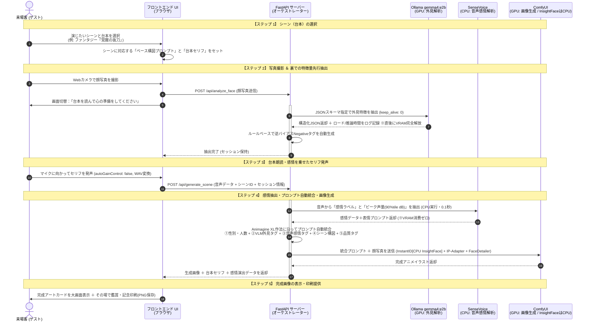

# StoryWeaver Live — AIクリエーターズマーケット展示運用・統合システム実装計画書 (v6.2)

* **改訂日**: 2026-10-17
* **対象イベント**: AIクリエーターズマーケット[cite: 1]
* **対象マシン**: ThinkPad X1 Extreme (RTX 3080 Laptop 16GB / RAM 32GB / Windows 11)[cite: 1]
* **設計の核心**:
  1. **来場者体験フロー連動型・非同期パイプライン**: 写真撮影時に裏でVLM外見抽出を完了させ、発声後の体感待ち時間を最小化＆VRAM競合を完全排除する[cite: 1]。
  2. **WD14 Tagger廃止とVLM（`gemma4:e2b` + JSONスキーマ）への刷新**: どんな来場者が来てもハードコーディングなしで「髪型・生え際・眼鏡・性別」と「前髪バイアス打消し用ネガティブタグ」を構造化出力で確実に自動抽出する[cite: 1]。
  3. **台本プリセット方式 ＆「SenseVoice感情×声量」ハイブリッド判定**: セリフとシーン構図は事前定義（台本）とし、音声からはCPU実行のSenseVoiceとAGC無効化済みのピーク音量計測で「感情と熱量」を0.1秒で抽出して表情とエフェクトに100%反映する[cite: 1]。

---

## 1. AIクリエーターズマーケット 来場客フローとシステム裏処理の連動設計

来場客のアクション（1〜5）に合わせ、システム内部の処理を「撮影時（フェーズA）」と「発声後（フェーズB）」の2段階に分割します[cite: 1]。これにより、**人間が台本を読んでいる時間をAIの処理時間として有効活用**します[cite: 1]。



---

## 2. なぜこの構成で「従来の問題点」と「潜在リスク」がすべて解決するのか？

| 従来の課題・潜在リスク | 新設計（v6.2）での解決メカニズム |
| :--- | :--- |
| **WD14 Taggerが実写の髪型（短髪・坊主等）を認識できず、手動でプロンプトを書いていた**[cite: 1] | **【ステップ2で解決】** 実写理解に優れたマルチモーダルLLM（Ollama `gemma4:e2b`）に JSON Schema（Structured Outputs）を適用[cite: 1]。`buzz cut, exposed forehead` 等の外見タグを確実に抽出し、前髪の有無フラグからAnimagineの前髪バイアスを打ち消す `bangs, fringe`（ネガティブ用）を自動生成する[cite: 1]。 |
| **InstantIDだけでは頭の形や髪型・眼鏡が維持されない**[cite: 1] | **【ステップ4で解決】** ComfyUI側で「InstantID（目鼻立ち固定）」と「IP-Adapter Plus Face（頭部・髪型・眼鏡の視覚補助）」をハイブリッド適用し、誰が来ても特徴を維持する[cite: 1]。 |
| **InstantID内部のInsightFace (onnxruntime) が隠れてVRAMを1.5〜2.5GB消費しOOMを招く** | **【ステップ4で解決】** ComfyUIのInstantIDモデルローダー（InsightFace）の実行プロバイダを明示的に **`CPU`** に固定。顔検出はCPUでも0.1〜0.2秒で完了するため、体感速度を落とさずonnxruntimeのVRAM確保を完全にゼロ化する。 |
| **写真の表情（笑顔など）と、セリフの感情（叫び・怒り）が衝突する**[cite: 1] | **【ステップ2＆3で解決】** ステップ2の写真解析ではJSONスキーマ定義により「表情」を一切抽出しないよう厳格に除外[cite: 1]。表情はステップ3の「音声感情（SenseVoice）＋声量」からのみ100%決定する[cite: 1]。 |
| **棒読みで `<|NEUTRAL|>` になる問題 ＆ ブラウザの自動音量圧縮（AGC）や会場ノイズによる誤判定**[cite: 1] | **【ステップ3＆4で解決】** ブラウザ録音時に `autoGainControl: false` を強制して生の声量差を取得。さらに単純平均ではなく「上位10%ピーク音量（90パーセンタイルRMS）」と会場ノイズ閾値（設定変更可能）で判定し、大声なら `<|NEUTRAL|>` でも「熱血・咆哮」へ自動昇格、小声なら「冷静沈着なクールキャラ」に変換する[cite: 1]。 |
| **LLM解析・音声認識・画像生成でシステム負荷（VRAM・待ち時間）が重い**[cite: 1] | **【ステップ1〜4で解決】** ①セリフは台本固定でLLMの文章生成負荷をゼロ化[cite: 1]。②写真解析は撮影直後に済ませ `keep_alive: 0` でVRAM解放（ロード時間はログ記録）[cite: 1]。③SenseVoiceとInsightFaceは `CPU` 実行を強制してVRAM消費を完全ゼロ（0.0 MB）にする[cite: 1]。 |

---

## 3. シーン・台本プリセット設計と Animagine XL プロンプト構造

### 3.1 シーンプリセット定義例 (`presets.json`)

| シーンID | シーン名 | 来場客が読む台本セリフ（固定） | 事前設定されるシーン・ポーズプロンプト (`scene_prompt`) |
| :--- | :--- | :--- | :--- |
| `scene_01` | **覚醒の剣士**[cite: 1] | 「まだだ…俺は絶対に諦めない」[cite: 1] | `fantasy anime, dramatic battlefield, dynamic pose, drawing a glowing legendary sword, leaning forward, flying sparks, cinematic lighting`[cite: 1] |
| `scene_02` | **大魔法の発動**[cite: 1] | 「闇を照らせ、これが私の全力だ」[cite: 1] | `magic academy anime, casting a giant arcane spell, glowing magic circle, floating debris, wind blowing, dynamic angle, vibrant colors`[cite: 1] |
| `scene_03` | **サイバーパンクの切り札**[cite: 1] | 「ターゲット捕捉。これよりシステムを突破する」[cite: 1] | `cyberpunk anime, neon city night background, futuristic tactical gear, holographic visor display, cool action pose, high contrast`[cite: 1] |
| `scene_04` | **栄光のフィナーレ**[cite: 1] | 「みんな、本当にありがとう。最高の気分だ」[cite: 1] | `bright fantasy festival, confetti and glowing light particles, triumphant pose, raising hand, warm sunlight, masterpiece scenery`[cite: 1] |

### 3.2 音声感情（SenseVoice）× ピーク声量（90%tile RMS）➔ 表情プロンプト自動変換テーブル

ステップ3のマイク音声から SenseVoice（CPU実行）が感情タグを判定し、さらにAGC無効化済みの音声波形の上位10%ピーク音量（`rms_p90`）を組み合わせて表情プロンプトを決定します[cite: 1]。

| SenseVoice 感情判定 | 声の熱量（ピーク音量 `rms_p90`） | 最終判定カテゴリ | 自動セットされる表情プロンプト (`expression_prompt`) |
| :--- | :--- | :--- | :--- |
| `<|ANGRY|>`[cite: 1] | 任意[cite: 1] | **熱血・咆哮 (BURNING)**[cite: 1] | `shouting, fierce determination, intense eyes, open mouth, battle cry, dynamic expression`[cite: 1] |
| `<|NEUTRAL|>`[cite: 1] | **高（閾値以上：大声・叫び）**[cite: 1] | **熱血・咆哮へ自動昇格 (BURNING)**[cite: 1] | `shouting, fierce determination, intense eyes, open mouth, battle cry, dynamic expression`[cite: 1] |
| `<|HAPPY|>`[cite: 1] | 任意[cite: 1] | **歓喜・自信 (JOYFUL)**[cite: 1] | `confident smile, bright expressive eyes, joyful and energetic expression`[cite: 1] |
| `<|SAD|>`[cite: 1] | 任意[cite: 1] | **悲壮・覚悟 (EMOTIONAL)**[cite: 1] | `tearful eyes, emotional expression, biting lip, dramatic sorrow, desperate look`[cite: 1] |
| `<|NEUTRAL|>`[cite: 1] | 低〜中（閾値未満：通常発声）[cite: 1] | **冷静・クール (COOL)**[cite: 1] | `calm and composed expression, sharp gaze, cool determination, slight smirk`[cite: 1] |

### 3.3 Animagine XL 系のプロンプト構築作法（標準テンプレート）

Animagine XL（3.1 / 4.0系）の学習構造に合わせ、**「人数・性別タグを先頭、品質タグを末尾」** に配置する作法を基本とします（※Phase 2の実機検証にて最終的な重みや順序を微調整します）。

* **全体Positive (`Node_Pos_Base`)**:
  ```text
  {gender_tag}, solo, {physical_traits}, {expression_prompt}, {scene_prompt}, masterpiece, best quality, very aesthetic, absurdres
  ```
  * `{gender_tag}`: VLMが判定した `1boy` または `1girl`
  * `{physical_traits}`: VLMが抽出した髪型・生え際・眼鏡・年齢層タグ（例: `adult, buzz cut, very short hair, exposed forehead, black hair, glasses`）[cite: 1]
* **全体Negative (`Node_Neg_Base`)**:
  ```text
  {negative_hair_bias}, nsfw, lowres, (bad), text, error, fewer, extra, missing, worst quality, jpeg artifacts, low quality, watermark, unfinished, displeasing, oldest, early, chromatic aberration, signature, extra digits, artistic error, username, scan, [abstract], photorealistic, realistic, 3d
  ```
  * `{negative_hair_bias}`: 前髪なし判定時に自動挿入される `(bangs:1.3), (fringe:1.3), hair over forehead`[cite: 1]
* **FaceDetailer専用Positive (`Node_Pos_FD`)**:
  ```text
  {gender_tag}, solo, close-up, face focus, {physical_traits}, {expression_prompt}, detailed anime eyes, masterpiece, best quality, very aesthetic, absurdres
  ```
  * 背景エフェクトや武器が顔領域に再生成されるのを防ぐため、`{scene_prompt}` を除外し、`{gender_tag}, solo, close-up, face focus` を先頭に明示します[cite: 1]。

---

## 4. VRAM 配分とタイムライン制御（RTX 3080 Laptop 16GB 最適化）

```text
【タイムライン別のGPU VRAM使用推移】

[ステップ2: 写真撮影直後] (客は台本を読んでいる最中)
  ├── OS / 画面表示            : 1.5 GB
  ├── Ollama gemma4:e2b (外見) : 3.5 GB  <-- 抽出完了後 keep_alive:0 で 0GB へ即時解放 (ロード時間を記録)
  └── ComfyUI (待機中)         : 6.0 GB
  合計ピーク: 約 11.0 GB (余裕 5.0 GB)

[ステップ4: セリフ発声直後] (画像生成本番)
  ├── OS / 画面表示            : 1.5 GB
  ├── SenseVoice (感情認識)    : 0.0 GB  <-- device="cpu" 強制によりVRAM増加 0 MB (処理0.1秒)
  ├── InsightFace (顔検出)     : 0.0 GB  <-- provider="CPU" 強制により隠れVRAM消費(約2GB)を完全回避
  ├── Ollama gemma4:e2b        : 0.0 GB  <-- ステップ2で解放済みのため消費なし
  └── ComfyUI (フル稼働)       : 11.0 GB (Animagine FP8 + InstantID + IP-Adapter + FaceDetailer)
  合計ピーク: 約 12.5 GB (安全上限 14.5 GB に対し 2.0 GB の確実な安全マージン確保)
```

---

## 5. 全工程再構築ロードマップ（開発環境での実装・検証手順）

### Phase 1: 【Step 1 単体検証】VLM外見抽出（JSONスキーマ） ＆ SenseVoice感情・音量認識の実証

ComfyUIやFastAPIに統合する前に、2つの単体検証スクリプトを用いて「顔写真からの構造化外見抽出・ロード時間計測」と「音声からの感情・ピーク音量抽出＆CPU動作」を実証します[cite: 1]。

#### Step 1-A: Ollama `gemma4:e2b` による顔写真からのJSONスキーマ外見抽出・ロード時間計測の検証
* **検証スクリプト**: `verify_step1_vlm.py`[cite: 1]
* **実装仕様**:
  1. Ollama API呼び出し時に `model="gemma4:e2b"`, `keep_alive=0`, および Pydantic（JSON Schema）による `format` 指定を行う[cite: 1]。
  2. **JSONスキーマ定義**:
     * `gender_tag`: `"1boy"` | `"1girl"`
     * `hair_length`: `"buzz cut"` | `"very short hair"` | `"short hair"` | `"medium hair"` | `"long hair"` | `"bald"`
     * `hair_style_details`: 髪色・髪質・特徴のカンマ区切り英語タグ（例: `"black hair, receding hairline"`）
     * `has_bangs`: `bool`（前髪がおでこにかかっているか）
     * `exposed_forehead`: `bool`（おでこが露出しているか）
     * `glasses`: `"none"` | `"glasses"` | `"sunglasses"`
     * `facial_hair`: `"none"` | `"stubble"` | `"beard"` | `"mustache"`
  3. **Pythonルールベース変換**: `has_bangs == False` または `exposed_forehead == True` の場合、自動的に `physical_traits` に `exposed forehead` を付与し、`negative_hair_bias` に `(bangs:1.3), (fringe:1.3), hair over forehead` をセットする[cite: 1]。
  4. **時間計測ログ**: Ollamaレスポンスの `load_duration`（モデルロード時間）と `eval_duration`（推論時間）、および壁時計でのトータル処理時間をコンソールとCSVログ（`vlm_benchmark.csv`）に記録する。
* **合格基準 (Gate 1-A)**:
  | # | チェック項目 | 合格基準 | 合否 |
  | :-: | :--- | :--- | :---: |
  | 1 | **JSONスキーマ出力の安定性** | 5パターンの顔写真でJSONパースエラー率が **0%** であること | ☐ |
  | 2 | **短髪・おでこ露出の逆バイアス抽出** | 短髪・坊主頭・おでこ露出の男性写真で `buzz cut, very short hair, exposed forehead` と `negative_hair_bias`（`bangs, fringe`等）が自動出力されること[cite: 1] | ☐ |
  | 3 | **長髪・前髪ありの判定** | 前髪のある人物写真で `has_bangs: true` となり、`negative_hair_bias` が空文字になること[cite: 1] | ☐ |
  | 4 | **表情タグの完全排除** | 写真が笑顔等であっても `physical_traits` に表情に関する単語が一切含まれないこと[cite: 1] | ☐ |
  | 5 | **ロード・推論時間の計測記録** | `keep_alive: 0` 適用時のモデルロード時間・推論時間・VRAM解放後使用量がログファイルに記録されること | ☐ |

#### Step 1-B: SenseVoice による音声感情認識・ピーク音量計測 ＆ CPU動作の検証
* **検証スクリプト**: `verify_step1_sensevoice.py`[cite: 1]
* **確認内容**:
  1. `AutoModel(model="iic/SenseVoiceSmall", device="cpu")` でロードした際、PyTorchのCUDAメモリ使用量が **0.0 MB** であり、`nvidia-smi` 上でもモデルロード前後のGPU VRAM増分がゼロであることを確認する[cite: 1]。
  2. 音声波形を20msフレームに分割してRMSを計算し、無音区間を除いた **上位10%ピーク値（90パーセンタイルRMS / dBFS）** を算出するロジックを実装する。環境変数または設定ファイル（`config.json`）の閾値 `BURNING_DB_THRESHOLD`（初期値例: `-12.0 dBFS`）と比較して熱血昇格を判定する。
  3. ブラウザ録音相当の音声フォーマット（WAV変換データ、またはwebm/opus）を入力し、デコードエラーなく1回あたり **0.5秒以内（目標0.1〜0.3秒）** で推論が完了することを確認する[cite: 1]。
* **合格基準 (Gate 1-B)**:
  | # | チェック項目 | 合格基準 | 合否 |
  | :-: | :--- | :--- | :---: |
  | 1 | **CPU完全動作・VRAM消費ゼロ** | モデルロード前後でGPU VRAM使用量の増加が **0 MB** であること[cite: 1] | ☐ |
  | 2 | **推論速度＆フォーマット互換性** | 3〜5秒の音声に対するCPU推論時間が **0.5秒以内** でエラーなく完了すること[cite: 1] | ☐ |
  | 3 | **感情＆ピーク声量ハイブリッド判定** | 叫び声・明るい声・クールな声で表情プロンプトが正しく切り替わること[cite: 1] | ☐ |
  | 4 | **会場用音量閾値の外部設定化** | 閾値パラメータを変更することで `<|NEUTRAL|>` からの熱血昇格感度を調整できること | ☐ |

---

### Phase 2: 【Step 2 実装】ComfyUI ワークフローの改修（WD14撤去 ＋ InsightFace CPU化 ＋ IP-Adapter追加）

開発環境の ComfyUI を以下の構成に改修し、`storyweaver_anime_api.json` として保存します[cite: 1]。

1. **削除するノード**:
   * `WD14Tagger|pysssss` およびそれに付随する文字列結合ノード（プロンプト結合はすべて FastAPI 側で行うため不要）[cite: 1]。
2. **追加・設定するノード**:
   * **InstantID Face Analysis (InsightFace Loader)**:
     * **`provider`: `"CPU"` に明示設定**（※最重要：`CUDA` にするとonnxruntimeが約2GBのVRAMを専有するため必ず `CPU` とする）。
   * **IP-Adapter Plus Face (SDXL)**:
     * モデル: `ip-adapter-plus-face_sdxl_vit-h.safetensors` + `CLIP-ViT-H-14`[cite: 1]
     * 設定値: `weight: 0.35〜0.40`, `end_at: 0.70`（頭部の輪郭・生え際・眼鏡の視覚情報をベース画像に定着させる）[cite: 1]。
   * **ApplyInstantIDAdvanced (Base用)**:
     * 設定値: `ip_weight: 0.70`, **`cn_strength: 0.15`**（首の角度を固定せず、シーンの動的ポーズに追従させる）, `end_at: 0.85`[cite: 1]。
   * **CLIPTextEncode (3系統に整理・Animagine XL作法適用)**:
     * `Node_Pos_Base` (全体Positive): FastAPIから `{gender_tag}, solo, {physical_traits}, {expression_prompt}, {scene_prompt}, masterpiece, best quality, very aesthetic, absurdres` を一括注入[cite: 1]。
     * `Node_Neg_Base` (全体Negative): FastAPIから `{negative_hair_bias}, {Animagine基本Negative}` を一括注入[cite: 1]。
     * `Node_Pos_FD` (FaceDetailer専用Positive): FastAPIから `{gender_tag}, solo, close-up, face focus, {physical_traits}, {expression_prompt}, detailed anime eyes, masterpiece, best quality, very aesthetic, absurdres` を注入[cite: 1]。
   * **FaceDetailer**:
     * 設定値: `denoise: 0.25〜0.28`, `bbox_crop_factor: 1.4`, `feather: 10`[cite: 1]。FaceDetailer側のInstantIDは `cn_strength: 0.0`, `ip_weight: 0.45`[cite: 1]。
* **合格基準 (Gate 2)**:
  * Phase 1 で自動抽出した外見タグと感情タグをそのまま入れて生成し、手動修正ゼロで「本人の髪型・眼鏡・顔立ち」と「抜刀などの動的ポーズ」「指定した感情の表情」がすべて両立すること[cite: 1]。
  * 生成中のピークVRAMが **13.0 GB以下** に収まり、InsightFaceによる余分なVRAM増加が発生していないこと。
  * Animagine XLのプロンプト順序・重みの微調整を完了し、最終テンプレートを確定させること。

---

### Phase 3: FastAPI サーバー (`server.py`) の2段階エンドポイント実装

来場客フロー（ステップ1〜5）に合わせ、APIを2つのエンドポイントに分割実装します[cite: 1]。万一ステップ2の解析完了前にステップ3が送信された場合でも安全に待機できるよう、サーバー側でセッション状態を管理します。

1. **`POST /api/analyze_face`（ステップ2：写真撮影時に呼ばれるAPI）**[cite: 1]
   * 入力: `face_image` (UploadFile)[cite: 1]
   * 処理:
     1. 画像を一時保存し、ComfyUIの `input` フォルダへ配置[cite: 1]。
     2. Ollama `gemma4:e2b` をJSONスキーマ指定・`keep_alive: 0` で呼び出し、`gender_tag`, `physical_traits`, `negative_hair_bias` を生成してVRAMを解放[cite: 1]。
     3. レスポンスに含まれる `load_duration`（ロード時間）と `eval_duration`（推論時間）をサーバーログに記録。
   * 出力: `{ "session_id": "...", "image_filename": "...", "gender_tag": "...", "physical_traits": "...", "negative_hair_bias": "...", "vlm_metrics": {"load_ms": ..., "eval_ms": ...} }`[cite: 1]
2. **`POST /api/generate_scene`（ステップ3〜4：セリフ発声直後に呼ばれるAPI）**[cite: 1]
   * 入力: `audio_file` (UploadFile), `scene_id` (str), `session_id` (str)（※または外見JSONパラメータ一式）[cite: 1]
   * 処理:
     1. （安全策）もし該当 `session_id` の `/api/analyze_face` タスクが実行中であれば完了まで `await` する。
     2. SenseVoice (CPU) とピーク音量計測で `audio_file` から感情ラベルと熱量を判定し、`expression_prompt` を決定（約0.1秒）[cite: 1]。
     3. `scene_id` から `scene_prompt` と `script_text`（台本セリフ）を取得[cite: 1]。
     4. Animagine XLのプロンプト作法に従ってプロンプトを組み立て、`storyweaver_anime_api.json` にセットして ComfyUI にキュー送信[cite: 1]。
     5. 完成画像を Base64 化して返却（同時にローカルの `outputs/cards/` フォルダにも印刷・控え用PNGとして保存）[cite: 1]。
   * 出力: `{ "imageBase64": "...", "emotion": "...", "rms_db": ..., "script_text": "...", "final_prompt": "..." }`[cite: 1]

---

### Phase 4: 展示用フロントエンド UI の構築（5ステップ・ウィザード画面）

1. **画面1（シーン選択）**: 4つのシーンカード（台本セリフ付き）から1つをタップ[cite: 1]。画面隅のスタッフ用設定アイコンから「会場マイク音量閾値（dB）」をリアルタイム調整可能にする。
2. **画面2（カメラ撮影）**: カメラプレビューと「撮影」ボタン[cite: 1]。撮影ボタンを押した瞬間に裏で `/api/analyze_face` を非同期送信し、即座に画面3へ遷移[cite: 1]。
3. **画面3（台本表示＆ボイス録音）**:
   * 選択した台本セリフを大きく表示[cite: 1]。
   * マイク取得時は `navigator.mediaDevices.getUserMedia({ audio: { autoGainControl: false, noiseSuppression: true, echoCancellation: true } })` を指定し、ブラウザ側で16kHzモノラルWAV（PCM）に変換して録音する。
   * 「録音スタート」を押してセリフを発声し、「完了」で `/api/generate_scene` を送信[cite: 1]。
4. **画面4（生成中演出）**: 「あなたの感情エネルギーを検出中…（熱血・熱量120%）」などの演出アニメーションを表示[cite: 1]。
5. **画面5（完成＆その場で提供・印刷）**: 生成されたアニメイラストに台本セリフとタイトルロゴを合成した「記念アートカード」を大画面表示[cite: 1]。その場で楽しんでもらうとともに、ワンクリックでPNG保存・フォトプリンター等での記念印刷を行えるボタンを配置する。

---

### Phase 5: 展示本番リハーサル・耐久テスト

* 短髪男性・長髪女性・眼鏡の有無など5パターン以上の顔写真で通しテストを実施[cite: 1]。
* 展示会場を想定した環境音下でマイクの閾値キャリブレーションを実施。
* 10回連続ロールプレイを実行し、モデルロード時間の推移記録、VRAM $\le 14.5\text{ GB}$、OOMゼロを確認[cite: 1]。