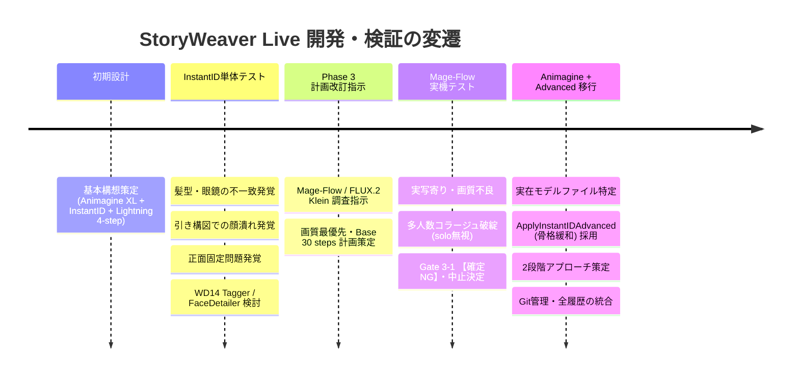

# StoryWeaver Live 開発経緯・意思決定履歴ログ (DEVELOPMENT_LOG)

本ドキュメントは、**StoryWeaver Live** プロジェクトの立ち上げから現在に至るまでの開発経緯、直面した課題、検証結果、および技術的決定事項の内容を残っている限り網羅して記録した正本ログである。

---

## 1. プロジェクト基本要件

* **目的**: 展示ブース等のイベント現場において、来場者の顔写真（Webカメラ1枚撮影）と発話音声（マイク）から、アニメ調キャラクターイラストとセリフ・朗読音声をリアルタイム生成する完全ローカルAIインスタレーション。
* **ターゲットハードウェア**: ThinkPad X1 Extreme (GPU: RTX 3080 Laptop 16GB VRAM / RAM: 32GB / Windows 11)
* **最重要制約**: 外部API非依存（完全ローカル稼働） / 展示中のゼロダウンタイム / VRAM 14.5GB 以内厳守（OOMゼロ）

---

## 2. 開発タイムラインと経緯詳細

---

### 【第1期】基本構想策定と初期設計 (`Attached_doc/storyweaver_live.md`)
* **構成案**:
  * フロントエンド: Vanilla HTML/CSS/JS (Web Speech API)
  * オーケストレーター: FastAPI (`http://localhost:8000`)
  * 音声認識 (ASR): `FunAudioLLM/SenseVoiceSmall` (CPU実行で VRAM 0.4GB 節約)
  * 小型 LLM: Ollama (`http://localhost:11434`, `gemma4:e2b` / `qwen2.5:3b`)
  * 画像生成: ComfyUI (`animagine-xl-3.1`, InstantID, `sdxl_lightning_4step_lora`)
* **メモリ運用方針**:
  * Ollama と ComfyUI を同時常駐させず、Ollama 生成完了後に `keep_alive: 0` でアンロードして ComfyUI を起動する直列化運用を決定。

---

### 【第2期】Phase 3 InstantID 単体テストの実施と「3つの壁」
初期設計に基づき、ComfyUI 上で Animagine XL ＋ InstantID の単体生成テストを実施。ここで以下の深刻な技術的課題に直面した。

1. **課題①：人物特徴（髪型・眼鏡）の不一致**
   * **現象**: 生成されたアニメキャラの目鼻立ちの比率はなんとなく本人に似ているが、髪型が別人のランダムなスタイルになり、眼鏡が消失するなど「本人に見えない」。
   * **原因**: InstantID の顔認識器（InsightFace）は「顔内部のパーツ配置（目・鼻・口）」に特化しており、顔の外側にある「髪型」「髪色」「眼鏡」の特徴抽出が弱いため。
   * **検討された対策**: 写真から外見属性タグ（`short hair`, `black hair`, `glasses` 等）を自動抽出する **`WD14 Tagger`** ノードの追加検討。
2. **課題②：引き・ダイナミック構図での顔の解像度低下**
   * **現象**: 全身構図や遠景にした際、顔のピクセル面積が小さくなり、InstantID の特徴が潰れて顔が崩れる。
   * **検討された対策**: 小顔領域のみを高精細に再現像する **`FaceDetailer` (Impact Pack, YOLOv8)** の追加検討。
3. **課題③：ポーズの正面直立固定（正面顔拘束の呪い）**
   * **現象**: プロンプトでアクションポーズ（抜刀、跳躍、振り返り等）を指示しても、顔と身体が写真の「正面棒立ち・首の角度」に強制拘束され、ダイナミックな絵にならない。
   * **原因**: 標準ノード `ApplyInstantID` では `weight`（0.8）によって、顔特徴埋め込み（IP-Adapter）と幾何学的骨格拘束（ControlNet）が一括で強くかかっていたため。

※この時期、WD14 Tagger から抽出されたテキストとプロンプトを合成するため `Text Concatenate` ノードの接続を模索していた。

---

### 【第3期】Phase 3 計画改訂指示と Mage-Flow への傾倒 (`Attached_doc/StoryWeaver Live Phase 3計画改訂指示プロンプト.md`)
* **改訂指示の受領**:
  * 最新の画像編集モデルである **`Mage-Flow`**（Microsoft / Comfy-Org）および **`FLUX.2 Klein`**（Black Forest Labs）の調査・再評価指示を受ける。
  * 「時間よりも意図した絵が得られるか（画質・品質）を最優先とし、手戻りのない段階的検証計画を立てよ」との指針を受け、計画書（`docs/plans/phase3_revision_plan.md` v2.2.0）を策定。
* **Mage-Flow-Edit Base (30 steps) の本線採択**:
  * DiT 4B ＋ Qwen3-VL 4B による参照画像編集能力に期待し、画質最優先で間引きのない Base 30 steps ワークフローを第1候補に設定。
  * `TextEncodeMageFlowEdit` ノードが ComfyUI 本体の Built-in コアノードであることを特定。

---

### 【第4期】Phase 3-1 Mage-Flow 実機検証と破綻（Gate 3-1 【確定 NG】）
Mage-Flow Base のワークフローを構築し、実際のテスト写真を入力して Gate 3-1 の検証を実施。その結果、**致命的な描画破綻**が発生した。

* **実機検証で確認された現象**:
  1. **実写寄り・チープな平塗り**: アニメ調指示にもかかわらず、元写真のリアルな肌テクスチャを引きずり、美麗なアニメ画質にならなかった。
  2. **マルチサブジェクト分裂・コラージュ破綻（致命的）**:
     プロンプトに `solo` を明記しているにもかかわらず、金髪男性、黒髪女性、金髪女性、さらには**アニメ集合ポスターのようなインセット（10名以上の集合絵）が画面内にパッチワーク状に同時レンダリング**された。
  3. **人物同一性の喪失**: 画面内に多数の人物が混在し、誰が本人なのかすら判定不能。
* **根本原因の特定**:
  * Mage-Flow は実写編集用途で学習されたモデルであり、アニメ表現の知識が「集合ポスター」等の断片としてしか存在しなかったため、`anime illustration` という単語でポスター集合絵の記憶を想起してしまった。
* **判定結果**:
  * **Gate 3-1 完全な「NG（不合格）」**。これ以上のパラメータ調整は時間の浪費と判断し、**Mage-Flow の検証を正式中止・廃止**。

---

### 【第5期】Animagine XL v3.1 ＋ ApplyInstantIDAdvanced への回帰と再構築
Mage-Flow の脱落を受け、元々の本命であるアニメ特化モデルへの回帰を決定。

1. **ローカル環境モデルの実態調査**:
   * `C:\pinokio\api\comfy.git\app\models` を直接走査し、実在ファイル名を確認・確定。
     * Checkpoint: `models/checkpoints/animagine-xl-3.1.float8_e4m3fn.safetensors`
     * InstantID: `models/instantid/ip-adapter.bin`
     * ControlNet: `models/controlnet/diffusion_pytorch_model.safetensors`
     * InsightFace: `models/insightface/models/antelopev2/` 一式
     * カスタムノード: `comfyui_instantid`, `comfyui-wd14-tagger`, `comfyui-impact-pack`
2. **`ApplyInstantIDAdvanced` の採用（第2期の課題解決）**:
   * 第2期で問題となった「ポーズ固定」を解決するため、拡張ノード `ApplyInstantIDAdvanced` を採用。
   * **`ip_weight: 0.60`**（顔特徴量）と **`cn_strength: 0.15`**（骨格拘束を80%カット）に完全分離し、顔の面影を残しながら身体のアクションポーズ追従を可能にした。
3. **2段階アプローチの策定**:
   * 【第1段階】：動的ポーズを入れず、本人らしさとアニメ画質のベースラインを確立。
   * 【第2段階】：第1段階の設定を維持したまま、抜刀・跳躍・振り返り構図を適用。

---

## 3. 現在の課題認識と今後の統合方針

現在、計画書（`phase3_revision_plan.md` v3.0.0）では、Mage-Flow 中止直後の暫定構成（手動プロンプト指定）がベースラインとなっている。  
しかし、展示自動化システムとしての本来のゴールは、第2期で議論していた **「WD14 Tagger による外見属性（髪型・眼鏡）の自動抽出」** である。

* **今後のマイルストーン**:
  1. **Step A**: まず現在の 12 ノード（手動プロンプト ＋ ApplyInstantIDAdvanced）にて、Animagine XL の画質と InstantID 緩和版のポーズ追従性のベースライン（第1段階・第2段階）を実証・確定させる。
  2. **Step B**: ベースライン確定後、以前模索していた `WD14 Tagger` を前段に接続し、完全自動での外見属性結合パイプラインを完成させる。
  3. **Step C**: 引き構図テスト（FaceDetailer 要否検証）を実施し、FastAPI（Phase 4）へ接続する。
