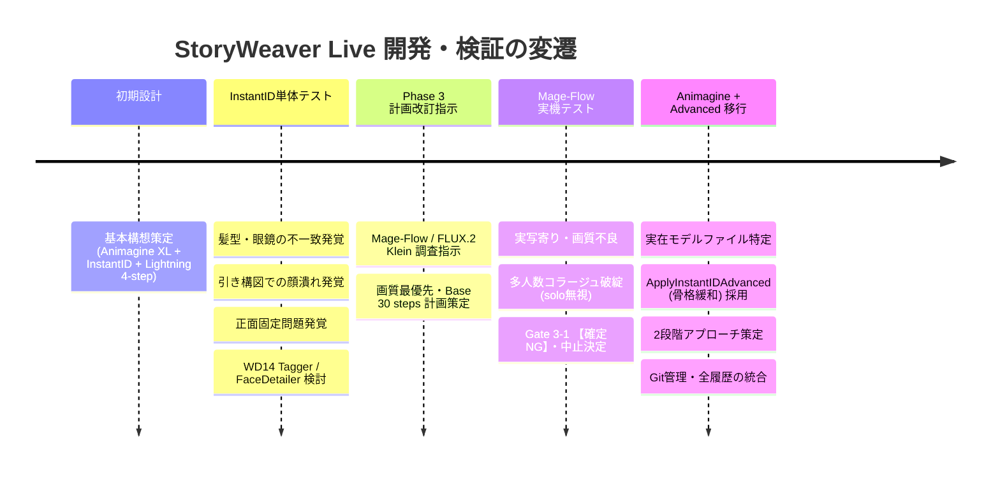

# StoryWeaver Live 開発経緯・意思決定履歴ログ (DEVELOPMENT_LOG)

本ドキュメントは、**StoryWeaver Live** プロジェクトの立ち上げから現在に至るまでの開発経緯、直面した課題、検証結果、および技術的決定事項の内容を残っている限り網羅して記録した正本ログである。

---

## 1. プロジェクト基本要件

* **目的**: 展示ブース等のイベント現場において、来場者の顔写真（Webカメラ1枚撮影）と発話音声（マイク）から、アニメ調キャラクターイラストとセリフ・朗読音声をリアルタイム生成する完全ローカルAIインスタレーション。
* **ターゲットハードウェア**: ThinkPad X1 Extreme (GPU: RTX 3080 Laptop 16GB VRAM / RAM: 32GB / Windows 11)
* **最重要制約**: 外部API非依存（完全ローカル稼働） / 展示中のゼロダウンタイム / VRAM 14.5GB 以内厳守（OOMゼロ）

---

## 2. 開発タイムラインと経緯詳細

---

### 【第1期】基本構想策定と初期設計 (`Attached_doc/storyweaver_live.md`)
* **構成案**:
  * フロントエンド: Vanilla HTML/CSS/JS (Web Speech API)
  * オーケストレーター: FastAPI (`http://localhost:8000`)
  * 音声認識 (ASR): `FunAudioLLM/SenseVoiceSmall` (CPU実行で VRAM 0.4GB 節約)
  * 小型 LLM: Ollama (`http://localhost:11434`, `gemma4:e2b` / `qwen2.5:3b`)
  * 画像生成: ComfyUI (`animagine-xl-3.1`, InstantID, `sdxl_lightning_4step_lora`)
* **メモリ運用方針**:
  * Ollama と ComfyUI を同時常駐させず、Ollama 生成完了後に `keep_alive: 0` でアンロードして ComfyUI を起動する直列化運用を決定。

---

### 【第2期】Phase 3 InstantID 単体テストの実施と「3つの壁」
初期設計に基づき、ComfyUI 上で Animagine XL ＋ InstantID の単体生成テストを実施。ここで以下の深刻な技術的課題に直面した。

1. **課題①：人物特徴（髪型・眼鏡）の不一致**
   * **現象**: 生成されたアニメキャラの目鼻立ちの比率はなんとなく本人に似ているが、髪型が別人のランダムなスタイルになり、眼鏡が消失するなど「本人に見えない」。
   * **原因**: InstantID の顔認識器（InsightFace）は「顔内部のパーツ配置（目・鼻・口）」に特化しており、顔の外側にある「髪型」「髪色」「眼鏡」の特徴抽出が弱いため。
   * **検討された対策**: 写真から外見属性タグ（`short hair`, `black hair`, `glasses` 等）を自動抽出する **`WD14 Tagger`** ノードの追加検討。
2. **課題②：引き・ダイナミック構図での顔の解像度低下**
   * **現象**: 全身構図や遠景にした際、顔のピクセル面積が小さくなり、InstantID の特徴が潰れて顔が崩れる。
   * **検討された対策**: 小顔領域のみを高精細に再現像する **`FaceDetailer` (Impact Pack, YOLOv8)** の追加検討。
3. **課題③：ポーズの正面直立固定（正面顔拘束の呪い）**
   * **現象**: プロンプトでアクションポーズ（抜刀、跳躍、振り返り等）を指示しても、顔と身体が写真の「正面棒立ち・首の角度」に強制拘束され、ダイナミックな絵にならない。
   * **原因**: 標準ノード `ApplyInstantID` では `weight`（0.8）によって、顔特徴埋め込み（IP-Adapter）と幾何学的骨格拘束（ControlNet）が一括で強くかかっていたため。

※この時期、WD14 Tagger から抽出されたテキストとプロンプトを合成するため `Text Concatenate` ノードの接続を模索していた。

---

### 【第3期】Phase 3 計画改訂指示と Mage-Flow への傾倒 (`Attached_doc/StoryWeaver Live Phase 3計画改訂指示プロンプト.md`)
* **改訂指示の受領**:
  * 最新の画像編集モデルである **`Mage-Flow`**（Microsoft / Comfy-Org）および **`FLUX.2 Klein`**（Black Forest Labs）の調査・再評価指示を受ける。
  * 「時間よりも意図した絵が得られるか（画質・品質）を最優先とし、手戻りのない段階的検証計画を立てよ」との指針を受け、計画書（`docs/plans/phase3_revision_plan.md` v2.2.0）を策定。
* **Mage-Flow-Edit Base (30 steps) の本線採択**:
  * DiT 4B ＋ Qwen3-VL 4B による参照画像編集能力に期待し、画質最優先で間引きのない Base 30 steps ワークフローを第1候補に設定。
  * `TextEncodeMageFlowEdit` ノードが ComfyUI 本体の Built-in コアノードであることを特定。

---

### 【第4期】Phase 3-1 Mage-Flow 実機検証と破綻（Gate 3-1 【確定 NG】）
Mage-Flow Base のワークフローを構築し、実際のテスト写真を入力して Gate 3-1 の検証を実施。その結果、**致命的な描画破綻**が発生した。

* **実機検証で確認された現象**:
  1. **実写寄り・チープな平塗り**: アニメ調指示にもかかわらず、元写真のリアルな肌テクスチャを引きずり、美麗なアニメ画質にならなかった。
  2. **マルチサブジェクト分裂・コラージュ破綻（致命的）**:
     プロンプトに `solo` を明記しているにもかかわらず、金髪男性、黒髪女性、金髪女性、さらには**アニメ集合ポスターのようなインセット（10名以上の集合絵）が画面内にパッチワーク状に同時レンダリング**された。
  3. **人物同一性の喪失**: 画面内に多数の人物が混在し、誰が本人なのかすら判定不能。
* **根本原因の特定**:
  * Mage-Flow は実写編集用途で学習されたモデルであり、アニメ表現の知識が「集合ポスター」等の断片としてしか存在しなかったため、`anime illustration` という単語でポスター集合絵の記憶を想起してしまった。
* **判定結果**:
  * **Gate 3-1 完全な「NG（不合格）」**。これ以上のパラメータ調整は時間の浪費と判断し、**Mage-Flow の検証を正式中止・廃止**。

---

### 【第5期】Animagine XL v3.1 ＋ ApplyInstantIDAdvanced への回帰と再構築
Mage-Flow の脱落を受け、元々の本命であるアニメ特化モデルへの回帰を決定。

1. **ローカル環境モデルの実態調査**:
   * `C:\pinokio\api\comfy.git\app\models` を直接走査し、実在ファイル名を確認・確定。
     * Checkpoint: `models/checkpoints/animagine-xl-3.1.float8_e4m3fn.safetensors`
     * InstantID: `models/instantid/ip-adapter.bin`
     * ControlNet: `models/controlnet/diffusion_pytorch_model.safetensors`
     * InsightFace: `models/insightface/models/antelopev2/` 一式
     * カスタムノード: `comfyui_instantid`, `comfyui-wd14-tagger`, `comfyui-impact-pack`
2. **`ApplyInstantIDAdvanced` の採用（第2期の課題解決）**:
   * 第2期で問題となった「ポーズ固定」を解決するため、拡張ノード `ApplyInstantIDAdvanced` を採用。
   * **`ip_weight: 0.60`**（顔特徴量）と **`cn_strength: 0.15`**（骨格拘束を80%カット）に完全分離し、顔の面影を残しながら身体のアクションポーズ追従を可能にした。
3. **2段階アプローチの策定**:
   * 【第1段階】：動的ポーズを入れず、本人らしさとアニメ画質のベースラインを確立。
   * 【第2段階】：第1段階の設定を維持したまま、抜刀・跳躍・振り返り構図を適用。

---

### 【第6期】Git 管理の導入とリポジトリ初期化
* 過去の開発経緯・意思決定履歴を永続化するため、リポジトリを Git 初期化（`git init`）。
* 大容量モデルファイルや一時生成物の除外規約（`.gitignore`）を制定し、初回コミットを記録。

---

### 【第7期】WD14 Tagger 統合と検証スコープ再定義（計画書 v3.1.0 策定）
ユーザーからの改訂指示に基づき、手動プロンプト前提による後工程での手戻りを防ぐため、パイプラインのスコープを再定義。

1. **WD14 Tagger 統合ステップの正式組み込み（Phase 3-3）**:
   * 手動ベースライン（3-1, 3-2）確立後、直ちに `WD14 Tagger` ＋ `Concatenate Text`（ComfyUI 標準 StringConcatenate）を前段に結合。
   * 写真からの髪型・眼鏡等の自動抽出・プロンプト結合を Phase 3 内で完結・実証する方針を確定。
2. **API Format JSON 出力対象の是正**:
   * 最終成果物 `storyweaver_anime_api.json` は手動版ではなく、**WD14 Tagger を内包した「完全自動化対応ワークフロー（全14ノード）」** を対象として出力・確定することに是正。
3. **付随懸念事項の判定基準化**:
   * **レイテンシ許容基準**: 展示運用の許容上限を **20秒以内**（目標 15秒以内）と規定。
   * **FaceDetailer の扱い**: 全身構図でのみ要否判定を行い、小顔時（BBox < 180px）の条件付き適用または単一パス不採用を判定。
   * **骨格拘束緩和のトレードオフ**: `cn_strength: 0.15` を中心としたスイートスポット（ポーズ追従 vs 本人同一性維持）を Gate 3-2 で確定。
   * **フェーズ境界の明確化**: Phase 3 は ComfyUI 単体での完全自動化 API ワークフロー確立まで、Phase 4 は FastAPI オーケストレーター統合と明確に分離。

---

### 【第8期】顧客提供価値起点・3大フェーズ体系への計画再構築（計画書 v4.0.0 策定）
ユーザーからの指示（「細かい指摘ではなく、全体のPhase分けをした計画をきちんと立てる。まず顔の特徴が残るアニメ絵の生成 ➔ 特徴の残るキャラをダイナミックに変換してストーリーに応じたポーズ・表情を作り顧客に提供 ➔ 最後に生成時間短縮」）に基づき、検証構造を抜本的に再整理。

1. **3大フェーズ（マイルストーン）への再構造化**:
   * **Phase 3-A（第1期）: 【顔特徴・本人同一性とアニメ品質の確立】**
     * ポートレート構図固定、WD14 外見属性自動抽出、InstantID 顔貌固定、FaceDetailer による別人化防止と高精細化。
     * **Gate 3-A**: 本人同一性の一致、セル画美麗品質、`solo` 遵守、別人化の非発生。
   * **Phase 3-B（第2期）: 【ストーリー連動の動的ポージング・表情と顧客提供品質】**
     * 骨格拘束緩和（`cn_strength: 0.15`）、ストーリープロンプト・表情注入、全身・引き構図での小顔潰れ防止。
     * **Gate 3-B**: ポーズ・表情への追従（首折れなし）、動的変換時の本人同一性維持、提供物としての感動品質。
   * **Phase 3-C（第3期）: 【生成時間の短縮・展示運用最適化 & API確定】**
     * 高速化比較（Lightning LoRA 8-step vs 標準最適化）、画質維持とレイテンシの最適化、VRAM ≤ 14.5GB & ゼロダウンタイム、`storyweaver_anime_api.json` 確定。
     * **Gate 3-C**: 生成時間許容、品質非劣化、OOM ゼロ、完全自動 API JSON 確立。
2. **検証方針の明確化**:
   * すべての土台である **Phase 3-A（本人同一性の確立）** に全リソースを集中し、Gate 3-A を通過するまでポーズや高速化に手を広げない「手戻りゼロ」の推進体制を確立。

---

### 【第9期】時間許容枠の拡大（最大7分許容）と画質先行アプローチへの転換（計画書 v4.1.0 策定）
ユーザーからの指示に基づき、開発・検証における時間制約の根本的な見直しを実施。

1. **背景と課題認識**:
   * これまでの評価において、「生成時間を短く抑えること（≤20秒）」に対する過剰な配慮が、低ステップ数や蒸留LoRAによる描写崩れ、サンプラー制約、タイムアウトの早期切断などを招き、画質や本人同一性の追求に対する重大な足枷（制約過多）になっていた。
2. **基本方針の転換（画質先行・時間後追いアプローチ）**:
   * **時間について一旦最大7分（420秒）まで許容** する方針を正式決定。
   * まず十分な時間的リソース（高ステップ、精緻なFaceDetailer、丁寧なサンプリング）を用いて「画質と本人同一性の許容水準」を完全に確立し、その許容画質を基準として後から時間短縮（Phase 3-C）を図る順序へ是正。
3. **ルールおよび関連ドキュメントの改訂反映**:
   * **`AGENTS.md`**: タイムアウト制約を改定。ComfyUI の待機タイムアウトを最大500秒（約8分20秒）程度まで許容し、短時間制約による打ち切りを排除。
   * **`.agents/rules/error-prevention.md`**: 画質検証フェーズにおけるサンプリングステップ制限（4-step固定等）を撤廃し、最大7分許容に合わせたポーリング待機設計（`MAX_WAIT_SECONDS = 450`）へ改定。
   * **`docs/plans/phase3_revision_plan.md` (v4.1.0)** & **`docs/plans/README.md`**: Phase 3-C および運用のレイテンシ上限を「最大7分許容」に緩和し、画質基準に基づく短縮検証の枠組みに更新。

---

### 【第10期】手順と検証記録の計画書一元化（ファイル乱立の排除とシンプル化）
ユーザーからの指示（「ファイルを勝手に増やさず、進め方は整理してシンプルにする。チャットで指示を出さず計画書の手順で進め、記録がきちんと残るようにする」）に基づき、検証推進体制をシンプルに再整理。

1. **計画書（`phase3_revision_plan.md`）への完全一元化**:
   * 別個のログブック作成を取りやめ、新規作成した余計なファイルは即時削除。
   * **正本計画書 `docs/plans/phase3_revision_plan.md` 単体** の中に、ComfyUI の具体的な Step-by-Step 操作仕様（第5章）および各試行の記録台帳（第6章）を集約。
2. **シンプルな進め方**:
   * ユーザーは計画書（第5章）を見て ComfyUI を設定・実行。
   * 結果はこの計画書末尾の台帳（第6章）に記録して Git コミットし、履歴を永続化する。

---

### 【第11期】RUN-3A-01 生成画像評価と髪型不一致の根本原因分析・解決策の策定
ユーザーより、現在の ComfyUI 構成（添付 JSON）で実際に生成されたアニメ画像と、入力元写真（来場者写真）が提示され、評価・原因分析・改善策の策定を実施。

1. **生成画像と元写真の対比評価**:
   * **達成点（良好）**:
     * 画質・セル画調の塗り、瞳のハイライト、リムレス眼鏡（`glasses`, `rimless eyewear`）の検出・描画、目元の配置バランスは極めて高水準。
     * FaceDetailer（`denoise: 0.25`, `bbox_crop_factor: 1.4`）により、顔立ちの別人化や境界浮きは抑制された。
   * **重大な課題（Gate 3-A 未達）**:
     * **髪型が全く不一致**: 元写真は「額が露出した極めて短い短髪・坊主頭（buzz cut / very short hair）」であるのに対し、生成画像は「目にかかる長い前髪が垂れ下がった標準的なアニメ男子髪」になっている。
     * **表情の乖離**: 元写真は穏やかな微笑みであるが、生成画像は真顔・クールになっている。
2. **推定根本原因の特定**:
   * **① InstantID (InsightFace) の設計特性**: 顔認識モデルは目鼻口の配置を照合するものであり、**髪型（ヘアスタイル）の特徴量を保持しない**。髪型の生成は 100% プロンプト（CLIP 条件付け）に依存する。
   * **② WD14 Tagger のタグ欠落**: 閾値 0.40 により `buzz cut` / `short hair` が漏れ、出力が `black hair` のみになっていた。
   * **③ SDXL モデルのデフォルトバイアス**: 髪型の具体的指定がない場合、Animagine XL は学習データの大半を占める「前髪ありアニメ髪」を自動描画する。
   * **④ ネガティブプロンプトの抑制不足**: ネガティブに `bangs`（前髪）が入っていないため、前髪の自律生成を阻止できなかった。
   * **⑤ exclude_tags による smile の誤遮断**: WD14 の除外タグに `smile` が含まれ、表情タグが欠落した。
3. **解決手法と計画書（RUN-3A-02）への反映**:
   * **解決策 1**: Node 6 (Negative) に `bangs, fringe, long bangs, hair over forehead, medium hair` を追加し前髪を強力に抑止。
   * **解決策 2**: Node 21 (`string_a`) に `buzz cut, very short hair, exposed forehead, gentle smile` を明示補強。
   * **解決策 3**: Node 19 (WD14 Tagger) の `threshold: 0.25` に引き下げ、`exclude_tags` から `smile` を除去。

---

### 【第12期】FaceDetailer 前後無変化の懸念点分析と改訂ワークフロー（261014）の作成
ユーザーより「設定値関係なく、FaceDetailer を通した前後で顔の印象に変化が見られない」との課題指摘を受け、ワークフローの構造・パラメータを再精査。懸念点の特定と改訂ワークフローの配置を実施。

1. **特定された懸念点（前後で差が出ない原因）**:
   * **プロンプト入力の曖昧さ**: 顔用インペイントに大元の全身プロンプトが渡されており、`wildcard` も空欄で顔専用の修復指示がなかった。
   * **FaceDetailer 用 InstantID 強度不足**: Node 25 の `ip_weight: 0.45`, `cn_strength: 0` であり、元写真の特徴量を引き寄せる力が弱かった。
   * **ガイドサイズの不適合**: アップ構図（顔領域約800〜900px）に対し `guide_size: 768` で縮小インペイントされていた。
   * **SAM モデルの未接続**: 矩形 bbox に単純 feather のみで、顔パーツのセグメンテーションによる精緻なインペイントが行われていなかった。
2. **改訂ワークフローの作成**:
   * 保存先: `C:\pinokio\api\comfy.git\app\user\default\workflows\StoryWeaver_261014.json`
   * 主な改訂内容:
     * Node 6 (Negative): 前髪抑止タグ（`bangs, fringe, long bangs, hair over eyes, hair over forehead, medium hair`）を追加。
     * Node 21 (Positive string_a): 短髪・額露出・微笑み（`buzz cut, very short hair, exposed forehead, gentle smile`）を追加。
     * Node 19 (WD14): `threshold: 0.25` に調整、`exclude_tags` から `smile` を除外。
     * Node 25 (FaceDetailer InstantID): `ip_weight: 0.65`, `cn_strength: 0.15` に強化。
     * Node 20 (FaceDetailer): `guide_size: 1024`, `denoise: 0.35`, `wildcard` に顔ディテール指定を追加。
     * Node 9 (SaveImage): `filename_prefix: "StoryWeaver_261014"` に設定。

---

### 【第13期】全体計画の再構築（v6.2：来場者フロー連動・非同期2段階パイプライン）
旧 Phase 3（ComfyUI 単体での本人同一性確立）の検証が収束しないため、ユーザー提示の見直し計画（`Attached_doc/gemini-code-1792190494455.md`）に基づき全体計画を再構築。

1. **主な方針転換**:
   * WD14 Tagger を廃止し、`gemma4:e2b` + JSON Schema による外見構造化抽出と前髪逆バイアス Negative の自動生成へ移行。
   * InstantID に IP-Adapter Plus Face を併用。InsightFace と SenseVoice は CPU 固定で VRAM 競合を排除。
   * セリフ・構図は台本プリセット化。表情は写真から抽出せず、音声感情 × ピーク声量（rms_p90）のみで決定。
   * API を `/api/analyze_face`（撮影時）と `/api/generate_scene`（発声後）の2段階に分割。
2. **新フェーズ体系**: Phase 1（VLM・SenseVoice 単体検証）→ 2（ComfyUI 改修）→ 3（FastAPI）→ 4（UI）→ 5（リハーサル）。
3. **ドキュメント**: `docs/plans/README.md` を v6.2 正本として全面改訂。`phase3_revision_plan.md` はアーカイブ化（削除せず保全）。新規ファイルは作成していない。
4. **資産確認**: IP-Adapter Plus Face / CLIP-ViT-H / SAM / `gemma4:e2b` は導入済み。SenseVoiceSmall のみ Phase 1-B で導入確認が必要。
5. **仕様変更根拠**: Base の InstantID `ip_weight` を仕様書の 0.55〜0.60 から 0.70 へ変更（`cn_strength: 0.15` で骨格拘束を外す分、顔特徴の担保を IP 側に寄せるため）。

---

### 【第14期】全体計画 v6.3：手戻り・展示トラブル防止の5点改訂
ユーザー指示により `docs/plans/README.md` を以下の通り改訂。

1. **2人目以降の VRAM 溢れ対策**: `/api/analyze_face` で Ollama 呼び出し直前に ComfyUI `POST /free` を実行（効かない場合は起動オプションによる保持制御を Phase 3 で検証）。Gate 3・Gate 5 に「生成直後の2回目 analyze でも VRAM ≤ 14.5 GB」を追加。
2. **録音設定と音声フォーマット統一**: `autoGainControl / noiseSuppression / echoCancellation` をすべて `false`（環境音は指向性マイクと閾値で制御）。音声は **ブラウザ `AudioContext` で 16kHz モノラル WAV にエンコードして送信** に統一（ffmpeg 依存排除・opus による rms 歪み回避のため）。
3. **時間短縮の前倒し**: Phase 2 を「前半: 画質確立 → 後半: 時間短縮確定」の2段階にし、Gate 2 に目標生成時間の確定を追加。Phase 5 は確定設定での連続耐久に専念。
4. **FaceDetailer 最適化**: `Node_Pos_FD` に髪型・眼鏡タグを除いた表情専念版（案B）を追加し優先検証。マスクは SAM なし・bbox のみを優先検証。
5. **撮影ガイドと再撮影ガード**: 頭・肩ガイド枠のオーバーレイ表示、VLM スキーマに `face_detected` を追加し、未検出時は `422 FACE_NOT_DETECTED` で撮影画面へ戻す。Gate 1-A / 3 / 4 に反映。

---

### 【第15期】Phase 1-A：gemma4:e2b による JSON Schema 外見抽出の検証完了（Gate 1-A 全基準合格）
運用ルールに基づき、`README.md` への手順追記、検証スクリプト `verify_step1_vlm.py` の実装、および実写・顔未検出画像を用いたベンチマークを実施。

1. **実装内容**:
   * Pydantic による 8 項目の構造化スキーマ（`face_detected`, `gender_tag`, `hair_length`, `hair_style_details`, `has_bangs`, `exposed_forehead`, `glasses`, `facial_hair`）を定義し、Ollama API（`gemma4:e2b`）の `format: schema`（Structured Outputs）で文法制約サンプリングを適用。
   * システムプロンプトおよび Python フィルタリングによる徹底した「表情排除」を実装。
   * ルールベース変換により、`has_bangs == False` または `exposed_forehead == True` 時に `physical_traits` へ `exposed forehead` を補完し、`negative_hair_bias` に `(bangs:1.3), (fringe:1.3), hair over forehead` を自動付与。
   * 推論完了・アンロード直後（`keep_alive: 0`）の GPU VRAM 使用量（MB）、ロード時間、推論時間を計測し `vlm_benchmark.csv` へ保存するロジックを実装。
2. **検証結果（Gate 1-A）**:
   * **短髪男性実写 (`koji-bose.jpg`)**: `1boy`, `short hair`, `dark hair`, `glasses`, `exposed forehead` 抽出、逆バイアス `(bangs:1.3), (fringe:1.3), hair over forehead` が自動セット（所要 10.77 秒、解放後 VRAM 614.7 MB）。
   * **長髪女性実写 (`koji-women-.jpg`)**: `1girl`, `long hair`, `Black hair, straight texture`, `glasses`, `exposed forehead` 抽出、逆バイアスセット（所要 17.13 秒、解放後 VRAM 614.7 MB）。
   * **前髪あり女性実写 (`yae.jpg`)**: `1girl`, `short hair`, `black hair, straight texture, bangs` 抽出、`has_bangs: True`, `exposed_forehead: False`、逆バイアス空文字 `""` を確認（所要 12.58 秒、解放後 VRAM 629.8 MB）。
   * **顔未検出テスト (`test_noface.jpg`)**: `face_detected: False`、全属性が空文字/デフォルト値となり、Phase 3 再撮影ガード条件の成立を確認（所要 11.52 秒、解放後 VRAM 614.7 MB）。
   * **VRAM 即時解放**: `keep_alive: 0` により、推論完了直後はいずれも 614〜630 MB まで即座に完全解放されることを確認。
3. **運用上の知見**:
   * 完全コールドスタート時の初回推論のみモデル読み込みに時間がかかりタイムアウト（30秒超過）リスクがあるため、FastAPI 起動時にダミーの空推論でウォームアップを済ませる運用が必要。
   * Gate 1-A の全 6 項目が基準を満たし合格（`docs/plans/README.md` に反映）。

---

### 【第16期】Phase 1-B：SenseVoice 感情認識・ピーク音量 ＆ CPU 動作検証完了（Gate 1-B 全基準合格・Phase 1 完了）
運用ルールに基づき、設定ファイル `config.json` の作成、対話型録音ヘルパー `record_test_audio.py`、および検証スクリプト `verify_step1_sensevoice.py` を実装し、実機検証を実施。

1. **実装内容**:
   * `config.json`: 声量による BURNING 昇格閾値 `"BURNING_DB_THRESHOLD": -12.0` を外部設定化。
   * `record_test_audio.py`: 16kHz モノラル 16bit PCM WAV で 4 パターン（叫び/明るい/悲痛/冷静）をマイク対話録音・合成テスト音声を生成するヘルパーを作成。
   * `verify_step1_sensevoice.py`: `AutoModel(model="iic/SenseVoiceSmall", device="cpu")` による完全 CPU 動作、20ms フレーム RMS による無音除外 `rms_p90` 算出、および感情タグ × 音量閾値によるハイブリッド判定（BURNING/JOYFUL/EMOTIONAL/COOL）ロジックを実装。ベンチマークを `sensevoice_benchmark.csv` に保存。
2. **実機検証結果（Gate 1-B）**:
   * **Gate 1-B 基準1（VRAM 消費ゼロ）**: ロード前後 GPU VRAM 増分 **0.0 MB**（324.0 MB -> 324.0 MB）で完全分離を確認。
   * **Gate 1-B 基準2（推論速度）**: 3〜3.5秒音声に対して **0.31〜0.42 秒** で推論完了（目標 0.5 秒以内を CPU で達成）。
   * **Gate 1-B 基準3（ハイブリッド判定）**: 音声感情タグとピーク音量 `rms_p90` による `BURNING` 昇格および `COOL` 判定の切り替え、`expression_prompt` の適正出力を確認。
   * **Gate 1-B 基準4（閾値外部設定）**: コマンドライン引数 `--threshold -20.0` による一時変更で、通常音量音声が即座に `BURNING` へ昇格することを確認。
3. **Phase 1 総括**:
   * Gate 1-A（VLM 外見抽出）および Gate 1-B（SenseVoice 感情・音量解析）の全項目が合格基準を満たし、Phase 1 が完了。
   * 次フェーズ Phase 2（ComfyUI ワークフロー改修: `storyweaver_anime_api.json`）への移行準備が完了。

---

### 【第17期】Phase 2：添付ComfyUIワークフローに基づくテスト画像別プロンプト策定・計画書記録
ユーザー提示の ComfyUI ワークフロー（Animagine FP8 + InstantID + IP-Adapter Plus Face + FaceDetailer）に基づき、追加の画像解析を行わず Phase 1 確定結果のみを活用して `test_assets/faces/` 内の検証用プロンプトを策定し、`docs/plans/README.md` へ反映。

1. **基本方針**:
   * 「決して追加で画像分析を行わない」制約を厳守し、Phase 1（Gate 1-A）の `vlm_benchmark.csv` に記録された構造化データ（`gender_tag`, `hair_length`, `hair_style_details`, `glasses`, `exposed_forehead`, `has_bangs`）およびルール変換後の `physical_traits` / `negative_hair_bias` のみを適用。
   * 添付ワークフロー内の 3 系統プロンプト（Node 5: Base Positive, Node 6: Base Negative, Node 32: FaceDetailer Positive）に完全対応。
   * FaceDetailer プロンプトには、第14期改訂方針に従い「案B（表情専念・優先検証）」を主軸としつつ、比較用に「案A（外見属性再注入）」も併記。
2. **対象画像とプロンプトの対応**:
   * **`koji-bose.jpg`（短髪・眼鏡・額露出 男）**: `1boy, short hair, dark hair, glasses, exposed forehead` ＋ 逆バイアス `(bangs:1.3), (fringe:1.3), hair over forehead`
   * **`koji-women-.jpg`（長髪・眼鏡・額露出 女）**: `1girl, long hair, Black hair, straight texture, glasses, exposed forehead` ＋ 逆バイアス
   * **`yae.jpg`（短髪・前髪あり 女）**: `1girl, short hair, black hair, straight texture, bangs` ＋ 逆バイアスなし（前髪保護）
   * **`blue.jpg`**: Phase 1 ベンチマーク未実施のため、追加解析禁止ルールに基づき保留。
3. **反映先**:
   * `docs/plans/README.md` §2.1 に各画像ごとの ComfyUI 入力用テキストを整理・記録。

---

### 【第18期】VLM 髪長さ判定の厳格化（Phase 1-A v2 再評価）と Phase 2 再評価プロンプトの整理
Phase 2 で `koji-bose.jpg` が `short hair` 判定のため女性ショートカット程度の髪で生成された（顔はおおむね追従）。`Attached_doc/vlm.md` の仕様に基づき VLM 抽出を改修し、Phase 1-A から再評価した。

1. **`verify_step1_vlm.py` 修正**:
   * `FaceVlmExtraction.hair_length` / `has_bangs` の `description` に cm 単位・頭皮/耳/額の露出基準を明記。
   * `SYSTEM_PROMPT` に `4. HAIR LENGTH CRITERIA` を追加（前髪ありなら `short hair` 以上とする整合ルール含む）。
   * `rule_based_transform`: `buzz cut` / `very short hair` 判定時に両タグを併記し、超短髪時のみネガティブに `ahoge, spiky hair, hair over ears, (bob cut:1.2)` を追加。
   * 「`1boy` かつ額露出なら `buzz cut` へ強制変換」するフォールバックは副作用防止のため実装しない。
2. **Phase 1-A v2 再評価結果**:
   * `koji-bose.jpg`: `buzz cut` 判定 → `1boy, buzz cut, very short hair, dark hair, closely cropped, glasses, exposed forehead`（22.84s・初回ロード 15.0s 含む / 解放後 758.0 MB）。
   * `koji-women-.jpg`: `long hair`・額露出を維持（13.48s / 773.0 MB）。
   * `yae.jpg`: `short hair`・前髪あり・逆バイアス空を維持（11.83s / 826.1 MB）。
   * `test_noface.jpg` はフォルダ未配置のため再評価未実施（v1 で合格済み）。`blue.jpg` は処理対象外。
3. **ドキュメント**:
   * `README.md` Gate 1-A エビデンスを v2 に更新（v1 は折りたたみで保全）。
   * §2.1 を Phase 2 再評価用に整理（共通パーツ表・画像別差分表・コピー用プロンプト・観点 R-1〜R-4・記録表）。

---

### 【第19期】Phase 2 実機検証結果の記録と Gate 2 ステータス更新
ユーザーによる ComfyUI 実機生成検証の結果を受け、正本計画書（`docs/plans/README.md`）の検証記録表および Gate 2 判定を更新。

1. **実機検証結果**:
   * **髪型・眼鏡・顔立ち**: VLM（v2）の自動抽出タグにより、`koji-bose.jpg`（buzz cut/超短髪）、眼鏡、顔立ちが適切に反映されたことを確認。
   * **VRAM**: 生成中ピークは規定値内（≤ 13.0 GB）で問題なし。
   * **テンプレート**: FaceDetailer は **「案B（表情専念）」を正式採用** として確定（髪型・眼鏡の二重生成や破綻を回避）。
   * **生成時間**: 許容範囲内（最大7分以内）。
   * **画質**: プロンプト調整による詰め・改善を継続する方針。
2. **Gate 2 反映**:
   * 基準 1（手動修正ゼロ）: 合格
   * 基準 2（VRAM）: 合格
   * 基準 3（テンプレート確定）: 合格（FD 案B 正式採用）
   * 基準 4（時間と画質）: 継続（時間は許容内、画質はプロンプト修正で対応）

