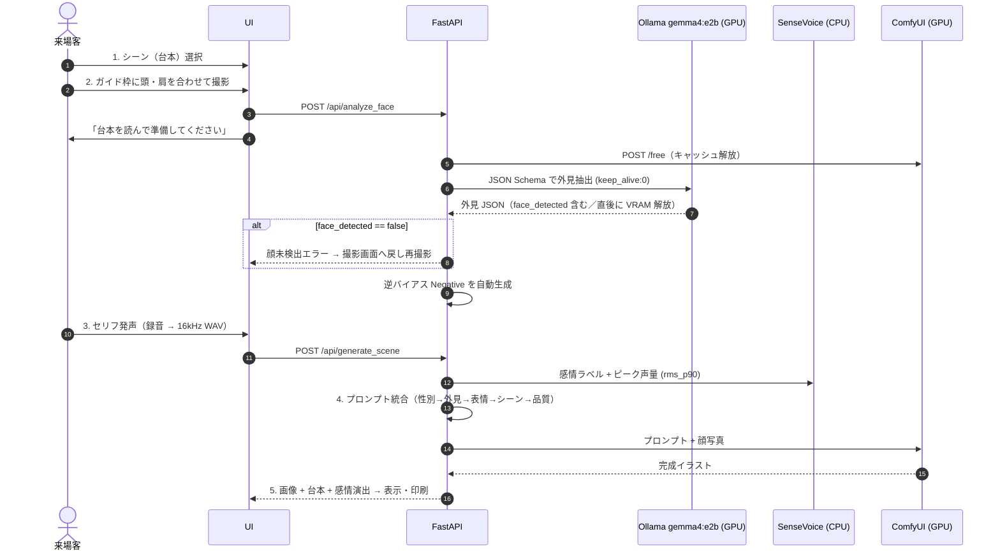
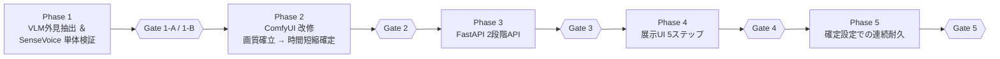

# StoryWeaver Live — 全体実装計画書 (v6.3)

- **改訂日**: 2026-10-17（v6.3: 手戻り・展示トラブル防止の5点を反映）
- **ステータス**: 全体計画 再構築済み（各 Phase の詳細手順は着手時に本書へ追記）
- **対象イベント**: AIクリエーターズマーケット
- **対象マシン**: ThinkPad X1 Extreme (RTX 3080 Laptop 16GB / RAM 32GB / Windows 11)
- **原典**: [gemini-code-1792190494455.md](file:///c:/antigravity/StoryWeaver/Attached_doc/gemini-code-1792190494455.md)

> [!IMPORTANT]
> 本書は全工程の **唯一の正本計画** です。各 Phase 末尾の **Gate** を通過するまで次 Phase に進みません。
> 旧計画（v1〜v4 系: Phase 1〜6 / Phase 3-A〜C）は Git 履歴に保全し、本書で置き換えました。

---

## 0. 再構築の経緯（なぜ計画を作り直すのか）

旧 Phase 3（ComfyUI 単体で本人同一性を確立）は、以下の構造的限界により収束しなかった。

| 旧 Phase 3 で詰まった点 | 根本原因 | v6.2 での対処 |
| :--- | :--- | :--- |
| 坊主・短髪・額が再現されない | WD14 Tagger は実写の髪型を認識できない／InstantID は髪型特徴を持たない | **VLM（`gemma4:e2b`）+ JSON Schema** で外見を構造化抽出し、前髪バイアス打消しネガティブを自動生成 |
| 頭部形状・眼鏡が維持されない | InstantID は目鼻口の配置のみ | **IP-Adapter Plus Face** を併用（頭部・生え際・眼鏡の視覚補助） |
| FaceDetailer 前後で差が出ない | 全体プロンプト流用・顔専用プロンプトなし | **FaceDetailer 専用 Positive** を独立系統化（シーンタグ除外） |
| 写真の表情とセリフの感情が衝突 | 写真から表情タグを拾っていた | 写真からは表情を **一切抽出しない**。表情は音声感情のみで決定 |
| LLM 生成・画像生成の VRAM 競合 | 同時ロード | 撮影時に VLM 実行→`keep_alive: 0` で解放。SenseVoice・InsightFace は **CPU 固定** |

---

## 1. 設計の核心

1. **来場者体験フロー連動型・非同期パイプライン**: 撮影時（フェーズA）に裏で VLM 外見抽出を完了させ、発声後（フェーズB）の待ち時間を最小化し VRAM 競合を排除する。
2. **WD14 Tagger 廃止 → VLM（`gemma4:e2b` + JSON Schema）**: 髪型・生え際・眼鏡・性別と、前髪バイアス打消し用ネガティブを、ハードコーディングなしで構造化出力する。
3. **台本プリセット方式 ＆ SenseVoice 感情 × 声量ハイブリッド判定**: セリフ・構図は事前定義。音声からは CPU 実行の SenseVoice と AGC 無効化済みピーク音量で「感情と熱量」を抽出し表情へ反映する。

---

## 2. システム構成

| コンポーネント | 実行先 | 役割 |
| :--- | :--- | :--- |
| フロントエンド UI | ブラウザ | シーン選択・撮影（頭・肩ガイド枠オーバーレイ／顔未検出時の再撮影）・台本表示・録音（AGC/NS/EC すべて無効）・アートカード表示/印刷 |
| FastAPI (`server.py`) | CPU | `/api/analyze_face` と `/api/generate_scene` の2段階 API、セッション管理、プロンプト統合 |
| Ollama `gemma4:e2b` | GPU（撮影直後のみ） | 顔写真の外見 JSON 抽出。完了後 `keep_alive: 0` で即解放 |
| SenseVoiceSmall | **CPU 固定** | 感情ラベル抽出（VRAM 0 MB） |
| ComfyUI | GPU | Animagine XL 3.1 FP8 + InstantID（InsightFace は **CPU**）+ IP-Adapter Plus Face + FaceDetailer |

### 音声データ受け渡し仕様（全 Phase 共通・統一）

- **ブラウザ側で `AudioContext`（`sampleRate: 16000`）を用いて 16kHz モノラル WAV（16bit PCM）にエンコードしてから送信する**。FastAPI は WAV のみを受け付ける。
- 採用理由: `MediaRecorder` は WAV 直接出力に非対応のため自前エンコードが必要。サーバ側の ffmpeg 依存とデコード工程を排除でき、非可逆圧縮（opus）による `rms_p90` の歪みも避けられる。

### 来場者フローと裏処理



---

## 3. 共通仕様

### 3.1 シーンプリセット（`presets.json`）

| ID | シーン | 台本セリフ | `scene_prompt` |
| :--- | :--- | :--- | :--- |
| `scene_01` | 覚醒の剣士 | 「まだだ…俺は絶対に諦めない」 | `fantasy anime, dramatic battlefield, dynamic pose, drawing a glowing legendary sword, leaning forward, flying sparks, cinematic lighting` |
| `scene_02` | 大魔法の発動 | 「闇を照らせ、これが私の全力だ」 | `magic academy anime, casting a giant arcane spell, glowing magic circle, floating debris, wind blowing, dynamic angle, vibrant colors` |
| `scene_03` | サイバーパンクの切り札 | 「ターゲット捕捉。これよりシステムを突破する」 | `cyberpunk anime, neon city night background, futuristic tactical gear, holographic visor display, cool action pose, high contrast` |
| `scene_04` | 栄光のフィナーレ | 「みんな、本当にありがとう。最高の気分だ」 | `bright fantasy festival, confetti and glowing light particles, triumphant pose, raising hand, warm sunlight, masterpiece scenery` |

### 3.2 感情 × 声量 → 表情プロンプト

| SenseVoice | ピーク音量 `rms_p90` | 判定 | `expression_prompt` |
| :--- | :--- | :--- | :--- |
| `ANGRY` | 任意 | BURNING | `shouting, fierce determination, intense eyes, open mouth, battle cry, dynamic expression` |
| `NEUTRAL` | 閾値以上 | BURNING（昇格） | 同上 |
| `HAPPY` | 任意 | JOYFUL | `confident smile, bright expressive eyes, joyful and energetic expression` |
| `SAD` | 任意 | EMOTIONAL | `tearful eyes, emotional expression, biting lip, dramatic sorrow, desperate look` |
| `NEUTRAL` | 閾値未満 | COOL | `calm and composed expression, sharp gaze, cool determination, slight smirk` |

- 閾値 `BURNING_DB_THRESHOLD`（初期値 `-12.0 dBFS`）は `config.json` で外部設定化する。

### 3.3 プロンプトテンプレート（Animagine XL 作法：人数・性別を先頭、品質を末尾）

| 系統 | テンプレート |
| :--- | :--- |
| `Node_Pos_Base` | `{gender_tag}, solo, {physical_traits}, {expression_prompt}, {scene_prompt}, masterpiece, best quality, very aesthetic, absurdres` |
| `Node_Neg_Base` | `{negative_hair_bias}, nsfw, lowres, (bad), text, error, fewer, extra, missing, worst quality, jpeg artifacts, low quality, watermark, unfinished, displeasing, oldest, early, chromatic aberration, signature, extra digits, artistic error, username, scan, [abstract], photorealistic, realistic, 3d` |
| `Node_Pos_FD`（案A: 原案） | `{gender_tag}, solo, close-up, face focus, {physical_traits}, {expression_prompt}, detailed anime eyes, masterpiece, best quality, very aesthetic, absurdres`（`{scene_prompt}` は除外） |
| `Node_Pos_FD`（案B: 表情専念・**優先検証**） | `{gender_tag}, solo, close-up, face focus, {expression_prompt}, detailed anime eyes, masterpiece, best quality, very aesthetic, absurdres`（`{physical_traits}` の髪型・眼鏡タグを除外） |

- `{negative_hair_bias}`: 前髪なし判定時に `(bangs:1.3), (fringe:1.3), hair over forehead` を自動挿入。
- **FD プロンプトの注記**: FaceDetailer は `bbox_crop_factor: 1.4` の狭いクロップを `denoise: 0.25〜0.28` で再描画するため、頭髪・眼鏡は Base 生成結果がほぼ維持される。ここで `buzz cut` / `glasses` 等を再注入すると、クロップ境界での不自然な生え際や二重フレームを招く恐れがあるため、**案B（表情専念）を優先検証** し、Phase 2 で A/B を比較して採否を確定する。
- 最終的な順序・重みは Phase 2 Gate で確定する。

### 3.4 VRAM 配分（上限 14.5 GB 厳守）

| タイミング | 内訳 | ピーク |
| :--- | :--- | :--- |
| 撮影直後（VLM 実行） | OS 1.5 + Ollama 3.5（完了後 0 へ）+ ComfyUI 待機 6.0（`/free` 実行後） | 約 11.0 GB |
| 発声後（画像生成） | OS 1.5 + SenseVoice 0（CPU）+ InsightFace 0（CPU）+ Ollama 0 + ComfyUI 11.0 | 約 12.5 GB |

> [!WARNING]
> **2人目以降のキャッシュ残留対策**: ComfyUI は生成完了後もモデル群を VRAM にキャッシュし続けるため、2人目の撮影時に待機 VRAM が 6.0 GB に戻らず（約 11 GB 占有）、Ollama ロードで 14.5 GB を超過する恐れがある。
> このため `/api/analyze_face` では **Ollama 呼び出し直前に ComfyUI の `POST /free`（`{"unload_models": true, "free_memory": true}`）を呼び出し**、`nvidia-smi` 等で待機 VRAM が規定値以下に下がったことを確認してから Ollama を呼ぶ。`/free` が効かない場合の代替として ComfyUI 起動オプション（`--disable-smart-memory` 等）による VRAM 保持制御を Phase 3 で検証する。

### 3.5 時間制約

- 画質・本人同一性の確立までは **生成時間 最大 7 分（420 秒）許容**、ComfyUI 待機タイムアウト 500 秒（[AGENTS.md](file:///c:/antigravity/StoryWeaver/AGENTS.md) 準拠）。
- Ollama 通信タイムアウト 30 秒。SenseVoice 推論 0.5 秒以内。
- **時間短縮は Phase 2 後半で実施・確定する**（前倒し）。画質・本人同一性を確立した直後に、画質が劣化しない最小ステップ数・サンプラー設定を同じ重みバランスのまま検証し、展示運用の目標生成時間を確定する。Phase 5 では確定設定を変更しない。

---

## 4. 環境・資産スナップショット（2026-10-17 確認）

| 区分 | 状態 |
| :--- | :--- |
| Pinokio / ComfyUI | ✅ 稼働（`C:\pinokio\api\comfy.git\app`） |
| Ollama | ✅ `gemma4:e2b` 導入済み |
| Checkpoint | ✅ `animagine-xl-3.1.float8_e4m3fn.safetensors` |
| InstantID | ✅ `ip-adapter.bin` / ControlNet `diffusion_pytorch_model.safetensors` / `antelopev2` |
| IP-Adapter Plus Face | ✅ `ip-adapter-plus-face_sdxl_vit-h.safetensors` + `CLIP-ViT-H-14-laion2B-s32B-b79K.safetensors` |
| FaceDetailer | ✅ `face_yolov8m.pt` / SAM `sam_vit_b_01ec64.pth`（**SAM なし・bbox＋`feather: 10` 構成を優先検証**。SAM は追加 VRAM を消費するため、bbox のみで合成が不自然な場合に限り採用） |
| SenseVoiceSmall | ☐ Phase 1-B で導入・CPU 動作確認 |
| 既存ワークフロー | `StoryWeaver(update).json`, `StoryWeaver_261014.json`（Phase 2 の改修元） |

---

## 5. 全体ロードマップ



### Phase 1: VLM 外見抽出 ＆ SenseVoice 感情・音量の単体検証

**1-A: `gemma4:e2b` による JSON Schema 外見抽出**（`verify_step1_vlm.py`）
- `keep_alive=0` + Pydantic JSON Schema `format` 指定。
- スキーマ: `face_detected`(bool) / `gender_tag`(1boy/1girl) / `hair_length`(buzz cut〜long hair, bald) / `hair_style_details` / `has_bangs` / `exposed_forehead` / `glasses` / `facial_hair`。**表情フィールドは持たない**。`face_detected` は Phase 3 の再撮影ガードに使用。
- ルール変換: `has_bangs==False` または `exposed_forehead==True` → `exposed forehead` 付与 + `negative_hair_bias` セット。
- `load_duration` / `eval_duration` / 壁時計 / VRAM 解放後使用量を `vlm_benchmark.csv` に記録。
- **検証手順**:
  1. `ollama list` で `gemma4:e2b` が存在することを確認（必要に応じて `ollama serve`）。
  2. `test_assets/faces/` に検証画像（短髪、女性/前髪あり、顔隠れ等）を配置。
  3. スクリプトを実行し、JSON パース安定性・表情排除・逆バイアス・`keep_alive: 0` による VRAM 即時解放を確認。
- **実行コマンド**:
  ```bash
  python verify_step1_vlm.py --faces-dir test_assets/faces --model gemma4:e2b
  ```

| # | Gate 1-A | 基準 | 合否 |
| :-: | :--- | :--- | :-: |
| 1 | JSON 安定性 | 5 パターンでパースエラー 0% | ☑ 合格 |
| 2 | 短髪・額露出 | `buzz cut, very short hair, exposed forehead` + 逆バイアス出力 | ☑ 合格 |
| 3 | 前髪あり | `has_bangs: true` かつ `negative_hair_bias` 空 | ☑ 合格 |
| 4 | 表情排除 | `physical_traits` に表情語が含まれない | ☑ 合格 |
| 5 | 計測記録 | ロード・推論時間・解放後 VRAM がログに残る | ☑ 合格 |
| 6 | 顔未検出判定 | 顔が隠れた／写っていない画像で `face_detected: false` となる | ☑ 合格 |

- **Gate 1-A 実測エビデンス（`vlm_benchmark.csv` より抜粋）**:

**【v2: 2026-10-18 再評価】髪長さ判定基準の厳格化後**（[vlm.md](file:///c:/antigravity/StoryWeaver/Attached_doc/vlm.md) 準拠：スキーマ `description` 厳格化 / `SYSTEM_PROMPT` §4 HAIR LENGTH CRITERIA 追加 / 超短髪時のタグ展開＋ネガティブ追加。強制フォールバックは不採用）

| テスト画像 | 特徴 | `hair_length` | physical_traits | negative_hair_bias | 壁時計 | 解放後VRAM | 判定 |
| :--- | :--- | :-: | :--- | :--- | :-: | :-: | :-: |
| `koji-bose.jpg` | 坊主〜ベリーショート・眼鏡 (男) | **buzz cut** | `1boy, buzz cut, very short hair, dark hair, closely cropped, glasses, exposed forehead` | `(bangs:1.3), (fringe:1.3), hair over forehead, ahoge, spiky hair, hair over ears, (bob cut:1.2)` | 22.84s ※ | 758.0 MB | 合格 |
| `koji-women-.jpg`| 長髪・眼鏡・額露出 (女) | long hair | `1girl, long hair, dark hair, straight, glasses, exposed forehead` | `(bangs:1.3), (fringe:1.3), hair over forehead` | 13.48s | 773.0 MB | 合格 |
| `yae.jpg` | 短髪・前髪あり (女) | short hair | `1girl, short hair, black hair, short cut, bangs` | なし（空文字） | 11.83s | 826.1 MB | 合格 |
| `test_noface.jpg` | 顔なし黒一色画像 | — | 再評価未実施（画像がフォルダに未配置）。v1 で `face_detected: false` 確認済み | — | — | — | v1 合格 |

※ 初回のためロード 15.0s を含む（30s 枠内）。

<details><summary>v1（2026-10-17・旧スキーマ）: koji-bose が <code>short hair</code> と判定され、Phase 2 で女性ショートカット風に生成された</summary>

| テスト画像 | 抽出属性 | 逆バイアス | 壁時計 | 解放後VRAM |
| :--- | :--- | :--- | :-: | :-: |
| `koji-bose.jpg` | `1boy, short hair, dark hair, glasses, exposed forehead` | `(bangs:1.3), (fringe:1.3), hair over forehead` | 10.77s | 614.7 MB |
| `koji-women-.jpg`| `1girl, long hair, Black hair, straight texture, glasses, exposed forehead` | `(bangs:1.3), (fringe:1.3), hair over forehead` | 17.13s | 614.7 MB |
| `yae.jpg` | `1girl, short hair, black hair, straight texture, bangs` | なし（空文字） | 12.58s | 629.8 MB |
| `test_noface.jpg` | `face_detected: false`, 全属性空/デフォルト値 | なし（空文字） | 11.52s | 614.7 MB |

</details>

> [!NOTE]
> **運用知見（コールドスタート対策）**: 完全コールドスタート時の初回推論のみモデルのSSD/VRAM読込に時間がかかりタイムアウト（30秒超過）する事象を確認。FastAPI サーバー起動時にバックグラウンドで1回ダミーの空推論を実行してウォームアップを完了させる設計とする（Phase 3）。


**1-B: SenseVoice 感情認識・ピーク音量 ＆ CPU 動作**（`verify_step1_sensevoice.py`）
- `AutoModel(model="iic/SenseVoiceSmall", device="cpu")`。
- 20ms フレーム RMS → 無音除外 → 90 パーセンタイル dBFS を算出し閾値判定。
- 入力は共通仕様どおり **16kHz モノラル WAV（16bit PCM）** に統一し、ブラウザ `AudioContext` 出力相当の WAV でデコードエラーがないことを確認する。
- 録音条件はブラウザ側 `autoGainControl / noiseSuppression / echoCancellation` すべて `false` 相当（叫び声のピークが減衰しない生音）で評価する。
- **検証手順**:
  1. `python record_test_audio.py` を実行してマイクからテスト音声を録音（または `--generate-synthetic` で合成音を生成）。
  2. `python verify_step1_sensevoice.py --audio-dir test_assets/audio` を実行。
  3. モデルロード前後の VRAM 増分が 0 MB であること、推論速度（0.5秒以内）、`rms_p90` による声量判定と感情タグのハイブリッド連動を確認。
  4. `--threshold` オプションで `BURNING_DB_THRESHOLD` を一時変更し、感度切り替え動作を検証。
- **実行コマンド**:
  ```bash
  # テスト録音（マイク対話式）
  python record_test_audio.py
  # 検証スクリプト実行
  python verify_step1_sensevoice.py --audio-dir test_assets/audio
  ```

| # | Gate 1-B | 基準 | 合否 |
| :-: | :--- | :--- | :-: |
| 1 | VRAM 消費ゼロ | ロード前後の増分 0 MB | ☑ 合格 |
| 2 | 推論速度 | 3〜5 秒音声で 0.5 秒以内 | ☑ 合格 |
| 3 | ハイブリッド判定 | 叫び・明るい声・クールな声で表情が切替 | ☑ 合格 |
| 4 | 閾値外部設定 | 閾値変更で昇格感度が変わる | ☑ 合格 |

- **Phase 1 実測サマリ（VLM ＆ SenseVoice 実機ベンチマーク）**:

| 項目 | モデル・設定 | 主要実測値 | Gate 基準との照合 |
| :--- | :--- | :--- | :--- |
| **VLM 外見抽出** | `gemma4:e2b`<br>(Ollama, `keep_alive: 0`) | ・通常時ロード時間: 約 5.5〜7.3s<br>・推論時間（eval）: 約 2.7〜6.0s<br>・壁時計合計: **10.8〜17.1s**（30s 枠内）<br>・解放後 VRAM: **614.7〜629.8 MB**（完全アンロード） | 全 5 パターンでパースエラー 0%・表情排除 100%・逆バイアス自動付与を確認（Gate 1-A 全基準クリア） |
| **SenseVoice 音声解析** | `iic/SenseVoiceSmall`<br>(funasr, `device="cpu"`) | ・ロード前後 VRAM 増分: **0.0 MB**<br>・3〜3.5s 音声推論速度: **0.31〜0.42s**<br>・音量計算: 20ms RMS・無音除外 `rms_p90` 算出<br>・感情 × 音量判定: `BURNING` 昇格・`JOYFUL`・`EMOTIONAL`・`COOL` 切替 | VRAM 完全分離・目標 0.5s 以内・ハイブリッド表情切替・閾値外部制御を確認（Gate 1-B 全基準クリア） |

### Phase 2: ComfyUI ワークフロー改修 → `storyweaver_anime_api.json`

| 区分 | 内容 |
| :--- | :--- |
| 削除 | `WD14Tagger\|pysssss`、`StringConcatenate`（結合は FastAPI 側） |
| InstantID Face Analysis | **`provider: CPU`**（CUDA だと onnxruntime が約 2GB 専有） |
| IP-Adapter Plus Face (SDXL) | `weight: 0.35〜0.40`, `end_at: 0.70` |
| ApplyInstantIDAdvanced（Base） | `ip_weight: 0.70`, `cn_strength: 0.15`, `end_at: 0.85` |
| CLIPTextEncode | `Node_Pos_Base` / `Node_Neg_Base` / `Node_Pos_FD` の 3 系統 |
| FaceDetailer | `denoise: 0.25〜0.28`, `bbox_crop_factor: 1.4`, `feather: 10`／FD 側 InstantID `ip_weight: 0.45`, `cn_strength: 0.0`／マスクは **SAM 未接続・`face_yolov8m.pt` bbox のみを優先検証**（VRAM 節約と自然な合成の両立）／プロンプトは 3.3 の案A/案B を比較 |

**Phase 2 の進め方（2段階）**
1. **前半: 画質・本人同一性の確立**（最大 7 分許容）— 重み・テンプレート・FD 構成（案A/B、SAM 有無）を確定。
2. **後半: 生成時間短縮の確定**（前倒し）— 前半の重みバランスを固定したまま、ステップ数・サンプラー・スケジューラ・FD steps を段階的に削減し、画質・本人同一性が劣化しない最小設定と目標生成時間を確定する。劣化が出た場合はその一段手前を採用する。

> [!NOTE]
> **仕様書からの変更根拠**: `storyweaver_live.md` の InstantID 重み `0.55〜0.60` を Base で `0.70` に引き上げる。IP-Adapter Plus Face で頭部を補助しつつ `cn_strength: 0.15` で骨格拘束を外すため、顔特徴の担保を IP 側に寄せる必要があるため。Lightning 4-step は画質確立まで不採用（[AGENTS.md](file:///c:/antigravity/StoryWeaver/AGENTS.md) §3②）。

#### 2.1 Phase 2 再評価プロンプト一覧（Phase 1-A v2 抽出結果の適用）

- 入力先: Node 12 `LoadImage` / Node 5 `CLIPTextEncode posi` / Node 6 `CLIPTextEncode nega` / Node 32 `CLIPTextEncode posi-fd`
- 外見タグは **Phase 1-A v2（2026-10-18）の `vlm_benchmark.csv` 出力をそのまま使用**（手動補正・追加の画像分析なし）。
- 固定条件: シーン `scene_01`（覚醒の剣士）/ 表情 `BURNING`。比較を外見タグの差だけに絞るため、シーン・表情・品質タグ・ワークフロー設定値は 3 画像で共通にする。
- テンプレート: §3.3 のとおり `{gender_tag}, solo, {physical_traits から gender_tag を除いたもの}, {expression}, {scene}, {quality}`。

**共通パーツ**

| 部品 | 内容 |
| :--- | :--- |
| `{expression}`（BURNING） | `shouting, fierce determination, intense eyes, open mouth, battle cry, dynamic expression` |
| `{scene}`（scene_01） | `fantasy anime, dramatic battlefield, dynamic pose, drawing a glowing legendary sword, leaning forward, flying sparks, cinematic lighting` |
| `{quality}` | `masterpiece, best quality, very aesthetic, absurdres` |
| `{neg_base}` | `nsfw, lowres, (bad), text, error, fewer, extra, missing, worst quality, jpeg artifacts, low quality, watermark, unfinished, displeasing, oldest, early, chromatic aberration, signature, extra digits, artistic error, username, scan, [abstract], photorealistic, realistic, 3d` |

> [!WARNING]
> 超短髪向けの追加ネガティブは重み `1.2` 以下に抑えている（強い重みを多数入れると画面全体のボケ・剣の構図崩れが出ることを確認済み。vlm.md §1-2）。手動で重みを上げないこと。

**画像別の差分**

| 画像 | 外見タグ（physical_traits） | negative_hair_bias | v1 からの変化 |
| :--- | :--- | :--- | :--- |
| `koji-bose.jpg` | `buzz cut, very short hair, dark hair, closely cropped, glasses, exposed forehead` | `(bangs:1.3), (fringe:1.3), hair over forehead, ahoge, spiky hair, hair over ears, (bob cut:1.2)` | **`short hair` → `buzz cut, very short hair`、超短髪ネガティブを追加**（今回の再評価の主対象） |
| `koji-women-.jpg` | `long hair, dark hair, straight, glasses, exposed forehead` | `(bangs:1.3), (fringe:1.3), hair over forehead` | 髪色・質感の表記ゆれのみ（回帰確認） |
| `yae.jpg` | `short hair, black hair, short cut, bangs` | なし | 表記ゆれのみ・前髪保護を維持（回帰確認） |

##### ① `koji-bose.jpg`（坊主〜ベリーショート・眼鏡 / 男性）— 主対象
- **Node 5（Base Positive）**:
  ```text
  1boy, solo, buzz cut, very short hair, dark hair, closely cropped, glasses, exposed forehead, shouting, fierce determination, intense eyes, open mouth, battle cry, dynamic expression, fantasy anime, dramatic battlefield, dynamic pose, drawing a glowing legendary sword, leaning forward, flying sparks, cinematic lighting, masterpiece, best quality, very aesthetic, absurdres
  ```
- **Node 6（Base Negative）**:
  ```text
  (bangs:1.3), (fringe:1.3), hair over forehead, ahoge, spiky hair, hair over ears, (bob cut:1.2), nsfw, lowres, (bad), text, error, fewer, extra, missing, worst quality, jpeg artifacts, low quality, watermark, unfinished, displeasing, oldest, early, chromatic aberration, signature, extra digits, artistic error, username, scan, [abstract], photorealistic, realistic, 3d
  ```
- **Node 32（FD 案B: 表情専念・優先）**:
  ```text
  1boy, solo, close-up, face focus, shouting, fierce determination, intense eyes, open mouth, battle cry, dynamic expression, detailed anime eyes, masterpiece, best quality, very aesthetic, absurdres
  ```
- **Node 32（FD 案A: 比較用）**:
  ```text
  1boy, solo, close-up, face focus, buzz cut, very short hair, dark hair, closely cropped, glasses, exposed forehead, shouting, fierce determination, intense eyes, open mouth, battle cry, dynamic expression, detailed anime eyes, masterpiece, best quality, very aesthetic, absurdres
  ```

##### ② `koji-women-.jpg`（長髪・眼鏡・額露出 / 女性）— 回帰確認
- **Node 5**:
  ```text
  1girl, solo, long hair, dark hair, straight, glasses, exposed forehead, shouting, fierce determination, intense eyes, open mouth, battle cry, dynamic expression, fantasy anime, dramatic battlefield, dynamic pose, drawing a glowing legendary sword, leaning forward, flying sparks, cinematic lighting, masterpiece, best quality, very aesthetic, absurdres
  ```
- **Node 6**:
  ```text
  (bangs:1.3), (fringe:1.3), hair over forehead, nsfw, lowres, (bad), text, error, fewer, extra, missing, worst quality, jpeg artifacts, low quality, watermark, unfinished, displeasing, oldest, early, chromatic aberration, signature, extra digits, artistic error, username, scan, [abstract], photorealistic, realistic, 3d
  ```
- **Node 32（案B）**:
  ```text
  1girl, solo, close-up, face focus, shouting, fierce determination, intense eyes, open mouth, battle cry, dynamic expression, detailed anime eyes, masterpiece, best quality, very aesthetic, absurdres
  ```
- **Node 32（案A）**:
  ```text
  1girl, solo, close-up, face focus, long hair, dark hair, straight, glasses, exposed forehead, shouting, fierce determination, intense eyes, open mouth, battle cry, dynamic expression, detailed anime eyes, masterpiece, best quality, very aesthetic, absurdres
  ```

##### ③ `yae.jpg`（短髪・前髪あり / 女性）— 回帰確認
- **Node 5**:
  ```text
  1girl, solo, short hair, black hair, short cut, bangs, shouting, fierce determination, intense eyes, open mouth, battle cry, dynamic expression, fantasy anime, dramatic battlefield, dynamic pose, drawing a glowing legendary sword, leaning forward, flying sparks, cinematic lighting, masterpiece, best quality, very aesthetic, absurdres
  ```
- **Node 6**（前髪ありのため前髪抑止タグは入れない）:
  ```text
  nsfw, lowres, (bad), text, error, fewer, extra, missing, worst quality, jpeg artifacts, low quality, watermark, unfinished, displeasing, oldest, early, chromatic aberration, signature, extra digits, artistic error, username, scan, [abstract], photorealistic, realistic, 3d
  ```
- **Node 32（案B）**:
  ```text
  1girl, solo, close-up, face focus, shouting, fierce determination, intense eyes, open mouth, battle cry, dynamic expression, detailed anime eyes, masterpiece, best quality, very aesthetic, absurdres
  ```
- **Node 32（案A）**:
  ```text
  1girl, solo, close-up, face focus, short hair, black hair, short cut, bangs, shouting, fierce determination, intense eyes, open mouth, battle cry, dynamic expression, detailed anime eyes, masterpiece, best quality, very aesthetic, absurdres
  ```

##### 対象外: `blue.jpg`
> [!NOTE]
> `blue.jpg` はフォルダにあるが Phase 1-A v2 の処理対象（3 枚）に入っておらず、VLM 抽出データがないため対象外とする。

##### 再評価の観点と記録

| # | 観点 | 対象 | 合格の目安 |
| :-: | :--- | :--- | :--- |
| R-1 | 髪型一致 | koji-bose | 頭の形に沿った坊主〜ベリーショート。アホ毛・耳にかかる毛・ボブのボリュームが出ない |
| R-2 | 画質・構図の非劣化 | koji-bose | 追加ネガティブで画面のボケや剣の構図崩れが起きない |
| R-3 | 回帰なし | koji-women / yae | v1 と同等の髪型（長髪・額出し / 前髪ありショート）が維持される |
| R-4 | FD 案A/B | 全画像 | 案B で髪・眼鏡が Base から崩れないか。案A でクロップ境界の不自然な生え際や二重フレームが出ないか |

| Run ID | 日付 | 画像 | FD 案 | R-1 | R-2 | R-3 | R-4 | 所感 |
| :--- | :--- | :--- | :-: | :-: | :-: | :-: | :-: | :--- |
| P2-v1-01 | 2026-10-18 | koji-bose（`short hair`） | — | ❌ | — | — | — | 顔はおおむね追従。髪が女性ショートカット程度まで伸びる → VLM 判定基準を厳格化（v2） |
| P2-v2-01 | | koji-bose | B | | | — | | |
| P2-v2-02 | | koji-bose | A | | | — | | |
| P2-v2-03 | | koji-women | B | — | — | | | |
| P2-v2-04 | | yae | B | — | — | | | |


| # | Gate 2 | 基準 | 合否 |
| :-: | :--- | :--- | :-: |
| 1 | 手動修正ゼロの両立 | Phase 1 の自動タグのみで、髪型・眼鏡・顔立ち／動的ポーズ／指定表情が両立 | ☐ |
| 2 | VRAM | 生成中ピーク ≤ 13.0 GB、InsightFace による増分なし | ☐ |
| 3 | テンプレート確定 | プロンプト順序・重みを確定し本書 3.3 を更新（FD 案A/B・SAM 有無の採否を含む） | ☐ |
| 4 | 時間と画質の両立 | 展示運用で許容できる生成時間（目標秒数）と画質・本人同一性の両立設定を確定し、本書 3.5 に記録 | ☐ |

### Phase 3: FastAPI 2 段階エンドポイント（`server.py`）

| API | 入力 | 処理 | 出力 |
| :--- | :--- | :--- | :--- |
| `POST /api/analyze_face` | `face_image` | ComfyUI `input` へ配置 → **ComfyUI `POST /free` でキャッシュ解放・待機 VRAM 確認** → VLM 抽出（`keep_alive:0`）→ **`face_detected == false` なら `422 FACE_NOT_DETECTED` を返却し一時画像を破棄** → 逆バイアス生成 → 計測ログ | `session_id, image_filename, face_detected, gender_tag, physical_traits, negative_hair_bias, vlm_metrics` |
| `POST /api/generate_scene` | `audio_file`（**16kHz モノラル WAV のみ**。それ以外は 415 エラー）, `scene_id, session_id` | analyze 実行中なら `await` → SenseVoice + 音量 → プリセット取得 → プロンプト統合 → ComfyUI 送信 → PNG 保存（`outputs/cards/`） | `imageBase64, emotion, rms_db, script_text, final_prompt` |

| # | Gate 3 | 基準 | 合否 |
| :-: | :--- | :--- | :-: |
| 1 | 正常系 | 2 API が連続で正常応答し画像が返る | ☐ |
| 2 | 競合安全 | analyze 完了前の generate でも待機して正常完了 | ☐ |
| 3 | 異常系 | Ollama/ComfyUI 停止・タイムアウト時に明示エラー、ハングなし。**顔未検出画像で `FACE_NOT_DETECTED` が返り、セッションが生成に進まない** | ☐ |
| 4 | 後始末 | 顔画像・音声の一時ファイルがリークしない | ☐ |
| 5 | 2人目 VRAM | 1回目の画像生成完了直後に2回目の `/api/analyze_face` を実行しても VRAM ピーク ≤ 14.5 GB | ☐ |

### Phase 4: 展示用フロントエンド（5 ステップ・ウィザード）

1. シーン選択（スタッフ用に音量閾値のリアルタイム調整）
2. カメラ撮影
   - ライブプレビュー上に **頭と肩のガイド枠（シルエット／ターゲットフレーム）をオーバーレイ表示** し、「枠に頭と肩を合わせて撮影してください」と案内。顔が画面中央に適切なサイズで収まるよう誘導する（背後の通行人の映り込み・フレームアウト・距離ばらつきの防止）。
   - 撮影後、裏で `/api/analyze_face` を非同期送信し画面3へ遷移。**`FACE_NOT_DETECTED` が返った場合は画面3（または録音開始前）から撮影画面へ戻し、再撮影を促すメッセージを表示**する（録音・生成には進ませない）。
3. 台本表示 ＆ 録音
   - `getUserMedia({ audio: { autoGainControl: false, noiseSuppression: false, echoCancellation: false } })`。ブラウザのノイズ抑制は突発的な叫び声を減衰させ `rms_p90` を下げるため無効化する。**環境音対策は指向性マイクと `BURNING_DB_THRESHOLD` で制御** する。
   - 録音データは `AudioContext`（16kHz）で **モノラル WAV（16bit PCM）にエンコードして送信**（共通仕様）。
4. 生成中演出（感情エネルギー表示）
5. 完成アートカード表示（台本・ロゴ合成）＋ PNG 保存・印刷

| # | Gate 4 | 基準 | 合否 |
| :-: | :--- | :--- | :-: |
| 1 | E2E | ブラウザから 5 ステップ通しで生成・表示・保存成功 | ☐ |
| 2 | 録音品質 | AGC/NS/EC 無効で叫び声と通常発声の声量差が `rms_db` に反映され、BURNING 昇格が機能する | ☐ |
| 3 | 撮影ガイド | ガイド枠が表示され、枠に合わせた撮影で顔が中央・適切サイズに収まる | ☐ |
| 4 | 再撮影ガード | 顔を隠して撮影すると撮影画面に戻り、再撮影案内が表示される | ☐ |

### Phase 5: 展示本番リハーサル・耐久テスト

| # | Gate 5 | 基準 | 合否 |
| :-: | :--- | :--- | :-: |
| 1 | 多様性 | 短髪男性・長髪女性・眼鏡有無など 5 パターン以上で本人性 OK | ☐ |
| 2 | 会場音 | 環境音下で閾値キャリブレーション完了 | ☐ |
| 3 | 耐久 | Gate 2 確定設定のまま 10 回連続でロード時間推移を記録、VRAM ≤ 14.5 GB、OOM ゼロ | ☐ |
| 4 | 2人目以降 VRAM | 各回の生成完了直後の `/api/analyze_face` でも VRAM ピーク ≤ 14.5 GB を維持 | ☐ |
| 5 | 生成時間 | Gate 2 で確定した目標生成時間を連続運用でも維持（設定変更はしない） | ☐ |

---

## 6. 運用ルール

- 計画・手順・検証記録は **本書と既存ファイルのみ** で管理し、新規ファイルを勝手に増やさない（検証スクリプト等の成果物は除く）。
- 各 Phase の詳細手順・実行記録は、その Phase 着手時に本書の該当節へ追記する。
- 意思決定は [DEVELOPMENT_LOG.md](file:///c:/antigravity/StoryWeaver/docs/DEVELOPMENT_LOG.md) に記録し、Git コミットする。
- 旧 Phase 3 の検証記録は [phase3_revision_plan.md](file:///c:/antigravity/StoryWeaver/docs/plans/phase3_revision_plan.md)（アーカイブ）を参照。
