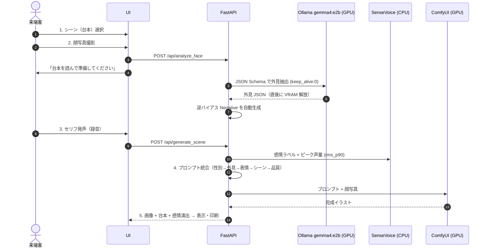
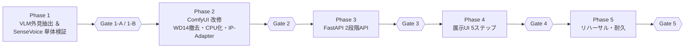

# StoryWeaver Live — 全体実装計画書 (v6.2)

- **改訂日**: 2026-10-17
- **ステータス**: 全体計画 再構築済み（各 Phase の詳細手順は着手時に本書へ追記）
- **対象イベント**: AIクリエーターズマーケット
- **対象マシン**: ThinkPad X1 Extreme (RTX 3080 Laptop 16GB / RAM 32GB / Windows 11)
- **原典**: [gemini-code-1792190494455.md](file:///c:/antigravity/StoryWeaver/Attached_doc/gemini-code-1792190494455.md)

> [!IMPORTANT]
> 本書は全工程の **唯一の正本計画** です。各 Phase 末尾の **Gate** を通過するまで次 Phase に進みません。
> 旧計画（v1〜v4 系: Phase 1〜6 / Phase 3-A〜C）は Git 履歴に保全し、本書で置き換えました。

---

## 0. 再構築の経緯（なぜ計画を作り直すのか）

旧 Phase 3（ComfyUI 単体で本人同一性を確立）は、以下の構造的限界により収束しなかった。

| 旧 Phase 3 で詰まった点 | 根本原因 | v6.2 での対処 |
| :--- | :--- | :--- |
| 坊主・短髪・額が再現されない | WD14 Tagger は実写の髪型を認識できない／InstantID は髪型特徴を持たない | **VLM（`gemma4:e2b`）+ JSON Schema** で外見を構造化抽出し、前髪バイアス打消しネガティブを自動生成 |
| 頭部形状・眼鏡が維持されない | InstantID は目鼻口の配置のみ | **IP-Adapter Plus Face** を併用（頭部・生え際・眼鏡の視覚補助） |
| FaceDetailer 前後で差が出ない | 全体プロンプト流用・顔専用プロンプトなし | **FaceDetailer 専用 Positive** を独立系統化（シーンタグ除外） |
| 写真の表情とセリフの感情が衝突 | 写真から表情タグを拾っていた | 写真からは表情を **一切抽出しない**。表情は音声感情のみで決定 |
| LLM 生成・画像生成の VRAM 競合 | 同時ロード | 撮影時に VLM 実行→`keep_alive: 0` で解放。SenseVoice・InsightFace は **CPU 固定** |

---

## 1. 設計の核心

1. **来場者体験フロー連動型・非同期パイプライン**: 撮影時（フェーズA）に裏で VLM 外見抽出を完了させ、発声後（フェーズB）の待ち時間を最小化し VRAM 競合を排除する。
2. **WD14 Tagger 廃止 → VLM（`gemma4:e2b` + JSON Schema）**: 髪型・生え際・眼鏡・性別と、前髪バイアス打消し用ネガティブを、ハードコーディングなしで構造化出力する。
3. **台本プリセット方式 ＆ SenseVoice 感情 × 声量ハイブリッド判定**: セリフ・構図は事前定義。音声からは CPU 実行の SenseVoice と AGC 無効化済みピーク音量で「感情と熱量」を抽出し表情へ反映する。

---

## 2. システム構成

| コンポーネント | 実行先 | 役割 |
| :--- | :--- | :--- |
| フロントエンド UI | ブラウザ | シーン選択・撮影・台本表示・録音（`autoGainControl: false`, 16kHz WAV）・アートカード表示/印刷 |
| FastAPI (`server.py`) | CPU | `/api/analyze_face` と `/api/generate_scene` の2段階 API、セッション管理、プロンプト統合 |
| Ollama `gemma4:e2b` | GPU（撮影直後のみ） | 顔写真の外見 JSON 抽出。完了後 `keep_alive: 0` で即解放 |
| SenseVoiceSmall | **CPU 固定** | 感情ラベル抽出（VRAM 0 MB） |
| ComfyUI | GPU | Animagine XL 3.1 FP8 + InstantID（InsightFace は **CPU**）+ IP-Adapter Plus Face + FaceDetailer |

### 来場者フローと裏処理

---

## 3. 共通仕様

### 3.1 シーンプリセット（`presets.json`）

| ID | シーン | 台本セリフ | `scene_prompt` |
| :--- | :--- | :--- | :--- |
| `scene_01` | 覚醒の剣士 | 「まだだ…俺は絶対に諦めない」 | `fantasy anime, dramatic battlefield, dynamic pose, drawing a glowing legendary sword, leaning forward, flying sparks, cinematic lighting` |
| `scene_02` | 大魔法の発動 | 「闇を照らせ、これが私の全力だ」 | `magic academy anime, casting a giant arcane spell, glowing magic circle, floating debris, wind blowing, dynamic angle, vibrant colors` |
| `scene_03` | サイバーパンクの切り札 | 「ターゲット捕捉。これよりシステムを突破する」 | `cyberpunk anime, neon city night background, futuristic tactical gear, holographic visor display, cool action pose, high contrast` |
| `scene_04` | 栄光のフィナーレ | 「みんな、本当にありがとう。最高の気分だ」 | `bright fantasy festival, confetti and glowing light particles, triumphant pose, raising hand, warm sunlight, masterpiece scenery` |

### 3.2 感情 × 声量 → 表情プロンプト

| SenseVoice | ピーク音量 `rms_p90` | 判定 | `expression_prompt` |
| :--- | :--- | :--- | :--- |
| `ANGRY` | 任意 | BURNING | `shouting, fierce determination, intense eyes, open mouth, battle cry, dynamic expression` |
| `NEUTRAL` | 閾値以上 | BURNING（昇格） | 同上 |
| `HAPPY` | 任意 | JOYFUL | `confident smile, bright expressive eyes, joyful and energetic expression` |
| `SAD` | 任意 | EMOTIONAL | `tearful eyes, emotional expression, biting lip, dramatic sorrow, desperate look` |
| `NEUTRAL` | 閾値未満 | COOL | `calm and composed expression, sharp gaze, cool determination, slight smirk` |

- 閾値 `BURNING_DB_THRESHOLD`（初期値 `-12.0 dBFS`）は `config.json` で外部設定化する。

### 3.3 プロンプトテンプレート（Animagine XL 作法：人数・性別を先頭、品質を末尾）

| 系統 | テンプレート |
| :--- | :--- |
| `Node_Pos_Base` | `{gender_tag}, solo, {physical_traits}, {expression_prompt}, {scene_prompt}, masterpiece, best quality, very aesthetic, absurdres` |
| `Node_Neg_Base` | `{negative_hair_bias}, nsfw, lowres, (bad), text, error, fewer, extra, missing, worst quality, jpeg artifacts, low quality, watermark, unfinished, displeasing, oldest, early, chromatic aberration, signature, extra digits, artistic error, username, scan, [abstract], photorealistic, realistic, 3d` |
| `Node_Pos_FD` | `{gender_tag}, solo, close-up, face focus, {physical_traits}, {expression_prompt}, detailed anime eyes, masterpiece, best quality, very aesthetic, absurdres`（`{scene_prompt}` は除外） |

- `{negative_hair_bias}`: 前髪なし判定時に `(bangs:1.3), (fringe:1.3), hair over forehead` を自動挿入。
- 最終的な順序・重みは Phase 2 Gate で確定する。

### 3.4 VRAM 配分（上限 14.5 GB 厳守）

| タイミング | 内訳 | ピーク |
| :--- | :--- | :--- |
| 撮影直後（VLM 実行） | OS 1.5 + Ollama 3.5（完了後 0 へ）+ ComfyUI 待機 6.0 | 約 11.0 GB |
| 発声後（画像生成） | OS 1.5 + SenseVoice 0（CPU）+ InsightFace 0（CPU）+ Ollama 0 + ComfyUI 11.0 | 約 12.5 GB |

### 3.5 時間制約

- 画質・本人同一性の確立までは **生成時間 最大 7 分（420 秒）許容**、ComfyUI 待機タイムアウト 500 秒（[AGENTS.md](file:///c:/antigravity/StoryWeaver/AGENTS.md) 準拠）。
- Ollama 通信タイムアウト 30 秒。SenseVoice 推論 0.5 秒以内。
- 時間短縮は Phase 5（リハーサル）で画質非劣化を条件に実施する。

---

## 4. 環境・資産スナップショット（2026-10-17 確認）

| 区分 | 状態 |
| :--- | :--- |
| Pinokio / ComfyUI | ✅ 稼働（`C:\pinokio\api\comfy.git\app`） |
| Ollama | ✅ `gemma4:e2b` 導入済み |
| Checkpoint | ✅ `animagine-xl-3.1.float8_e4m3fn.safetensors` |
| InstantID | ✅ `ip-adapter.bin` / ControlNet `diffusion_pytorch_model.safetensors` / `antelopev2` |
| IP-Adapter Plus Face | ✅ `ip-adapter-plus-face_sdxl_vit-h.safetensors` + `CLIP-ViT-H-14-laion2B-s32B-b79K.safetensors` |
| FaceDetailer | ✅ `face_yolov8m.pt` / SAM `sam_vit_b_01ec64.pth` |
| SenseVoiceSmall | ☐ Phase 1-B で導入・CPU 動作確認 |
| 既存ワークフロー | `StoryWeaver(update).json`, `StoryWeaver_261014.json`（Phase 2 の改修元） |

---

## 5. 全体ロードマップ

### Phase 1: VLM 外見抽出 ＆ SenseVoice 感情・音量の単体検証

**1-A: `gemma4:e2b` による JSON Schema 外見抽出**（`verify_step1_vlm.py`）
- `keep_alive=0` + Pydantic JSON Schema `format` 指定。
- スキーマ: `gender_tag`(1boy/1girl) / `hair_length`(buzz cut〜long hair, bald) / `hair_style_details` / `has_bangs` / `exposed_forehead` / `glasses` / `facial_hair`。**表情フィールドは持たない**。
- ルール変換: `has_bangs==False` または `exposed_forehead==True` → `exposed forehead` 付与 + `negative_hair_bias` セット。
- `load_duration` / `eval_duration` / 壁時計 / VRAM 解放後使用量を `vlm_benchmark.csv` に記録。

| # | Gate 1-A | 基準 | 合否 |
| :-: | :--- | :--- | :-: |
| 1 | JSON 安定性 | 5 パターンでパースエラー 0% | ☐ |
| 2 | 短髪・額露出 | `buzz cut, very short hair, exposed forehead` + 逆バイアス出力 | ☐ |
| 3 | 前髪あり | `has_bangs: true` かつ `negative_hair_bias` 空 | ☐ |
| 4 | 表情排除 | `physical_traits` に表情語が含まれない | ☐ |
| 5 | 計測記録 | ロード・推論時間・解放後 VRAM がログに残る | ☐ |

**1-B: SenseVoice 感情認識・ピーク音量 ＆ CPU 動作**（`verify_step1_sensevoice.py`）
- `AutoModel(model="iic/SenseVoiceSmall", device="cpu")`。
- 20ms フレーム RMS → 無音除外 → 90 パーセンタイル dBFS を算出し閾値判定。
- WAV / webm(opus) 入力でデコードエラーなし。

| # | Gate 1-B | 基準 | 合否 |
| :-: | :--- | :--- | :-: |
| 1 | VRAM 消費ゼロ | ロード前後の増分 0 MB | ☐ |
| 2 | 推論速度 | 3〜5 秒音声で 0.5 秒以内 | ☐ |
| 3 | ハイブリッド判定 | 叫び・明るい声・クールな声で表情が切替 | ☐ |
| 4 | 閾値外部設定 | 閾値変更で昇格感度が変わる | ☐ |

### Phase 2: ComfyUI ワークフロー改修 → `storyweaver_anime_api.json`

| 区分 | 内容 |
| :--- | :--- |
| 削除 | `WD14Tagger\|pysssss`、`StringConcatenate`（結合は FastAPI 側） |
| InstantID Face Analysis | **`provider: CPU`**（CUDA だと onnxruntime が約 2GB 専有） |
| IP-Adapter Plus Face (SDXL) | `weight: 0.35〜0.40`, `end_at: 0.70` |
| ApplyInstantIDAdvanced（Base） | `ip_weight: 0.70`, `cn_strength: 0.15`, `end_at: 0.85` |
| CLIPTextEncode | `Node_Pos_Base` / `Node_Neg_Base` / `Node_Pos_FD` の 3 系統 |
| FaceDetailer | `denoise: 0.25〜0.28`, `bbox_crop_factor: 1.4`, `feather: 10`／FD 側 InstantID `ip_weight: 0.45`, `cn_strength: 0.0` |

> [!NOTE]
> **仕様書からの変更根拠**: `storyweaver_live.md` の InstantID 重み `0.55〜0.60` を Base で `0.70` に引き上げる。IP-Adapter Plus Face で頭部を補助しつつ `cn_strength: 0.15` で骨格拘束を外すため、顔特徴の担保を IP 側に寄せる必要があるため。Lightning 4-step は画質確立まで不採用（[AGENTS.md](file:///c:/antigravity/StoryWeaver/AGENTS.md) §3②）。

| # | Gate 2 | 基準 | 合否 |
| :-: | :--- | :--- | :-: |
| 1 | 手動修正ゼロの両立 | Phase 1 の自動タグのみで、髪型・眼鏡・顔立ち／動的ポーズ／指定表情が両立 | ☐ |
| 2 | VRAM | 生成中ピーク ≤ 13.0 GB、InsightFace による増分なし | ☐ |
| 3 | テンプレート確定 | プロンプト順序・重みを確定し本書 3.3 を更新 | ☐ |

### Phase 3: FastAPI 2 段階エンドポイント（`server.py`）

| API | 入力 | 処理 | 出力 |
| :--- | :--- | :--- | :--- |
| `POST /api/analyze_face` | `face_image` | ComfyUI `input` へ配置 → VLM 抽出（`keep_alive:0`）→ 逆バイアス生成 → 計測ログ | `session_id, image_filename, gender_tag, physical_traits, negative_hair_bias, vlm_metrics` |
| `POST /api/generate_scene` | `audio_file, scene_id, session_id` | analyze 実行中なら `await` → SenseVoice + 音量 → プリセット取得 → プロンプト統合 → ComfyUI 送信 → PNG 保存（`outputs/cards/`） | `imageBase64, emotion, rms_db, script_text, final_prompt` |

| # | Gate 3 | 基準 | 合否 |
| :-: | :--- | :--- | :-: |
| 1 | 正常系 | 2 API が連続で正常応答し画像が返る | ☐ |
| 2 | 競合安全 | analyze 完了前の generate でも待機して正常完了 | ☐ |
| 3 | 異常系 | Ollama/ComfyUI 停止・タイムアウト時に明示エラー、ハングなし | ☐ |
| 4 | 後始末 | 顔画像・音声の一時ファイルがリークしない | ☐ |

### Phase 4: 展示用フロントエンド（5 ステップ・ウィザード）

1. シーン選択（スタッフ用に音量閾値のリアルタイム調整）
2. カメラ撮影 → 裏で `/api/analyze_face` 非同期送信、即画面遷移
3. 台本表示 ＆ 録音（`autoGainControl: false, noiseSuppression: true, echoCancellation: true`、16kHz モノラル WAV）
4. 生成中演出（感情エネルギー表示）
5. 完成アートカード表示（台本・ロゴ合成）＋ PNG 保存・印刷

| # | Gate 4 | 基準 | 合否 |
| :-: | :--- | :--- | :-: |
| 1 | E2E | ブラウザから 5 ステップ通しで生成・表示・保存成功 | ☐ |
| 2 | 録音品質 | AGC 無効で声量差が `rms_db` に反映される | ☐ |

### Phase 5: 展示本番リハーサル・耐久テスト

| # | Gate 5 | 基準 | 合否 |
| :-: | :--- | :--- | :-: |
| 1 | 多様性 | 短髪男性・長髪女性・眼鏡有無など 5 パターン以上で本人性 OK | ☐ |
| 2 | 会場音 | 環境音下で閾値キャリブレーション完了 | ☐ |
| 3 | 耐久 | 10 回連続でロード時間推移を記録、VRAM ≤ 14.5 GB、OOM ゼロ | ☐ |
| 4 | 時間短縮 | 画質非劣化の範囲で生成時間を短縮し、運用上限を確定 | ☐ |

---

## 6. 運用ルール

- 計画・手順・検証記録は **本書と既存ファイルのみ** で管理し、新規ファイルを勝手に増やさない（検証スクリプト等の成果物は除く）。
- 各 Phase の詳細手順・実行記録は、その Phase 着手時に本書の該当節へ追記する。
- 意思決定は [DEVELOPMENT_LOG.md](file:///c:/antigravity/StoryWeaver/docs/DEVELOPMENT_LOG.md) に記録し、Git コミットする。
- 旧 Phase 3 の検証記録は [phase3_revision_plan.md](file:///c:/antigravity/StoryWeaver/docs/plans/phase3_revision_plan.md)（アーカイブ）を参照。
