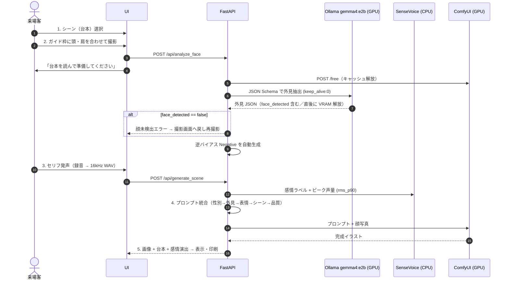
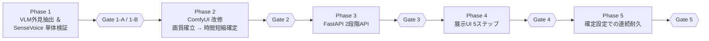

# StoryWeaver Live — 全体実装計画書 (v6.3)

- **改訂日**: 2026-10-17（v6.3: 手戻り・展示トラブル防止の5点を反映）
- **ステータス**: 全体計画 再構築済み（各 Phase の詳細手順は着手時に本書へ追記）
- **対象イベント**: AIクリエーターズマーケット
- **対象マシン**: ThinkPad X1 Extreme (RTX 3080 Laptop 16GB / RAM 32GB / Windows 11)
- **原典**: [gemini-code-1792190494455.md](file:///c:/antigravity/StoryWeaver/Attached_doc/gemini-code-1792190494455.md)

> [!IMPORTANT]
> 本書は全工程の **唯一の正本計画** です。各 Phase 末尾の **Gate** を通過するまで次 Phase に進みません。
> 旧計画（v1〜v4 系: Phase 1〜6 / Phase 3-A〜C）は Git 履歴に保全し、本書で置き換えました。

---

## 0. 再構築の経緯（なぜ計画を作り直すのか）

旧 Phase 3（ComfyUI 単体で本人同一性を確立）は、以下の構造的限界により収束しなかった。

| 旧 Phase 3 で詰まった点 | 根本原因 | v6.2 での対処 |
| :--- | :--- | :--- |
| 坊主・短髪・額が再現されない | WD14 Tagger は実写の髪型を認識できない／InstantID は髪型特徴を持たない | **VLM（`gemma4:e2b`）+ JSON Schema** で外見を構造化抽出し、前髪バイアス打消しネガティブを自動生成 |
| 頭部形状・眼鏡が維持されない | InstantID は目鼻口の配置のみ | **IP-Adapter Plus Face** を併用（頭部・生え際・眼鏡の視覚補助） |
| FaceDetailer 前後で差が出ない | 全体プロンプト流用・顔専用プロンプトなし | **FaceDetailer 専用 Positive** を独立系統化（シーンタグ除外） |
| 写真の表情とセリフの感情が衝突 | 写真から表情タグを拾っていた | 写真からは表情を **一切抽出しない**。表情は音声感情のみで決定 |
| LLM 生成・画像生成の VRAM 競合 | 同時ロード | 撮影時に VLM 実行→`keep_alive: 0` で解放。SenseVoice・InsightFace は **CPU 固定** |

---

## 1. 設計の核心

1. **来場者体験フロー連動型・非同期パイプライン**: 撮影時（フェーズA）に裏で VLM 外見抽出を完了させ、発声後（フェーズB）の待ち時間を最小化し VRAM 競合を排除する。
2. **WD14 Tagger 廃止 → VLM（`gemma4:e2b` + JSON Schema）**: 髪型・生え際・眼鏡・性別と、前髪バイアス打消し用ネガティブを、ハードコーディングなしで構造化出力する。
3. **台本プリセット方式 ＆ SenseVoice 感情 × 声量ハイブリッド判定**: セリフ・構図は事前定義。音声からは CPU 実行の SenseVoice と AGC 無効化済みピーク音量で「感情と熱量」を抽出し表情へ反映する。

---

## 2. システム構成

| コンポーネント | 実行先 | 役割 |
| :--- | :--- | :--- |
| フロントエンド UI | ブラウザ | シーン選択・撮影（頭・肩ガイド枠オーバーレイ／顔未検出時の再撮影）・台本表示・録音（AGC/NS/EC すべて無効）・アートカード表示/印刷 |
| FastAPI (`server.py`) | CPU | `/api/analyze_face` と `/api/generate_scene` の2段階 API、セッション管理、プロンプト統合 |
| Ollama `gemma4:e2b` | GPU（撮影直後のみ） | 顔写真の外見 JSON 抽出。完了後 `keep_alive: 0` で即解放 |
| SenseVoiceSmall | **CPU 固定** | 感情ラベル抽出（VRAM 0 MB） |
| ComfyUI | GPU | Animagine XL 3.1 FP8 + InstantID（InsightFace は **CPU**）+ IP-Adapter Plus Face + FaceDetailer |

### 音声データ受け渡し仕様（全 Phase 共通・統一）

- **ブラウザ側で `AudioContext`（`sampleRate: 16000`）を用いて 16kHz モノラル WAV（16bit PCM）にエンコードしてから送信する**。FastAPI は WAV のみを受け付ける。
- 採用理由: `MediaRecorder` は WAV 直接出力に非対応のため自前エンコードが必要。サーバ側の ffmpeg 依存とデコード工程を排除でき、非可逆圧縮（opus）による `rms_p90` の歪みも避けられる。

### 来場者フローと裏処理



---

## 3. 共通仕様

### 3.1 シーンプリセット（`presets.json`）

| ID | シーン | 台本セリフ | `scene_prompt` | `scene_neg_prompt`（任意） |
| :--- | :--- | :--- | :--- | :--- |
| `scene_01` | 赤ずきんちゃん | 「おまえを　一口で飲み込んでしまうためだ」 | `dark fairytale anime, spooky forest background, upper body, looking at viewer, dynamic foreshortening, stylized wolf costume, wolf ears hood, lunging forward, dramatic pose, cinematic backlighting, rim light` | `""`（例: `modern buildings, cars` 等をシーン別に指定可） |
| `scene_02` | 大魔法の発動 | 「闇を照らせ、これが私の全力だ」 | `magic academy anime, casting a giant arcane spell, glowing magic circle, floating debris, wind blowing, dynamic angle, vibrant colors` | `""` |
| `scene_03` | サイバーパンクの切り札 | 「ターゲット捕捉。これよりシステムを突破する」 | `cyberpunk anime, neon city night background, futuristic tactical gear, holographic visor display, cool action pose, high contrast` | `""` |
| `scene_04` | 栄光のフィナーレ | 「みんな、本当にありがとう。最高の気分だ」 | `bright fantasy festival, confetti and glowing light particles, triumphant pose, raising hand, warm sunlight, masterpiece scenery` | `""` |

- `scene_neg_prompt`: シーン固有で排除したい要素（例: ファンタジー世界における現代建築・銃器など）を指定する文字列フィールド（初期値 `""`）。空欄時は共通ネガティブ（`NEG_BASE`）および外見逆バイアス（`negative_hair_bias`）のみが適用される。

### 3.2 感情 × 声量 → 表情プロンプト

| SenseVoice | ピーク音量 `rms_p90` | 判定 | `expression_prompt` |
| :--- | :--- | :--- | :--- |
| `ANGRY` | 任意 | BURNING | `shouting, fierce determination, intense eyes, open mouth, battle cry, dynamic expression` |
| `NEUTRAL` | 閾値以上 | BURNING（昇格） | 同上 |
| `HAPPY` | 任意 | JOYFUL | `confident smile, bright expressive eyes, joyful and energetic expression` |
| `SAD` | 任意 | EMOTIONAL | `tearful eyes, emotional expression, biting lip, dramatic sorrow, desperate look` |
| `NEUTRAL` | 閾値未満 | COOL | `calm and composed expression, sharp gaze, cool determination, slight smirk` |

- 閾値 `BURNING_DB_THRESHOLD`（初期値 `-12.0 dBFS`）は `config.json` で外部設定化する。

### 3.3 プロンプトテンプレート（Animagine XL 作法：人数・性別を先頭、品質を末尾）

| 系統 | テンプレート |
| :--- | :--- |
| `Node_Pos_Base` | `{gender_tag}, solo, {physical_traits}, {expression_prompt}, {scene_prompt}, masterpiece, best quality, very aesthetic, absurdres` |
| `Node_Neg_Base` | `{negative_hair_bias}, {scene_neg_prompt}, nsfw, lowres, (bad), text, error, fewer, extra, missing, worst quality, jpeg artifacts, low quality, watermark, unfinished, displeasing, oldest, early, chromatic aberration, signature, extra digits, artistic error, username, scan, [abstract], photorealistic, realistic, 3d`（※空の要素は除外して `, ` 結合） |
| `Node_Pos_FD`（**案B: 表情専念・正式採用**） | `{gender_tag}, solo, close-up, face focus, {expression_prompt}, detailed anime eyes, masterpiece, best quality, very aesthetic, absurdres`（`{physical_traits}` の髪型・眼鏡タグを除外） |
| `Node_Pos_FD`（案A: 参考・原案） | `{gender_tag}, solo, close-up, face focus, {physical_traits}, {expression_prompt}, detailed anime eyes, masterpiece, best quality, very aesthetic, absurdres`（`{scene_prompt}` は除外） |

- `{negative_hair_bias}`: 前髪なし判定時に `(bangs:1.3), (fringe:1.3), hair over forehead` を自動挿入（超短髪時は `ahoge, spiky hair, hair over ears, (bob cut:1.2)` を追加）。
- `{scene_neg_prompt}`: シーン別に設定された追加ネガティブプロンプト（`presets.json` の `scene_neg_prompt`）。空文字でない場合のみ `{negative_hair_bias}` の直後・共通 `NEG_BASE` の直前に結合される。
- **FD プロンプトの確定（案B）**: FaceDetailer は `bbox_crop_factor: 1.4` の狭いクロップを `denoise: 0.25〜0.28` で再描画するため、頭髪・眼鏡は Base 生成結果が維持される。髪型・眼鏡タグの再注入による二重描画を防ぐため、**案B（表情専念）を正式採用**。
- 最終的な品質タグ等の詳細調整はプロンプト修正にて継続。

### 3.4 VRAM 配分（上限 14.5 GB 厳守）

| タイミング | 内訳 | ピーク |
| :--- | :--- | :--- |
| 撮影直後（VLM 実行） | OS 1.5 + Ollama 3.5（完了後 0 へ）+ ComfyUI 待機 6.0（`/free` 実行後） | 約 11.0 GB |
| 発声後（画像生成） | OS 1.5 + SenseVoice 0（CPU）+ InsightFace 0（CPU）+ Ollama 0 + ComfyUI 11.0 | 約 12.5 GB |

> [!WARNING]
> **2人目以降のキャッシュ残留対策**: ComfyUI は生成完了後もモデル群を VRAM にキャッシュし続けるため、2人目の撮影時に待機 VRAM が 6.0 GB に戻らず（約 11 GB 占有）、Ollama ロードで 14.5 GB を超過する恐れがある。
> このため `/api/analyze_face` では **Ollama 呼び出し直前に ComfyUI の `POST /free`（`{"unload_models": true, "free_memory": true}`）を呼び出し**、`nvidia-smi` 等で待機 VRAM が規定値以下に下がったことを確認してから Ollama を呼ぶ。`/free` が効かない場合の代替として ComfyUI 起動オプション（`--disable-smart-memory` 等）による VRAM 保持制御を Phase 3 で検証する。

### 3.5 時間制約

- 画質・本人同一性の確立までは **生成時間 最大 7 分（420 秒）許容**、ComfyUI 待機タイムアウト 500 秒（[AGENTS.md](file:///c:/antigravity/StoryWeaver/AGENTS.md) 準拠）。
- Ollama 通信タイムアウト 30 秒。SenseVoice 推論 0.5 秒以内。
- **時間短縮は Phase 2 後半で実施・確定する**（前倒し）。画質・本人同一性を確立した直後に、画質が劣化しない最小ステップ数・サンプラー設定を同じ重みバランスのまま検証し、展示運用の目標生成時間を確定する。Phase 5 では確定設定を変更しない。

---

## 4. 環境・資産スナップショット（2026-10-17 確認）

| 区分 | 状態 |
| :--- | :--- |
| Pinokio / ComfyUI | ✅ 稼働（`C:\pinokio\api\comfy.git\app`） |
| Ollama | ✅ `gemma4:e2b` 導入済み |
| Checkpoint | ✅ `animagine-xl-3.1.float8_e4m3fn.safetensors` |
| InstantID | ✅ `ip-adapter.bin` / ControlNet `diffusion_pytorch_model.safetensors` / `antelopev2` |
| IP-Adapter Plus Face | ✅ `ip-adapter-plus-face_sdxl_vit-h.safetensors` + `CLIP-ViT-H-14-laion2B-s32B-b79K.safetensors` |
| FaceDetailer | ✅ `face_yolov8m.pt` / SAM `sam_vit_b_01ec64.pth`（**SAM なし・bbox＋`feather: 10` 構成を優先検証**。SAM は追加 VRAM を消費するため、bbox のみで合成が不自然な場合に限り採用） |
| SenseVoiceSmall | ☐ Phase 1-B で導入・CPU 動作確認 |
| 既存ワークフロー | `StoryWeaver(update).json`, `StoryWeaver_261014.json`（Phase 2 の改修元） |

---

## 5. 全体ロードマップ



### Phase 1: VLM 外見抽出 ＆ SenseVoice 感情・音量の単体検証

**1-A: `gemma4:e2b` による JSON Schema 外見抽出**（`verify_step1_vlm.py`）
- `keep_alive=0` + Pydantic JSON Schema `format` 指定。
- スキーマ: `face_detected`(bool) / `gender_tag`(1boy/1girl) / `hair_length`(buzz cut〜long hair, bald) / `hair_style_details` / `has_bangs` / `exposed_forehead` / `glasses` / `facial_hair`。**表情フィールドは持たない**。`face_detected` は Phase 3 の再撮影ガードに使用。
- ルール変換: `has_bangs==False` または `exposed_forehead==True` → `exposed forehead` 付与 + `negative_hair_bias` セット。
- `load_duration` / `eval_duration` / 壁時計 / VRAM 解放後使用量を `vlm_benchmark.csv` に記録。
- **検証手順**:
  1. `ollama list` で `gemma4:e2b` が存在することを確認（必要に応じて `ollama serve`）。
  2. `test_assets/faces/` に検証画像（短髪、女性/前髪あり、顔隠れ等）を配置。
  3. スクリプトを実行し、JSON パース安定性・表情排除・逆バイアス・`keep_alive: 0` による VRAM 即時解放を確認。
- **実行コマンド**:
  ```bash
  python verify_step1_vlm.py --faces-dir test_assets/faces --model gemma4:e2b
  ```

| # | Gate 1-A | 基準 | 合否 |
| :-: | :--- | :--- | :-: |
| 1 | JSON 安定性 | 5 パターンでパースエラー 0% | ☑ 合格 |
| 2 | 短髪・額露出 | `buzz cut, very short hair, exposed forehead` + 逆バイアス出力 | ☑ 合格 |
| 3 | 前髪あり | `has_bangs: true` かつ `negative_hair_bias` 空 | ☑ 合格 |
| 4 | 表情排除 | `physical_traits` に表情語が含まれない | ☑ 合格 |
| 5 | 計測記録 | ロード・推論時間・解放後 VRAM がログに残る | ☑ 合格 |
| 6 | 顔未検出判定 | 顔が隠れた／写っていない画像で `face_detected: false` となる | ☑ 合格 |

- **Gate 1-A 実測エビデンス（`vlm_benchmark.csv` より抜粋）**:

**【v2: 2026-10-18 再評価】髪長さ判定基準の厳格化後**（[vlm.md](file:///c:/antigravity/StoryWeaver/Attached_doc/vlm.md) 準拠：スキーマ `description` 厳格化 / `SYSTEM_PROMPT` §4 HAIR LENGTH CRITERIA 追加 / 超短髪時のタグ展開＋ネガティブ追加。強制フォールバックは不採用）

| テスト画像 | 特徴 | `hair_length` | physical_traits | negative_hair_bias | 壁時計 | 解放後VRAM | 判定 |
| :--- | :--- | :-: | :--- | :--- | :-: | :-: | :-: |
| `koji-bose.jpg` | 坊主〜ベリーショート・眼鏡 (男) | **buzz cut** | `1boy, buzz cut, very short hair, dark hair, closely cropped, glasses, exposed forehead` | `(bangs:1.3), (fringe:1.3), hair over forehead, ahoge, spiky hair, hair over ears, (bob cut:1.2)` | 22.84s ※ | 758.0 MB | 合格 |
| `koji-women-.jpg`| 長髪・眼鏡・額露出 (女) | long hair | `1girl, long hair, dark hair, straight, glasses, exposed forehead` | `(bangs:1.3), (fringe:1.3), hair over forehead` | 13.48s | 773.0 MB | 合格 |
| `yae.jpg` | 短髪・前髪あり (女) | short hair | `1girl, short hair, black hair, short cut, bangs` | なし（空文字） | 11.83s | 826.1 MB | 合格 |
| `test_noface.jpg` | 顔なし黒一色画像 | — | 再評価未実施（画像がフォルダに未配置）。v1 で `face_detected: false` 確認済み | — | — | — | v1 合格 |

※ 初回のためロード 15.0s を含む（30s 枠内）。

<details><summary>v1（2026-10-17・旧スキーマ）: koji-bose が <code>short hair</code> と判定され、Phase 2 で女性ショートカット風に生成された</summary>

| テスト画像 | 抽出属性 | 逆バイアス | 壁時計 | 解放後VRAM |
| :--- | :--- | :--- | :-: | :-: |
| `koji-bose.jpg` | `1boy, short hair, dark hair, glasses, exposed forehead` | `(bangs:1.3), (fringe:1.3), hair over forehead` | 10.77s | 614.7 MB |
| `koji-women-.jpg`| `1girl, long hair, Black hair, straight texture, glasses, exposed forehead` | `(bangs:1.3), (fringe:1.3), hair over forehead` | 17.13s | 614.7 MB |
| `yae.jpg` | `1girl, short hair, black hair, straight texture, bangs` | なし（空文字） | 12.58s | 629.8 MB |
| `test_noface.jpg` | `face_detected: false`, 全属性空/デフォルト値 | なし（空文字） | 11.52s | 614.7 MB |

</details>

> [!NOTE]
> **運用知見（コールドスタート対策）**: 完全コールドスタート時の初回推論のみモデルのSSD/VRAM読込に時間がかかりタイムアウト（30秒超過）する事象を確認。FastAPI サーバー起動時にバックグラウンドで1回ダミーの空推論を実行してウォームアップを完了させる設計とする（Phase 3）。


**1-B: SenseVoice 感情認識・ピーク音量 ＆ CPU 動作**（`verify_step1_sensevoice.py`）
- `AutoModel(model="iic/SenseVoiceSmall", device="cpu")`。
- 20ms フレーム RMS → 無音除外 → 90 パーセンタイル dBFS を算出し閾値判定。
- 入力は共通仕様どおり **16kHz モノラル WAV（16bit PCM）** に統一し、ブラウザ `AudioContext` 出力相当の WAV でデコードエラーがないことを確認する。
- 録音条件はブラウザ側 `autoGainControl / noiseSuppression / echoCancellation` すべて `false` 相当（叫び声のピークが減衰しない生音）で評価する。
- **検証手順**:
  1. `python record_test_audio.py` を実行してマイクからテスト音声を録音（または `--generate-synthetic` で合成音を生成）。
  2. `python verify_step1_sensevoice.py --audio-dir test_assets/audio` を実行。
  3. モデルロード前後の VRAM 増分が 0 MB であること、推論速度（0.5秒以内）、`rms_p90` による声量判定と感情タグのハイブリッド連動を確認。
  4. `--threshold` オプションで `BURNING_DB_THRESHOLD` を一時変更し、感度切り替え動作を検証。
- **実行コマンド**:
  ```bash
  # テスト録音（マイク対話式）
  python record_test_audio.py
  # 検証スクリプト実行
  python verify_step1_sensevoice.py --audio-dir test_assets/audio
  ```

| # | Gate 1-B | 基準 | 合否 |
| :-: | :--- | :--- | :-: |
| 1 | VRAM 消費ゼロ | ロード前後の増分 0 MB | ☑ 合格 |
| 2 | 推論速度 | 3〜5 秒音声で 0.5 秒以内 | ☑ 合格 |
| 3 | ハイブリッド判定 | 叫び・明るい声・クールな声で表情が切替 | ☑ 合格 |
| 4 | 閾値外部設定 | 閾値変更で昇格感度が変わる | ☑ 合格 |

- **Phase 1 実測サマリ（VLM ＆ SenseVoice 実機ベンチマーク）**:

| 項目 | モデル・設定 | 主要実測値 | Gate 基準との照合 |
| :--- | :--- | :--- | :--- |
| **VLM 外見抽出** | `gemma4:e2b`<br>(Ollama, `keep_alive: 0`) | ・通常時ロード時間: 約 5.5s（コールド初回 15.0s）<br>・推論時間（eval）: 約 3.7〜4.7s<br>・壁時計合計: **11.8〜22.8s**（30s 枠内）<br>・解放後 VRAM: **758.0〜826.1 MB**（完全アンロード） | v2 再評価にて `koji-bose` の `buzz cut` 判定と超短髪ネガティブ付与を確認。全画像でパースエラー 0%・表情排除 100%（Gate 1-A 全基準クリア） |
| **SenseVoice 音声解析** | `iic/SenseVoiceSmall`<br>(funasr, `device="cpu"`) | ・ロード前後 VRAM 増分: **0.0 MB**<br>・3〜3.5s 音声推論速度: **0.31〜0.42s**<br>・音量計算: 20ms RMS・無音除外 `rms_p90` 算出<br>・感情 × 音量判定: `BURNING` 昇格・`JOYFUL`・`EMOTIONAL`・`COOL` 切替 | VRAM 完全分離・目標 0.5s 以内・ハイブリッド表情切替・閾値外部制御を確認（Gate 1-B 全基準クリア） |

### Phase 2: ComfyUI ワークフロー改修 → `storyweaver_anime_api.json`

| 区分 | 内容 |
| :--- | :--- |
| 削除 | `WD14Tagger\|pysssss`、`StringConcatenate`（結合は FastAPI 側） |
| InstantID Face Analysis | **`provider: CPU`**（CUDA だと onnxruntime が約 2GB 専有） |
| IP-Adapter Plus Face (SDXL) | `weight: 0.35〜0.40`, `end_at: 0.70` |
| ApplyInstantIDAdvanced（Base） | `ip_weight: 0.70`, `cn_strength: 0.15`, `end_at: 0.85` |
| CLIPTextEncode | `Node_Pos_Base` / `Node_Neg_Base` / `Node_Pos_FD` の 3 系統 |
| FaceDetailer | `denoise: 0.25〜0.28`, `bbox_crop_factor: 1.4`, `feather: 10`／FD 側 InstantID `ip_weight: 0.45`, `cn_strength: 0.0`／マスクは **SAM 未接続・`face_yolov8m.pt` bbox のみを優先検証**（VRAM 節約と自然な合成の両立）／プロンプトは 3.3 の案A/案B を比較 |

**Phase 2 の進め方（2段階）**
1. **前半: 画質・本人同一性の確立**（最大 7 分許容）— 重み・テンプレート・FD 構成（案A/B、SAM 有無）を確定。
2. **後半: 生成時間短縮の確定**（前倒し）— 前半の重みバランスを固定したまま、ステップ数・サンプラー・スケジューラ・FD steps を段階的に削減し、画質・本人同一性が劣化しない最小設定と目標生成時間を確定する。劣化が出た場合はその一段手前を採用する。

> [!NOTE]
> **仕様書からの変更根拠**: `storyweaver_live.md` の InstantID 重み `0.55〜0.60` を Base で `0.70` に引き上げる。IP-Adapter Plus Face で頭部を補助しつつ `cn_strength: 0.15` で骨格拘束を外すため、顔特徴の担保を IP 側に寄せる必要があるため。Lightning 4-step は画質確立まで不採用（[AGENTS.md](file:///c:/antigravity/StoryWeaver/AGENTS.md) §3②）。

#### 2.1 Phase 2 再評価プロンプト一覧（Phase 1-A v2 抽出結果の適用）

- 入力先: Node 12 `LoadImage` / Node 5 `CLIPTextEncode posi` / Node 6 `CLIPTextEncode nega` / Node 32 `CLIPTextEncode posi-fd`
- 外見タグは **Phase 1-A v2（2026-10-18）の `vlm_benchmark.csv` 出力をそのまま使用**（手動補正・追加の画像分析なし）。
- 固定条件: シーン `scene_01`（覚醒の剣士）/ 表情 `BURNING`。比較を外見タグの差だけに絞るため、シーン・表情・品質タグ・ワークフロー設定値は 3 画像で共通にする。
- テンプレート: §3.3 のとおり `{gender_tag}, solo, {physical_traits から gender_tag を除いたもの}, {expression}, {scene}, {quality}`。

**共通パーツ**

| 部品 | 内容 |
| :--- | :--- |
| `{expression}`（BURNING） | `shouting, fierce determination, intense eyes, open mouth, battle cry, dynamic expression` |
| `{scene}`（scene_01） | `fantasy anime, dramatic battlefield, dynamic pose, drawing a glowing legendary sword, leaning forward, flying sparks, cinematic lighting` |
| `{quality}` | `masterpiece, best quality, very aesthetic, absurdres` |
| `{neg_base}` | `nsfw, lowres, (bad), text, error, fewer, extra, missing, worst quality, jpeg artifacts, low quality, watermark, unfinished, displeasing, oldest, early, chromatic aberration, signature, extra digits, artistic error, username, scan, [abstract], photorealistic, realistic, 3d` |

> [!WARNING]
> 超短髪向けの追加ネガティブは重み `1.2` 以下に抑えている（強い重みを多数入れると画面全体のボケ・剣の構図崩れが出ることを確認済み。vlm.md §1-2）。手動で重みを上げないこと。

**画像別の差分**

| 画像 | 外見タグ（physical_traits） | negative_hair_bias | v1 からの変化 |
| :--- | :--- | :--- | :--- |
| `koji-bose.jpg` | `buzz cut, very short hair, dark hair, closely cropped, glasses, exposed forehead` | `(bangs:1.3), (fringe:1.3), hair over forehead, ahoge, spiky hair, hair over ears, (bob cut:1.2)` | **`short hair` → `buzz cut, very short hair`、超短髪ネガティブを追加**（今回の再評価の主対象） |
| `koji-women-.jpg` | `long hair, dark hair, straight, glasses, exposed forehead` | `(bangs:1.3), (fringe:1.3), hair over forehead` | 髪色・質感の表記ゆれのみ（回帰確認） |
| `yae.jpg` | `short hair, black hair, short cut, bangs` | なし | 表記ゆれのみ・前髪保護を維持（回帰確認） |

##### ① `koji-bose.jpg`（坊主〜ベリーショート・眼鏡 / 男性）— 主対象
- **Node 5（Base Positive）**:
  ```text
  1boy, solo, buzz cut, very short hair, dark hair, closely cropped, glasses, exposed forehead, shouting, fierce determination, intense eyes, open mouth, battle cry, dynamic expression, fantasy anime, dramatic battlefield, dynamic pose, drawing a glowing legendary sword, leaning forward, flying sparks, cinematic lighting, masterpiece, best quality, very aesthetic, absurdres
  ```
- **Node 6（Base Negative）**:
  ```text
  (bangs:1.3), (fringe:1.3), hair over forehead, ahoge, spiky hair, hair over ears, (bob cut:1.2), nsfw, lowres, (bad), text, error, fewer, extra, missing, worst quality, jpeg artifacts, low quality, watermark, unfinished, displeasing, oldest, early, chromatic aberration, signature, extra digits, artistic error, username, scan, [abstract], photorealistic, realistic, 3d
  ```
- **Node 32（FD 案B: 表情専念・優先）**:
  ```text
  1boy, solo, close-up, face focus, shouting, fierce determination, intense eyes, open mouth, battle cry, dynamic expression, detailed anime eyes, masterpiece, best quality, very aesthetic, absurdres
  ```
- **Node 32（FD 案A: 比較用）**:
  ```text
  1boy, solo, close-up, face focus, buzz cut, very short hair, dark hair, closely cropped, glasses, exposed forehead, shouting, fierce determination, intense eyes, open mouth, battle cry, dynamic expression, detailed anime eyes, masterpiece, best quality, very aesthetic, absurdres
  ```

##### ② `koji-women-.jpg`（長髪・眼鏡・額露出 / 女性）— 回帰確認
- **Node 5**:
  ```text
  1girl, solo, long hair, dark hair, straight, glasses, exposed forehead, shouting, fierce determination, intense eyes, open mouth, battle cry, dynamic expression, fantasy anime, dramatic battlefield, dynamic pose, drawing a glowing legendary sword, leaning forward, flying sparks, cinematic lighting, masterpiece, best quality, very aesthetic, absurdres
  ```
- **Node 6**:
  ```text
  (bangs:1.3), (fringe:1.3), hair over forehead, nsfw, lowres, (bad), text, error, fewer, extra, missing, worst quality, jpeg artifacts, low quality, watermark, unfinished, displeasing, oldest, early, chromatic aberration, signature, extra digits, artistic error, username, scan, [abstract], photorealistic, realistic, 3d
  ```
- **Node 32（案B）**:
  ```text
  1girl, solo, close-up, face focus, shouting, fierce determination, intense eyes, open mouth, battle cry, dynamic expression, detailed anime eyes, masterpiece, best quality, very aesthetic, absurdres
  ```
- **Node 32（案A）**:
  ```text
  1girl, solo, close-up, face focus, long hair, dark hair, straight, glasses, exposed forehead, shouting, fierce determination, intense eyes, open mouth, battle cry, dynamic expression, detailed anime eyes, masterpiece, best quality, very aesthetic, absurdres
  ```

##### ③ `yae.jpg`（短髪・前髪あり / 女性）— 回帰確認
- **Node 5**:
  ```text
  1girl, solo, short hair, black hair, short cut, bangs, shouting, fierce determination, intense eyes, open mouth, battle cry, dynamic expression, fantasy anime, dramatic battlefield, dynamic pose, drawing a glowing legendary sword, leaning forward, flying sparks, cinematic lighting, masterpiece, best quality, very aesthetic, absurdres
  ```
- **Node 6**（前髪ありのため前髪抑止タグは入れない）:
  ```text
  nsfw, lowres, (bad), text, error, fewer, extra, missing, worst quality, jpeg artifacts, low quality, watermark, unfinished, displeasing, oldest, early, chromatic aberration, signature, extra digits, artistic error, username, scan, [abstract], photorealistic, realistic, 3d
  ```
- **Node 32（案B）**:
  ```text
  1girl, solo, close-up, face focus, shouting, fierce determination, intense eyes, open mouth, battle cry, dynamic expression, detailed anime eyes, masterpiece, best quality, very aesthetic, absurdres
  ```
- **Node 32（案A）**:
  ```text
  1girl, solo, close-up, face focus, short hair, black hair, short cut, bangs, shouting, fierce determination, intense eyes, open mouth, battle cry, dynamic expression, detailed anime eyes, masterpiece, best quality, very aesthetic, absurdres
  ```

##### 対象外: `blue.jpg`
> [!NOTE]
> `blue.jpg` はフォルダにあるが Phase 1-A v2 の処理対象（3 枚）に入っておらず、VLM 抽出データがないため対象外とする。

##### 再評価の観点と記録

| # | 観点 | 対象 | 合格の目安 |
| :-: | :--- | :--- | :--- |
| R-1 | 髪型一致 | koji-bose | 頭の形に沿った坊主〜ベリーショート。アホ毛・耳にかかる毛・ボブのボリュームが出ない |
| R-2 | 画質・構図の非劣化 | koji-bose | 追加ネガティブで画面のボケや剣の構図崩れが起きない |
| R-3 | 回帰なし | koji-women / yae | v1 と同等の髪型（長髪・額出し / 前髪ありショート）が維持される |
| R-4 | FD 案A/B | 全画像 | 案B で髪・眼鏡が Base から崩れないか。案A でクロップ境界の不自然な生え際や二重フレームが出ないか |

| Run ID | 日付 | 画像 | FD 案 | R-1 | R-2 | R-3 | R-4 | 所感 |
| :--- | :--- | :--- | :-: | :-: | :-: | :-: | :-: | :--- |
| P2-v1-01 | 2026-10-18 | koji-bose（`short hair`） | — | ❌ | — | — | — | 顔はおおむね追従。髪が女性ショートカット程度まで伸びる → VLM 判定基準を厳格化（v2） |
| P2-v2-01 | 2026-10-18 | koji-bose（`buzz cut`） | B | ☑ | ☑ | — | ☑ | 髪型・眼鏡・顔立ちにVLM結果が反映。FD案はBで確定。VRAM問題なし、時間許容内。画質はプロンプト修正で詰める方針 |
| P2-v2-02 | 2026-10-18 | koji-women | B | — | — | ☑ | ☑ | 回帰確認 |
| P2-v2-03 | 2026-10-18 | yae | B | — | — | ☑ | ☑ | 回帰確認 |


| # | Gate 2 | 基準 | 合否 |
| :-: | :--- | :--- | :-: |
| 1 | 手動修正ゼロの両立 | Phase 1 の自動タグのみで、髪型・眼鏡・顔立ち／動的ポーズ／指定表情が両立 | ☑ 合格（VLM v2 結果の反映を確認） |
| 2 | VRAM | 生成中ピーク ≤ 13.0 GB、InsightFace による増分なし | ☑ 合格（問題なし） |
| 3 | テンプレート確定 | プロンプト順序・重みを確定し本書 3.3 を更新（FD 案A/B・SAM 有無の採否を含む） | ☑ 合格（FD は案B［表情専念］を正式採用） |
| 4 | 時間と画質の両立 | 展示運用で許容できる生成時間（目標秒数）と画質・本人同一性の両立設定を確定し、本書 3.5 に記録 | ⏳ 継続（時間は許容範囲内。画質はプロンプト修正で詰める方針） |

### Phase 3: FastAPI 2 段階エンドポイント（`server.py`）

| API | 入力 | 処理 | 出力 |
| :--- | :--- | :--- | :--- |
| `POST /api/analyze_face` | `face_image` | ComfyUI `input` へ配置 → **ComfyUI `POST /free` でキャッシュ解放・待機 VRAM 確認** → VLM 抽出（`keep_alive:0`）→ **`face_detected == false` なら `422 FACE_NOT_DETECTED` を返却し一時画像を破棄** → 逆バイアス生成 → 計測ログ | `session_id, image_filename, face_detected, gender_tag, physical_traits, negative_hair_bias, vlm_metrics` |
| `POST /api/generate_scene` | `audio_file`（**16kHz モノラル WAV のみ**。それ以外は 415 エラー）, `scene_id, session_id` | analyze 実行中なら `await` → SenseVoice + 音量 → プリセット取得 → プロンプト統合 → ComfyUI 送信 → PNG 保存（`outputs/cards/`） | `imageBase64, emotion, rms_db, script_text, final_prompt` |

| # | Gate 3 | 基準 | 合否 |
| :-: | :--- | :--- | :-: |
| 1 | 正常系 | 2 API が連続で正常応答し画像が返る | ☑ 合格（所要時間 125.6s, emotion=JOYFUL, rms=-6.55 dBFS） |
| 2 | 競合安全 | analyze 完了前の generate でも待機して正常完了 | ☑ 合格（analyze 中投入 → 待機後 200 応答, 133.7s） |
| 3 | 異常系 | Ollama/ComfyUI 停止・タイムアウト時に明示エラー、ハングなし。**顔未検出画像で `FACE_NOT_DETECTED` が返り、セッションが生成に進まない** | ☑ 合格（422 FACE_NOT_DETECTED, 顔未検出後 generate は 404/エラー, 非WAV 415 検出） |
| 4 | 後始末 | 顔画像・音声の一時ファイルがリークしない | ☑ 合格（残留画像 0 件, 残留音声 0 件, 残セッション 0 件） |
| 5 | 2人目 VRAM | 1回目の画像生成完了直後に2回目の `/api/analyze_face` を実行しても VRAM ピーク ≤ 14.5 GB | ☑ 合格（連続実行時 VRAM ピーク 13,568 MB ≤ 14,848 MB） |

- **Gate 3 実測エビデンス（`verify_step3_api.py` 2026-10-22 実機検証）**:

| テスト項目 | 検証シナリオ | 実測値・ステータス | 判定 |
| :--- | :--- | :--- | :-: |
| **① 正常系2段階通信** | `/api/analyze_face` → `/api/generate_scene` の順次実行 | 所要時間: **125.6s**<br>抽出感情: `JOYFUL`（rms_p90: `-6.55 dBFS`）<br>`imageBase64` 取得成功 (Base64 長さ > 1KB) | **PASS** |
| **② 競合安全性** | analyze 実行中（スレッド開始 1.0s 後）に別スレッドから同一 `session_id` で generate 投入 | analyze 完了まで generate が `asyncio.Event` で安全待機<br>完了後に生成へ遷移し 200 応答（合計 **133.7s**） | **PASS** |
| **③ 異常系ハンドリング** | 1) 黒一色画像（顔なし）の analyze<br>2) 顔未検出セッションでの generate<br>3) 破損・非WAVバイナリの generate | 1) **HTTP 422 (`FACE_NOT_DETECTED`)** 返却<br>2) **HTTP 404 / 非200** で生成拒否（パイプライン進行を阻止）<br>3) **HTTP 415** 即時返却（セッション汚染なし） | **PASS** |
| **④ 一時ファイル破棄** | 一連の検証（全5テスト）完了後の `sw_*` 画像・一時WAV・セッション残留確認 | ComfyUI input 残留画像: **0件**<br>`tmp_audio` 残留WAV: **0件**<br>アクティブセッション数: **0件** | **PASS** |
| **⑤ 連続2回実行時 VRAM ピーク** | 1人目画像生成直後（VRAM占有状態）に2人目 analyze（ComfyUI `/free` + Ollama）→ 2人目生成 | 連続サンプリング VRAM ピーク: **13,568 MB (13.25 GB)**<br>安全上限 **14,848 MB (14.5 GB)** を厳守（OOM・ドライバクラッシュなし） | **PASS** |


### Phase 4: 展示用フロントエンド（5 ステップ・ウィザード ＆ スタッフ管理）

#### 4.1 スタッフ用設定モード（シーン作り込み ＆ デバイス・マイク設定）
来場者用画面右上の設定アイコンからモーダル（または管理ビュー）を開き、現場で即座にチューニング可能な管理機能を備える。
1. **シーン管理（CRUD）**:
   - `presets.json` のシーン一覧を表示し、「シーン名（name）」「事前プロンプト（scene_prompt）」「事前セリフ（script_text）」の追加・編集・削除を GUI 上で行い、即時保存・反映（`GET/PUT /api/presets`）。
2. **デバイス選択 & 音量閾値キャリブレーション**:
   - `navigator.mediaDevices.enumerateDevices()` により使用可能なマイク（`audioinput`）およびカメラ（`videoinput`）を検出・切替選択（選択値は `localStorage` に保持）。
   - マイク入力のリアルタイム音量メーター（dBFS）を確認しながら、`BURNING_DB_THRESHOLD`（初期値 `-12.0 dBFS`）をスライダーで変更し、`config.json` へ保存・即時反映（`GET/PUT /api/config`）。

#### 4.2 来場者用フロー（5 ステップ・ウィザード）
1. **ステップ1: シーン選択**
   - プリセット一覧から体験したい世界観・台本を選択。選択シーンの「事前セリフ」がステップ3の入力欄に自動設定される。
2. **ステップ2: カメラ撮影**
   - ライブプレビュー上に **頭と肩のガイド枠（シルエット／ターゲットフレーム）をオーバーレイ表示** し、適切な距離・画角での撮影を誘導。
   - 撮影直後、裏で `/api/analyze_face` を非同期送信しステップ3へ進行。**`FACE_NOT_DETECTED` が返った場合は撮影画面へ差し戻し、再撮影案内を表示**（次工程に進ませない）。
3. **ステップ3: 台本表示・録音 ＆ セリフ編集**
   - 指定されたマイクデバイスを用い、`getUserMedia({ audio: { autoGainControl: false, noiseSuppression: false, echoCancellation: false } })` の生音声を `AudioContext`（16kHz）でモノラル WAV（16bit PCM）にリアルタイムエンコード。
   - 録音停止直後に `POST /api/analyze_audio` へ送信し、SenseVoice (CPU) による文字起こしテキスト、感情ラベル、`rms_db`、判定結果（BURNING 等）を即座に取得。
   - 文字起こしテキストが得られた場合はセリフ入力欄へ自動反映（空の場合は事前セリフを維持）。
   - 来場者・スタッフがセリフ入力欄を **キーボード等で自由に加筆・修正（入力し直し）** 可能。「この内容で生成する」ボタンで確定したセリフを画像生成に引き渡す。
4. **ステップ4: 生成中演出**
   - 感情エネルギー（BURNING/JOYFUL 等の演出カラー・パーティクル）と進行ステータスを可視化。
5. **ステップ5: 完成アートカード表示 ＆ 保存・印刷**
   - 生成されたイラストに、確定セリフ・シーン名・感情タグ・StoryWeaver ロゴを美しく合成したアートカードを表示。
   - PNG ダウンロード保存および印刷機能（`window.print()` / 印刷用レイアウト）を提供。

| # | Gate 4 | 基準 | 合否 |
| :-: | :--- | :--- | :-: |
| 1 | E2E フロー | ブラウザから 5 ステップ通しで撮影・音声認識・セリフ編集・生成・カード表示・保存が動作 | ☐ |
| 2 | 音声解析・セリフ編集 | `POST /api/analyze_audio` で文字起こし・感情・音量が即時返却され、入力欄への自動反映と手動修正ができる | ☐ |
| 3 | スタッフ管理 | シーン CRUD、マイク/カメラ選択、閾値スライダー調整が GUI から行え、設定が保存・反映される | ☐ |
| 4 | ガイド & 再撮影 | 撮影ガイド枠の表示と、顔未検出時の安全な差し戻し・再撮影案内が機能する | ☐ |
| 5 | カード合成 & 印刷 | 最終確定セリフ・ロゴを含むアートカードの画面表示・PNG 保存・印刷レイアウトが正常 | ☐ |

### Phase 5: 展示本番リハーサル・耐久テスト

| # | Gate 5 | 基準 | 合否 |
| :-: | :--- | :--- | :-: |
| 1 | 多様性 | 短髪男性・長髪女性・眼鏡有無など 5 パターン以上で本人性 OK | ☐ |
| 2 | 会場音 | 環境音下で閾値キャリブレーション完了 | ☐ |
| 3 | 耐久 | Gate 2 確定設定のまま 10 回連続でロード時間推移を記録、VRAM ≤ 14.5 GB、OOM ゼロ | ☐ |
| 4 | 2人目以降 VRAM | 各回の生成完了直後の `/api/analyze_face` でも VRAM ピーク ≤ 14.5 GB を維持 | ☐ |
| 5 | 生成時間 | Gate 2 で確定した目標生成時間を連続運用でも維持（設定変更はしない） | ☐ |

---

## 6. 運用ルール

- 計画・手順・検証記録は **本書と既存ファイルのみ** で管理し、新規ファイルを勝手に増やさない（検証スクリプト等の成果物は除く）。
- 各 Phase の詳細手順・実行記録は、その Phase 着手時に本書の該当節へ追記する。
- 意思決定は [DEVELOPMENT_LOG.md](file:///c:/antigravity/StoryWeaver/docs/DEVELOPMENT_LOG.md) に記録し、Git コミットする。
- 旧 Phase 3 の検証記録は [phase3_revision_plan.md](file:///c:/antigravity/StoryWeaver/docs/plans/phase3_revision_plan.md)（アーカイブ）を参照。

---

## 7. 商用利用可能化 改修計画（2026-10-26 追加）

イベント会場で生成イラストを有償販売するため、非商用ライセンスのモデル・ツールを排除する。

### 7.1 排除対象・維持対象

| 区分 | 対象 | ライセンス | 対応 |
| :--- | :--- | :--- | :--- |
| 排除 | `audeering/wav2vec2-large-robust-12-ft-emotion-msp-dim` | CC-BY-NC-SA 4.0 | `voice_emo_analyzer.py` から削除 → librosa/scipy/numpy 実装へ |
| 排除 | `openSMILE` (eGeMAPSv02) | audEERING Research License | 同上 |
| 排除 | `InsightFace antelopev2` / `InstantID`（`ip-adapter.bin`, ControlNet `diffusion_pytorch_model.safetensors`） | 非商用 | ワークフロー Node 13/14/17/18/25 を削除 |
| 維持 | `gemma4:e2b`, `iic/SenseVoiceSmall`, `animagine-xl-3.1 FP8`, `ip-adapter-plus-face_sdxl_vit-h`, `CLIP-ViT-H-14-laion2B`, `bbox/face_yolov8m.pt`, `"standard"` モード | 商用可（YOLO はオフライン稼働のため現状維持） | 変更なし |

### 7.2 不変条件
- `server.py` のエンドポイント仕様、`"standard"` モード（SenseVoice + `rms_p90`）は変更しない。
- ワークフロー主要ノード番号 `1, 2, 5, 6, 8, 9, 12, 20, 22, 27, 28, 29, 32` は維持。
- `voice_emo_analyzer` の公開 IF（`get_voice_emo_analyzer`, `warmup`, `baseline`, `calibrate_baseline`, `analyze` と返却キー）は維持。

### 7.3 進捗チェックリスト

- [x] **Phase A**: 現行コード確認・計画記載（本節 / DEVELOPMENT_LOG 第25期）
- [x] **Phase B**: `voice_emo_analyzer.py` を librosa/scipy/numpy のみの 7 特徴量エンジンへ刷新（`detailed_12`）
  - [x] B-1 wav2vec2 / openSMILE / torch / transformers の import 削除（`voice_emo_config.json` の `model_name` も削除）
  - [x] B-2 7 特徴（arousal / dominance / valence / breathiness(HNR) / jitter / shimmer / pitch）実装
  - [x] B-3 12 感情スコア・上位2ブレンドプロンプト生成（w2 = w1×top2/top1、比 < 0.80 なら FD は主感情のみ）
  - [x] B-4 UI ラベル（`app.js` / `workbench.js`）を新 7 特徴キーへ追従／`server.py` は SenseVoice 感情を `analyze(wav, sense_emo)` で Valence 補助に渡す 1 行のみ変更
  - [x] B-5 単体テスト：`test_assets/audio` 4 本で `analyze` **0.022〜0.034s**、`calibrate_baseline` 0.028s、返却キー・12感情/7特徴の件数・無音入力すべて OK（初回ウォームアップは numba JIT で約 26s、サーバ起動時に実施）
- [x] **Phase C**: `storyweaver_anime_api.json` から InstantID 系（13/14/17/18/25）削除、IP-Adapter Plus Face 2 系統化
  - Base `"29"`: weight 0.60 / end_at 0.75 / linear / V only → `"2"` KSampler `model`（positive `"5"`, negative `"6"`）
  - FD `"30"`（新規 `IPAdapter Advanced FD`）: weight 0.40 / end_at 0.75 / V only → `"20"` FaceDetailer `model`（positive `"32"`, negative `"6"`, bbox `"22"`）
  - 検証：未解決参照 0、`InstantID` 文字列 0、主要ノード全存在、`server.build_workflow()` 正常
  - ⚠ 実機 ComfyUI での画質・本人同一性の再評価は未実施（Gate 2 基準 1 の再判定が必要）
- [x] **Phase D**: `verify_step1_vlm.py` 外見タグ拡張（目・眉の印象）と統合検証・完了記録
  - D-1 Pydantic スキーマ拡張: `eye_shape` (`tsurime`, `tareme`, `narrow eyes`, `none`) および `eyebrows` (`thick eyebrows`, `thin eyebrows`, `none`) を既定値付き任意フィールドとして追加。省略時にもパースエラー 0% を維持。
  - D-2 `rule_based_transform`: 目・眉のタグ（`none` 除外）を `physical_traits` に安全に追加。表情語の除外・髪型逆バイアスロジックは完全維持。
  - D-3 統合テスト:
    - `verify_step1_vlm.py`: `gemma4:e2b` による実機推論（`koji-bose.jpg`）でパースエラー 0%、VRAM解放確認。
    - `self_test_voice_emo.py`: 合成音声 A/B/C 全テスト PASS（推論時間 約 0.02s、VRAM増分 0.00 MB）。
    - `server.py` TestClient API 統合テスト: `standard` / `detailed_12` 両モード、`calibrate_voice_emo` 全エンドポイント 200 OK。
    - `storyweaver_anime_api.json`: JSON 構造・ノード接続・dangling 参照 0・`build_workflow` 整合性確認。

---

## 8. 商用化移行に伴う未対応課題・改善点バックログ（2026-10-27 整理）

商用化改修（Phase A〜D）の完了に伴い洗い出された、今後の改善・対策検討用の未対応課題一覧です。
優先順位付けと対策実施の検討用として、影響範囲別に分類して記録します。

### カテゴリ 1: 展示運用・即時設定確認（現場稼働前の必須確認・即時対策）

- [ ] **課題 1-1: VLM判定の髪型認識後退の検証と再評価**
  - **内容**: 目・眉属性追加後の実機テストにおいて、`koji-bose.jpg` が `short hair` と判定され超短髪ネガティブが付与されない事象が発生した。
  - **改善点**: テスト3画像（`koji-bose.jpg`, `koji-women-.jpg`, `yae.jpg`）で再評価を実行し、スキーマ定義やシステムプロンプトの調整（目・眉タグ追加による注意散漫の抑制、髪型判定基準の再強化）要否を検証する。
- [x] **課題 1-2: `voice_emo_baseline.json` の実声再キャリブレーション**（※2026-11-01 `DEFAULT_BASELINE` の健全な初期値にクリーン初期化＋来場者ごとの3点ボイスチェックUI［`normal`/`power`/`whisper`］および `test_assets/calibrated_samples/latest_{mode}.wav` 自動保存を実装完了）
  - **内容**: API統合テスト実行時に合成音声（`voice_A_standard.wav`）を送信したため、基準ファイルが合成音パラメータで上書きされている。
  - **改善点**: イベント展示運用前、または実機テスト前に、実際の発話者の声（平坦な棒読み＋任意の張り声・ささやき声）を用いてベースラインの再録音・登録（Step 3・スタッフ設定・ワークベンチの3点ボイスチェック UI または `POST /api/calibrate_voice_emo`）を実施する。
- [ ] **課題 1-3: `config.json` の本番稼働モード確認**
  - **内容**: APIテストのクリーンアップ処理により、`config.json` の `emotion_mode` が `"standard"` に設定されている。
  - **改善点**: 本番イベントで「従来モード（`standard`）」と「詳細12感情モード（`detailed_12`）」のどちらをデフォルト起動とするか方針を決定し、設定ファイルおよびUI選択状態を確認・調整する。

### カテゴリ 2: 生成品質・本人同一性（ComfyUI実機評価・画質チューニング）

- [ ] **課題 2-1: IP-Adapter Plus Face 単独構成における実機画質・本人同一性の再評価**
  - **内容**: InstantID（骨格拘束・顔特徴埋め込み）を完全排除し、`IP-Adapter Plus Face` の2系統（Base: weight 0.60 / FD: weight 0.40）のみとした構成での、ComfyUI 実機生成イラストが未評価。
  - **改善点**: Gate 2 基準1（髪型・眼鏡・顔立ち・動的構図・表情の両立）に照らし、実機生成での本人認識性・画質崩れの有無を検証し、必要に応じて IP-Adapter の weight / end_at やサンプラーステップ数を微調整する。

### カテゴリ 3: 音響・感情解析アルゴリズム改善（精度・安定性向上）

- [x] **課題 3-1: `server.py` の `generate_scene` への SenseVoice 感情タグ引き渡し（整合性修正）**（※§9 Step 2 で修正完了）
  - **内容**: `server.py` の `analyze_audio` では SenseVoice 感情タグを `analyzer.analyze(wav, sense_emo)` に渡して Valence 補助バイアスを適用しているが、`generate_scene` の直接音声入力ルート（L674付近）では `sense_emo` が渡されていない。
  - **改善点**: `generate_scene` 側でも SenseVoice の感情タグを `analyzer.analyze()` の引数として渡し、音声分析結果の一貫性を確保する。
- [x] **課題 3-2: Shimmer / Jitter の算出感度とゼロ固定化の改善**（※2026-11-01 窓幅5の移動中央値フィルタによるイントネーション分離＆有声フレームRMS偏差によるShimmer算出、およびクランプ範囲緩和により0点張り付き・誤跳ね上がりを完全解消）
  - **内容**: 音声テストにおいて `shimmer` スコアが 0.0 に張り付きやすい事象が確認された。フレーム単位のピーク振幅変動の算出ロジックおよび `DEFAULT_SCALES`（0.08）や既定値が実音声のダイナミクスと乖離している可能性がある。
  - **改善点**: `f0_use` と有声フレーム `rms` に移動中央値フィルタ（`size=5`）を適用して通常のイントネーション変化と微細揺らぎ（`jitter` / `f0_delta_st` / `shimmer`）を分離し、クリップ音声でも `shimmer` が有意に算出されるよう改善完了。
- [x] **課題 3-3: 語尾ピッチスロープ（`f0_slope_st`）のベースライン相対比較化**（※2026-11-01 修正完了）
  - **内容**: `f0_slope_st`（半音/秒）が生特徴量ベースラインに保存されているが、正規化計算式（`_s`）では常に 0.0 を基準（水平）として計算されている。
  - **改善点**: `normalize_7_features()` にて `self._s(raw, "f0_slope_st", b, True, scale_key="f0_slope_st")` とし、ベースラインの `f0_slope_st` との相対差分で `_contour` を算出するよう修正完了。
- [x] **課題 3-4: 無音・極小音声入力時の感情スコア中立化フォールバック**（※2026-11-01 修正完了）
  - **内容**: 完全無音や極端に短い音声が入力された際、全特徴量が 50 点基準値となり、12感情計算の重みバランスによって `bashfulness`（照れ）や `sensuality`（色気）が上位に選出される傾向がある。
  - **改善点**: `extract_raw_features()` で無音・有声フレーム不足（`active.sum() < 3` 等）のときに `raw["_is_silent"] = 1.0` を記録し、無音時は常に基本感情 `serene`（穏やか）・ニュアンス修飾なし（`none_modifier`）・重み `0.85` に安全にフォールバックするガードを導入完了。
- [x] **課題 3-5: 12感情計算式の重み係数の実声キャリブレーション**（※2026-11-01 2階層感情モデル＋音漏れ防止マイク対応3点アンカー非対称スケーリング［`normal`/`power`/`whisper`］により解決）
  - **内容**: 現在の12感情算出式（線形結合係数）は合成音声および理論値ベースで設計されており、実声テスト（例: `02_happy.wav` が `rage` と判定されるなど）で意図と異なる感情が上位に来る場合がある。
  - **改善点**: 第1階層（基本表情6種の排他選択）＋第2階層（声質ニュアンス修飾2種の乗算ゲート＆60pt閾値発動）＋3点アンカーによる個人別片側スケーリング＆低Jitter時の `surprise_fear` 減衰ゲートへ刷新完了。

### カテゴリ 4: テスト・ドキュメント保守（品質管理・ドキュメント整合性）

- [x] **課題 4-1: `self_test_voice_emo.py` のアサーション強化とクリーンアップ**（※2026-11-01 `import torch` 排除および2階層仕様・無音/棒読み/ささやき/大声/元気声の厳格アサーション更新完了）
  - **内容**: openSMILE 排除に伴い旧 `softness` の合否判定が一時的に緩和されたこと、および使用されなくなった `import torch` が残存している。
  - **改善点**: 新7特徴量（Arousal, Dominance, Breathiness 等）の境界値・変化量に対する厳格なアサーションを追加し、不要な依存コードを削除する。
- [ ] **課題 4-2: `plans/README.md` および `AGENTS.md` の旧 InstantID 記述の整合整理**
  - **内容**: `plans/README.md` の過去節（§0, §2, §3.4, §4, Phase 2 表）や `AGENTS.md` に、商用化改修前の InstantID / InsightFace 前提の記述が残存している。
  - **改善点**: 過去ログとしての文脈を維持しつつ、現行の商用可能アーキテクチャ（IP-Adapter Plus Face のみ）と矛盾しないよう注記・更新を整理する。
- [ ] **課題 4-3: `vlm_benchmark.csv` のベンチマーク記録精査**
  - **内容**: Phase D の単体検証実行時のログ（`short hair` 判定）がベンチマーク CSV に追記されている。
  - **改善点**: 再評価実施後に正規のベンチマークログとしてデータを整理・更新する。

---

## 9. カメラ撮影後のクロップ画像確認 ＆ ワークベンチ撮影・選択機能

### 9.1 目的・概要
InstantID を廃止し `IP-Adapter Plus Face SDXL` 単体構成（Node 29 / Node 30）へ移行したことに伴い、カメラ撮影画像の背景の写り込みや余白によって顔特徴が薄まるのを防ぐため、`server.py` 側で画像保存時に顔検出を行い、「頭頂部の髪〜肩まで」の領域に自動クロップしてから VLM および ComfyUI へ渡す。
さらに、通常モードUIでの撮影後クロップ確認・再撮影フロー、および作りこみワークベンチUIでのカメラ撮影・クロップ済み画像選択機能を連携・実装する。

### 9.2 進捗チェックリスト
- [x] Step 1: `README.md` への計画記載と `server.py` のクロップ画像確認・一覧API実装
- [x] Step 2: 通常モードUI（`index.html` / `app.js`）への撮影後クロップ確認・再撮影フロー実装
- [x] Step 3: 作りこみワークベンチUI（`workbench.html` / `workbench.js`）へのカメラ撮影・クロップ画像選択機能の実装と統合検証

### 9.3 実装仕様
1. **設定・ディレクトリの準備**:
   - `DEFAULT_CONFIG` に `"CAPTURED_FACES_DIR": "outputs/captured_faces"` を定義し、起動時（`lifespan`）に作成する。
2. **「頭髪〜肩」自動クロップ関数 `crop_head_and_shoulders(image_bytes: bytes, ext: str = ".jpg") -> bytes`**:
   - `PIL.Image`（`ImageOps.exif_transpose` 適用後 RGB変換）と OpenCV（`haarcascade_frontalface_default.xml`）を使用。
   - 顔検出時：最大面積の顔 `(x, y, w, h)` に対し、`cx = x + w * 0.5`, `cy = y + h * 0.45`, `side = min(int(max(w, h) * 2.2), img_w, img_h)` の正方形領域を境界クランプして切り抜く。
   - 顔未検出時（フェイルセーフ）：短辺 `min(img_w, img_h)` による中央正方形クロップ。
   - `1024px` 超の場合は `1024x1024` にリサイズし、`ext` に合わせた画像バイト列を返却。
3. **既存エンドポイントへのクロップ適用とプレビュー返却**:
   - `POST /api/analyze_face`: アップロード画像に `crop_head_and_shoulders` を適用して `COMFY_INPUT_DIR` に保存し、返却JSONに `"cropped_image_base64"` を追加。
   - `POST /api/generate_custom`: `face_image` アップロード時は `auto_crop: bool = Form(True)` に応じてクロップ適用。`image_filename` 指定時は再クロップせず、`COMFY_INPUT_DIR` に存在しない場合は `CAPTURED_FACES_DIR` または `test_assets/faces` からコピー。
4. **カメラ撮影・クロップ保存・一覧取得用エンドポイント**:
   - `POST /api/capture_cropped_face`: `sw_crop_{YYYYmmdd_HHMMSS}_{uuid[:6]}.jpg` として `CAPTURED_FACES_DIR` と `COMFY_INPUT_DIR` の両方に保存し、`{"status": "ok", "image_filename": filename, "cropped_image_base64": base64_str, "created_at": timestamp}` を返却。
   - `GET /api/captured_faces`: `CAPTURED_FACES_DIR` 内のクロップ済み画像一覧（新しい順、最大30件）のメタデータ（`image_filename`, `url`, `created_at`）を返却。
   - `GET /api/captured_faces/{filename}`: パストラバーサル防止検証の上、`FileResponse` で画像ファイルを返却。

### 9.4 動作検証結果（2026-10-28 実測）

| テスト画像 | 元画像 | 顔検出結果 (Haar Cascade) | クロップ後サイズ | 判定 |
| :--- | :--- | :--- | :--- | :-: |
| `koji-bose.jpg` | 463×463 | 検出成功 (`w=335, h=335`) → crop side=463 | **463×463 (正方形)** | **PASS** |
| `koji-women-.jpg` | 1952×1952 | 検出成功 (`w=1344, h=1344`) → crop side=1952 → 1024縮小 | **1024×1024 (正方形)** | **PASS** |
| `yae.jpg` | 790×790 | 検出成功 (`w=543, h=543`) → crop side=790 | **790×790 (正方形)** | **PASS** |
| ダミー（顔なし青画像） | 640×480 | 顔未検出 → 短辺中央正方形フォールバック | **480×480 (正方形)** | **PASS** |

- **FastAPI `TestClient` API検証 (`POST /api/capture_cropped_face`, `GET /api/captured_faces`, `GET /api/captured_faces/{filename}`)**:
  - `POST /api/capture_cropped_face` で `sw_crop_...` 形式の保存（`CAPTURED_FACES_DIR` & `COMFY_INPUT_DIR` 両方）、`image_filename`, `cropped_image_base64`, `created_at` の返却を確認。
  - `GET /api/captured_faces` で一覧取得（最大30件、新しい順）および `GET /api/captured_faces/{filename}` でファイル配信・パストラバーサル防御を確認。

---

## 10. ComfyUI ワークフローJSONの動的切り替え機能（FaceDetailer 有無の選択・比較）

### 10.1 目的・概要
生成時間の短縮検証（Phase 2 後半）および現場運用における速度・品質バランスの柔軟な選択を可能にするため、既存の `storyweaver_anime_api.json`（FaceDetailer あり / 30+20 steps）に加えて、FaceDetailer 系ノードを除外した `storyweaver_anime_nofd_api.json`（FaceDetailer なし / 30 steps）を導入し、バックエンドAPIおよび展示モード（スタッフ設定）・作りこみワークベンチUIの双方から動的に選択・切り替えられるようにする。

### 10.2 進捗チェックリスト
- [x] Step 1: バックエンド実装（`server.py`: `AVAILABLE_WORKFLOWS`, `GET /api/workflows`, `PUT /api/config` バリデーション, `build_workflow()` の FD ノード条件付き注入, `POST /api/generate_custom` の `workflow_path` 指定対応）と単体・API検証
- [x] Step 2: 展示モード（スタッフ設定モーダル）および作りこみワークベンチUIへのワークフロー選択機能実装（FDなし選択時の Node 32 UI 無効化連動・履歴復元含む）とドキュメント更新

### 10.3 実装仕様
1. **選択可能なワークフロー定義（ホワイトリスト）**:
   - `storyweaver_anime_api.json`: ラベル `"標準 (FaceDetailer あり / 30+20 steps)"`, `"has_fd": True`
   - `storyweaver_anime_nofd_api.json`: ラベル `"高速 (FaceDetailer なし / 30 steps)"`, `"has_fd": False`
2. **バックエンドAPI（`server.py`）**:
   - `GET /api/workflows`: 各ワークフローのファイル存在確認（`exists: bool`）付き一覧と現在の設定値 `current_workflow` を返却。
   - `PUT /api/config`: `WORKFLOW_PATH` が `ALLOWED_WORKFLOW_FILES` 以外の場合は `HTTP 400` で拒否。
   - `build_workflow(image_filename, pos_base, neg_base, pos_fd="", workflow_filename=None)`: Node `"12"`, `"5"`, `"6"`, `"2"` は必須注入とし、Node `"32"`（`pos_fd`）と Node `"20"`（`seed`）はワークフロー内に存在する場合のみ注入。
   - `POST /api/generate_custom`: Form引数 `workflow_path` を追加（未指定時は `CFG["WORKFLOW_PATH"]` を使用）し、レスポンスに使用した `workflow_path` を含める。
3. **フロントエンドUI**:
   - **展示モード（`static/index.html`, `static/app.js`）**: スタッフ設定モーダル内に「ComfyUI ワークフロー (JSON)」選択プルダウンを設置。`GET /api/workflows` で初期化し、変更時に `PUT /api/config` で `WORKFLOW_PATH` を即時保存。
   - **作りこみワークベンチ（`static/workbench.html`, `static/workbench.js`, `static/workbench.css`）**: 下部スタジオヘッダーに「使用ワークフロー JSON」選択プルダウンを設置。`has_fd: false` のワークフロー選択時は Node 32（`Node_Pos_FD`）のテキストエリアおよび案A/案Bボタンを `disabled` 化（`FDなしJSON選択中は未使用` バッジ表示）し、生成実行時・履歴復元時にも `workflow_path` を連携。

