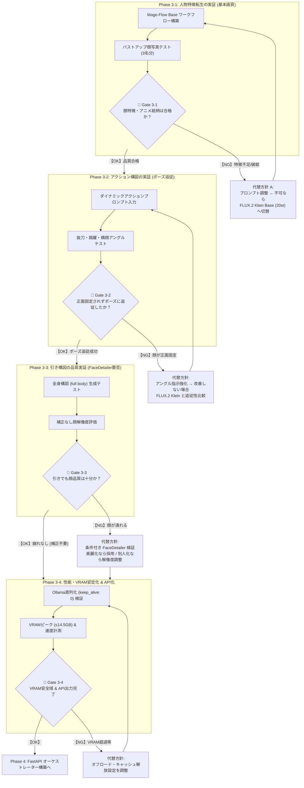

# StoryWeaver Live — 完全ローカル構築 実装計画書

- **作成日**: 2026-10-03
- **ステータス**: 承認待ち
- **対象マシン**: ThinkPad X1 Extreme (RTX 3080 Laptop 16GB / RAM 32GB / Windows)

> [!IMPORTANT]
> 本計画書は `Attached_doc/storyweaver_live.md` の仕様を実現するための **全工程ロードマップ** です。
> 各 Phase の末尾に **Phase Gate（関門チェック）** を設けています。
> Gate を通過できない場合は **次の Phase に進まず、必ず問題を解決** してください。

---

## 現在の環境スナップショット (2026-10-03 確認済み)

| 項目 | 状態 |
| :--- | :--- |
| GPU | NVIDIA GeForce RTX 3080 Laptop GPU — **16,384 MiB** ✅ |
| NVIDIA Driver | 610.47 ✅ |
| RAM | 約 32 GB (空き ≈ 18 GB) ✅ |
| ディスク空き (C:) | 約 130 GB ✅ （モデル合計 ≈ 15 GB 必要） |
| Python | 3.11.6 ✅ |
| Pinokio | **未インストール** 🔴 → Phase 1 で導入 |
| Ollama | **未インストール** 🔴 → Phase 2 で導入 |

---

## 全体フロー図

```mermaid
graph LR
    P1["Phase 1\nComfyUI 基盤構築\n(Pinokio + モデル配置)"]
    G1{{"🚧 Gate 1\nComfyUI で\nテスト画像生成"}}
    P2["Phase 2\nOllama 導入\n(LLM ローカル稼働)"]
    G2{{"🚧 Gate 2\nOllama で\nJSON 生成確認"}}
    P3["Phase 3\nComfyUI 画像生成基盤刷新\n(Mage-Flow / FLUX.2 Klein)\n+ 条件付きFaceDetailer"]
    G3{{"🚧 Gate 3\n人物転生・動的構図\np95 ≤ 30s / VRAM ≤ 13GB"}}
    P4["Phase 4\nFastAPI\nオーケストレーター構築"]
    G4{{"🚧 Gate 4\nAPI 単体テスト\n全エンドポイント正常"}}
    P5["Phase 5\nフロントエンド UI\n構築・接続"]
    G5{{"🚧 Gate 5\nブラウザから\nEnd-to-End 生成成功"}}
    P6["Phase 6\n展示本番チューニング\n& リハーサル"]
    G6{{"🚧 Gate 6\n連続10回生成\nOOM・ハングなし"}}

    P1 --> G1 --> P2 --> G2 --> P3 --> G3 --> P4 --> G4 --> P5 --> G5 --> P6 --> G6
```



---

## VRAM 配分計画（常に意識すること）

> [!IMPORTANT]
> **2026-10-10 改訂（Phase 3 アーキテクチャ刷新）**:
> 従来の「ComfyUI + Ollama 常時同時ロード（合計 14.4 GB / マージン 0.1 GB の極限状態）」を撤廃し、**Ollama 直列化・即時アンロード（`keep_alive: 0`）** を採用しました。
> これにより、LLM 推論時と画像生成時で GPU メモリを排他利用し、展示中の OOM リスクを根本から排除しています。

```
【フェーズ A: LLM シーン生成時 (Ollama)】
┌─────────────────────────────────────────────────────┐
│  OS / ディスプレイドライバ             :  1.5 GB    │
│  Ollama: gemma4:e2b (または qwen2.5:3b):  2.2 GB    │
│  ─── 使用量合計 ───────────────────── :  3.7 GB    │
│  安全マージン                          : 12.6 GB    │
└─────────────────────────────────────────────────────┘
  ※ keep_alive: 0 により、JSON 生成直後に VRAM からモデルを即時解放

【フェーズ B: アニメ画像生成時 (ComfyUI)】
┌─────────────────────────────────────────────────────┐
│  OS / ディスプレイドライバ             :  1.5 GB    │
│  ComfyUI:                                           │
│    - Option A: Mage-Flow-Edit-Turbo (Int8)          │
│        (DiT 4.16GB + Qwen3-VL 8.88GB 動的オフロード):  9.3 GB    │
│        + 条件付き FaceDetailer (発火時のみ) :  0.4 GB    │
│        + VAE / 一時バッファ                 :  1.2 GB    │
│    - Option B: FLUX.2 Klein 4B (Distilled FP8)      │
│        (Klein 4B FP8 4.3GB + Qwen3 4B 4.2GB):  7.8 GB    │
│        + 条件付き FaceDetailer (発火時のみ) :  0.4 GB    │
│        + VAE / 一時バッファ                 :  1.0 GB    │
│  ─── 小計 (OS 含むピーク) ─────────── : 10.7〜12.4 GB│
│  安全マージン                          :  3.9〜 5.6 GB│
└─────────────────────────────────────────────────────┘
  RTX 3080 16GB の安全上限 14.5 GB に対し、常時 3.9 GB 以上の動的バッファを確保
```

> [!CAUTION]
> 全 Phase を通じて `nvidia-smi` で VRAM 使用量を常に確認する習慣をつけてください。
> **14.5 GB を超えたら危険域** です。

> [!TIP]
> 詳細なメモリ測定基準、モデル別 VRAM 解析、Ollama 直列化の設計根拠は [phase3_revision_plan.md](file:///c:/antigravity/StoryWeaver/docs/plans/phase3_revision_plan.md) を参照してください。

---

---

# Phase 1: ComfyUI 基盤構築（Pinokio 経由）

**目的**: Pinokio をインストールし、ComfyUI を起動して「テキストからアニメ画像を1枚生成できる」状態にする。

## Step 1-1: Pinokio のインストール

1. ブラウザで https://pinokio.computer にアクセスし、**Windows 版インストーラー** をダウンロード
2. インストーラーを実行し、デフォルト設定でインストール
3. Pinokio を起動する

### ✅ 確認ポイント
- Pinokio のホーム画面（ダッシュボード）がブラウザに表示されること

## Step 1-2: Pinokio 上で ComfyUI をインストール

1. Pinokio のダッシュボードで **「Discover」** タブをクリック
2. 検索窓に **「ComfyUI」** と入力
3. **ComfyUI** を見つけて **「Download」→「Install」** をクリック
4. インストールが完了するまで待つ（数分〜10分程度）

### ✅ 確認ポイント
- Pinokio のアプリ一覧に **ComfyUI** が表示される
- 「Start」ボタンが有効になっている

## Step 1-3: ComfyUI の初回起動テスト

1. Pinokio から ComfyUI の **「Start」** をクリック
2. ブラウザで **`http://localhost:8188`** が自動的に開くのを確認

### ✅ 確認ポイント
- ComfyUI の Web UI が表示される（ノードベースのキャンバスが見える）
- 右上にキュー（Queue Prompt）ボタンがある

## Step 1-4: ComfyUI Manager のインストール

ComfyUI Manager は、後でカスタムノード（InstantID 等）を簡単にインストールするために **必須** です。

1. ComfyUI の Web UI で上部メニューを確認
2. もし **「Manager」** ボタンが既にあれば → この Step はスキップ
3. なければ Pinokio の ComfyUI 設定ページで「ComfyUI-Manager」を追加インストール

> [!TIP]
> Pinokio 経由でインストールした場合、ComfyUI Manager が最初から含まれていることが多いです。
> 上部に「Manager」ボタンがあればOK。

### ✅ 確認ポイント
- ComfyUI 画面上部に **「Manager」** ボタンが表示される

## Step 1-5: Animagine XL v3.1 (FP8) チェックポイントの配置

**ここが最も重要なモデル配置です。** FP8 版を使うことで VRAM を大幅に節約します。

1. **ダウンロード先**: Civitai または Hugging Face から `animagineXL_v31.safetensors` の **FP8 量子化版** を入手
   - 検索キーワード: `Animagine XL v3.1 FP8`
   - ファイルサイズ: 約 **5〜6 GB**（FP16版は約10GBなので間違えないこと）
2. **配置先ディレクトリ**: Pinokio の ComfyUI フォルダ内の `models/checkpoints/` にコピー
   ```
   (Pinokioインストール先)/api/comfyui.default/models/checkpoints/animagineXL_v31.safetensors
   ```

> [!WARNING]
> **FP16 版（約10GB）を絶対に使わないでください。** RTX 3080 Laptop 16GB では InstantID と同時起動時に OOM が確実に発生します。
> ファイルサイズで必ず確認: **FP8 版 ≈ 5〜6 GB** / FP16 版 ≈ 10 GB。

### ✅ 確認ポイント
- ファイルが `models/checkpoints/` に存在する
- ComfyUI の「Load Checkpoint」ノードのドロップダウンに `animagineXL_v31` が表示される

## Step 1-6: SDXL Lightning 4-step LoRA の配置

4ステップで高速生成を実現するための LoRA です。

1. **ダウンロード元**: Hugging Face — ByteDance/SDXL-Lightning
   - ファイル名: `sdxl_lightning_4step_lora.safetensors`
   - ファイルサイズ: 約 **400 MB**
2. **配置先**: `models/loras/` にコピー

### ✅ 確認ポイント
- ファイルが `models/loras/` に存在する

## Step 1-7: テスト画像生成（チェックポイント + LoRA のノード接続）

ComfyUI を初めて触る方向けに、**「どのノードのどの色の丸から、どの丸へ線をつなぐのか」** を一つずつ丁寧に解説します。

---

### 💡 初心者のための ComfyUI の基本ルール

1. **ノード（四角い箱）の構造**:
   - **左側の丸（端子）**: 入力（Input）＝ データを受け取る口
   - **右側の丸（端子）**: 出力（Output）＝ データを次のノードへ渡す口
2. **線のつなぎ方**:
   - 右側の丸を **マウス左クリックしたまま引っ張り（ドラッグ）**、繋ぎたい相手の左側の丸の上で **離す（ドロップ）**。
   - 既存の線を外したいときは、丸をクリックして何もない空間へ引っ張って離せば外れます。
3. **色のルール（超重要）**:
   - 原則として **「同じ色同士」** をつなぎます。
   - 🟣 **MODEL（紫色）**: AI の頭脳本体
   - 🟡 **CLIP（黄色）**: 人間の言葉（プロンプト）を理解する辞書
   - 🔴 **VAE（赤色）**: ノイズデータを肉眼で見える「画像」に現像するパーツ
   - 🟠 **CONDITIONING（薄橙色）**: プロンプトの指示内容
   - 🌸 **LATENT（ピンク/赤紫色）**: 画像になる前のノイズデータ
   - 🔵 **IMAGE（青色）**: 完成した画像データ

---

### 🗺️ Step 1-7 の全体配線図（完成形）

```mermaid
graph LR
    subgraph 1. モデル読込
        CKPT["Load Checkpoint\n(animagineXL_v31)"]
    end

    subgraph 2. 高速化アドオン
        LORA["Load LoRA\n(sdxl_lightning_4step)"]
    end

    subgraph 3. プロンプト入力
        P_POS["CLIP Text Encode\n(Positive: 良い特徴)"]
        P_NEG["CLIP Text Encode\n(Negative: 除外特徴)"]
    end

    subgraph 4. キャンバス準備
        LATENT["Empty Latent Image\n(1024 x 1024)"]
    end

    subgraph 5. 描画・生成
        KS["KSampler\n(Steps: 4 / cfg: 1.8)"]
    end

    subgraph 6. 現像・保存
        VAE_DEC["VAE Decode"]
        SAVE["Save Image"]
    end

    %% 配線
    CKPT --"🟣 MODEL"--> LORA
    CKPT --"🟡 CLIP"--> LORA
    CKPT --"🔴 VAE"--> VAE_DEC

    LORA --"🟣 MODEL"--> KS
    LORA --"🟡 CLIP"--> P_POS
    LORA --"🟡 CLIP"--> P_NEG

    P_POS --"🟠 CONDITIONING"--> KS
    P_NEG --"🟠 CONDITIONING"--> KS
    LATENT --"🌸 LATENT"--> KS

    KS --"🌸 LATENT"--> VAE_DEC
    VAE_DEC --"🔵 IMAGE"--> SAVE

    classDef purple fill:#7c3aed,stroke:#a78bfa,color:#fff;
    classDef yellow fill:#d97706,stroke:#fcd34d,color:#fff;
    classDef red fill:#dc2626,stroke:#fca5a5,color:#fff;
    classDef orange fill:#ea580c,stroke:#fdba74,color:#fff;
    classDef pink fill:#db2777,stroke:#f472b6,color:#fff;
    classDef blue fill:#2563eb,stroke:#93c5fd,color:#fff;
```

---

### 🔌 端子接続の完全一覧表（この通りに線をつなぐ）

| # | 出発元ノード | 出発端子（右側） | 色 | つなぐ先ノード | 受け取り端子（左側） |
| :-: | :--- | :--- | :-: | :--- | :--- |
| **1** | **Load Checkpoint** | `MODEL` | 🟣 紫 | **Load LoRA** | `model` |
| **2** | **Load Checkpoint** | `CLIP` | 🟡 黄 | **Load LoRA** | `clip` |
| **3** | **Load Checkpoint** | `VAE` | 🔴 赤 | **VAE Decode** | `vae` |
| **4** | **Load LoRA** | `MODEL` | 🟣 紫 | **KSampler** | `model` |
| **5** | **Load LoRA** | `CLIP` | 🟡 黄 | **CLIP Text Encode（上: Positive）** | `clip` |
| **6** | **Load LoRA** | `CLIP` | 🟡 黄 | **CLIP Text Encode（下: Negative）** | `clip` |
| **7** | **CLIP Text Encode（上）** | `CONDITIONING` | 🟠 橙 | **KSampler** | `positive` |
| **8** | **CLIP Text Encode（下）** | `CONDITIONING` | 🟠 橙 | **KSampler** | `negative` |
| **9** | **Empty Latent Image** | `LATENT` | 🌸 ピンク | **KSampler** | `latent_image` |
| **10** | **KSampler** | `LATENT` | 🌸 ピンク | **VAE Decode** | `samples` |
| **11** | **VAE Decode** | `IMAGE` | 🔵 青 | **Save Image** | `images` |

> [!NOTE]
> **LoRA の役目（なぜ間に挟むのか？）**:
> デフォルトでは `Load Checkpoint` から `KSampler` や `CLIP Text Encode` に直接線が伸びています。
> LoRA はモデルをパワーアップさせる「中継器（アンプ）」のようなものなので、**一度 LoRA に線を入れて、LoRA から送り出す** という形に付け替えます。
> ※手順 5 と 6 のように、1つの端子（LoRA の `CLIP`）から 2 本の線を分岐させてそれぞれ繋いで問題ありません。

---

### 🛠️ 画面での具体的な操作手順（1ステップずつ実行）

#### 【作業 1】初期状態の確認
1. ComfyUI をブラウザで開きます（`http://localhost:8188`）。
2. 画面右側のメニューで **「Load Default」** をクリックして、標準状態にします。

#### 【作業 2】「Load LoRA」ノードを追加する
1. 画面の **何もない灰色の場所で右クリック** します。
2. メニューから **`Add Node` → `loaders` → `Load LoRA`** を順にクリックします。
3. 画面に「Load LoRA」という新しい四角い箱が現れます。ドラッグして `Load Checkpoint` と `KSampler` の間のスペースに置いてください。

#### 【作業 3】既存の線を付け替える（LoRA を挟み込む）
1. **Load Checkpoint の右側 `MODEL`（紫の丸）** をクリック＆ドラッグして、**Load LoRA の左側 `model`（紫の丸）** に繋ぎます。
2. **Load Checkpoint の右側 `CLIP`（黄色の丸）** をクリック＆ドラッグして、**Load LoRA の左側 `clip`（黄色の丸）** に繋ぎます。
3. **Load LoRA の右側 `MODEL`（紫の丸）** をクリック＆ドラッグして、**KSampler の左側 `model`（紫の丸）** に繋ぎます。
4. **Load LoRA の右側 `CLIP`（黄色の丸）** をクリック＆ドラッグして、**上側の CLIP Text Encode の左側 `clip`（黄色の丸）** に繋ぎます。
5. もう一度 **Load LoRA の右側 `CLIP`（黄色の丸）** からドラッグして、**下側の CLIP Text Encode の左側 `clip`（黄色の丸）** に繋ぎます。

#### 【作業 4】各ノードのパラメータ（数値）を設定する

上から順に、各ノードの中にある文字や数値を設定します：

1. **Load Checkpoint**:
   - `ckpt_name`: **`animagineXL_v31.safetensors`** を選択
2. **Load LoRA**:
   - `lora_name`: **`sdxl_lightning_4step_lora.safetensors`** を選択
   - `strength_model`: `1.00`
   - `strength_clip`: `1.00`
3. **CLIP Text Encode（上側: Positive プロンプト）**:
   - テキスト入力欄に以下を貼り付けます：
     ```text
     masterpiece, best quality, very aesthetic, 1girl, solo, anime style, blue hair, smile, school uniform, cherry blossom background
     ```
4. **CLIP Text Encode（下側: Negative プロンプト）**:
   - テキスト入力欄に以下を貼り付けます：
     ```text
     nsfw, lowres, bad anatomy, bad hands, text, error, missing fingers, worst quality, low quality, realistic, photograph, 3d render
     ```
5. **Empty Latent Image**:
   - `width`: `1024`
   - `height`: `1024`
   - `batch_size`: `1`
6. **KSampler（超重要設定！）**:
   - `seed`: そのままでOK（ランダム生成したい場合は `control_after_generate` を `randomize` に）
   - `steps`: **`4`**（※デフォルトの 20 から必ず **4** に変更してください）
   - `cfg`: **`1.8`**（※デフォルトの 8.0 から必ず **1.8** に変更してください）
   - `sampler_name`: **`euler`**
   - `scheduler`: **`sgm_uniform`**
   - `denoise`: `1.00`
7. **Save Image**:
   - `filename_prefix`: `ComfyUI`（変更不要）

#### 【作業 5】画像生成テストを実行
1. 画面右上の青い **「Queue Prompt」** ボタンをクリックします。
2. ノードの枠線が順番に緑色に光りながら処理が進みます。
3. **3〜5秒程度** で、一番右の `Save Image` ノードに桜並木と青髪のアニメ女子高生のイラストが表示されれば **大成功** です！

### ✅ 確認ポイント
- アニメ調の画像が **3〜5秒以内** に出力される
- 画像が真っ黒・ノイズ・崩壊画像ではなく、綺麗なイラストになっている
- ComfyUI のコンソール（Pinokio ログ）に赤いエラーが出ていないこと

---

## 🚧 Phase Gate 1: ComfyUI 基盤構築 完了チェック

> **以下の全項目を満たすまで Phase 2 に進まないでください。**

| # | チェック項目 | 確認方法 | 合否 |
| :--- | :--- | :--- | :--- |
| 1 | ComfyUI が `http://localhost:8188` で起動する | ブラウザでアクセス | ☐ |
| 2 | ComfyUI Manager が利用可能 | UI に「Manager」ボタンがある | ☐ |
| 3 | Animagine XL v3.1 **FP8版** がロードできる | Checkpoint ノードで選択可能 | ☐ |
| 4 | SDXL Lightning 4-step LoRA がロードできる | LoRA ノードで選択可能 | ☐ |
| 5 | テスト画像が **5秒以内** に生成される | Queue Prompt → 画像表示 | ☐ |
| 6 | VRAM 使用量が **8 GB 以下**（この段階） | PowerShell: `nvidia-smi` | ☐ |

---

---

# Phase 2: Ollama 導入（ローカル LLM 稼働）

**目的**: Ollama をインストールし、日本語の感情解析・プロンプト生成用の LLM がローカルで動作する状態にする。

## Step 2-1: Ollama のインストール

1. ブラウザで https://ollama.com/download にアクセス
2. **「Download for Windows」** をクリックしてインストーラーをダウンロード
3. インストーラーを実行（デフォルト設定でOK）
4. インストール完了後、**PowerShell を新しく開く**（パスの反映に必要）

### ✅ 確認コマンド
```powershell
ollama --version
```
バージョン番号が表示されればOK。

## Step 2-2: LLM モデルのダウンロード

PowerShell で以下を **1行ずつ** 実行します。

```powershell
# ① 本命モデル（超低遅延）— 約 1.6 GB
ollama pull gemma4:e2b

# ② 日本語リファレンス — 約 1.9 GB
ollama pull qwen2.5:3b

# ③ 非常用フェイルセーフ — 約 900 MB
ollama pull qwen2.5:1.5b
```

> [!NOTE]
> ダウンロードには回線速度に応じて 5〜30 分かかります。
> 3つ合計で約 **4.5 GB** のディスク容量を使用します。

### ✅ 確認コマンド
```powershell
ollama list
```
3つのモデルが一覧に表示されればOK。

## Step 2-3: LLM の動作テスト（JSON 生成）

実際に StoryWeaver で使うのと同じ形式で JSON を生成させて、正しく動くか確認します。

```powershell
ollama run gemma4:e2b 'You are an animation director. A hero shouted: "I will never give up!". Generate a JSON object with keys: emotion (Japanese), animeAura (English tags), narrativeCaption (Japanese sentence), characterAction (English). Output ONLY valid JSON.' --format json
```

### ✅ 確認ポイント
- JSON 形式のレスポンスが返ること（`{...}` で囲まれた構造）
- `emotion`, `animeAura`, `narrativeCaption`, `characterAction` の4つのキーが含まれていること
- 応答時間が **5秒以内** であること（e2b は非常に高速なモデル）

## Step 2-4: Ollama API サーバーの確認

Ollama はインストール時にバックグラウンドサービスとして自動起動します。

```powershell
# API が応答するか確認
Invoke-RestMethod -Uri "http://localhost:11434/api/tags"
```

### ✅ 確認ポイント
- JSON でモデル一覧が返却される
- ポート `11434` でリスニングしている

## Step 2-5: VRAM 共存テスト（ComfyUI + Ollama 同時起動）

**この確認が非常に重要です。** 両方を同時に起動した状態で VRAM が足りるか確認します。

1. **ComfyUI を起動中のまま** にする（Pinokio で Start 状態）
2. PowerShell で Ollama にリクエストを送る:
   ```powershell
   ollama run gemma4:e2b "Hello, test." --verbose
   ```
3. VRAM 使用量を確認:
   ```powershell
   nvidia-smi
   ```

### ✅ 確認ポイント
- 両方が同時に動作し、応答が返る
- VRAM 合計使用量が **14.5 GB 以下** であること

> [!WARNING]
> もし VRAM が 14.5 GB を超える場合:
> 1. Ollama のモデルを `qwen2.5:1.5b`（最軽量版）に切り替えて再テスト
> 2. ComfyUI 側で使っていないモデルがキャッシュに残っていないか確認
> 3. それでもダメな場合は `OLLAMA_GPU_MEMORY=2048` 環境変数で制限する

---

## 🚧 Phase Gate 2: Ollama 導入 完了チェック

> **以下の全項目を満たすまで Phase 3 に進まないでください。**

| # | チェック項目 | 確認方法 | 合否 |
| :--- | :--- | :--- | :--- |
| 1 | Ollama がインストール済み | `ollama --version` | ☐ |
| 2 | gemma4:e2b が応答する | `ollama run gemma4:e2b "test"` | ☐ |
| 3 | JSON 形式で正しく出力できる | 上記 Step 2-3 のテスト | ☐ |
| 4 | API サーバーがポート 11434 で応答 | `Invoke-RestMethod` テスト | ☐ |
| 5 | ComfyUI と同時起動で **VRAM ≤ 14.5 GB** | `nvidia-smi` | ☐ |

---

---

# Phase 3: ComfyUI — 画像生成・人物転生パイプライン構築（画質最優先・段階的実証）

**目的**: 写真の特徴（髪型・眼鏡・骨格）を自然に反映しつつ、ダイナミックなアクションポーズとアニメ絵柄を両立する画像生成パイプラインを確立する。

> [!IMPORTANT]
> **【基本方針】時間よりも画質・描画品質を最優先**:
> 意図した絵が得られない限り、高速化やステップ短縮、API連携は二の次です。
> 蒸留・間引きのないフル品質モデル（Mage-Flow Base 30 steps）で「人物特徴が反映された魅力的なアニメ絵柄が安定して出せるか」を実証することを最優先とし、以下の 4 つのサブフェーズ（Phase 3-1 〜 3-4）に分けて手戻りなく進めます。
> 詳細な技術仕様・背景理論は **[phase3_revision_plan.md](file:///c:/antigravity/StoryWeaver/docs/plans/phase3_revision_plan.md)** を参照してください。

---

## 1. モデル検証の優先順位と代替方針

| 優先順位 | 対象モデル / 構成 | 検証の狙い（画質最優先） |
| :--- | :--- | :--- |
| **第1候補<br>(最優先実証)** | **Mage-Flow-Edit Base (Int8)**<br>公式サブグラフ (30 steps, CFG 5.0) | **【最高画質本命】** Qwen3-VL（4B視覚言語モデル）が顔写真を直接解析し、DiT（4B画像生成モデル）がテキスト指示に従ってアニメ調に編集。骨格拘束がないため顔が正面固定されず、自律的に髪型・眼鏡を認識・保持する。間引きのない 30 steps で最高品質を実証。 |
| **第2候補<br>(代替方針 A)** | **FLUX.2 Klein 4B Base (FP8)**<br>公式サブグラフ (20 steps, CFG 5.0) | **【画質比較対抗】** Mage-Flow でアニメ調への変換や人物同一性に課題があった場合の最有力対抗馬。Black Forest Labs の FLUX.2 アーキテクチャに基づき、`ReferenceLatent`（潜在空間直接注入）により高い描画密度と人物転生を試みる。 |
| **第3候補<br>(代替方針 B)** | **Animagine XL + InstantID**<br>(骨格拘束緩和版, 20〜30 steps) | **【緊急予備】** 最新 DiT 2系統で日本のアニメ絵柄の再現がどうしても難しかった場合のバックアップ。骨格強度（`cn_strength`）を 0.15〜0.20 の極小にしてポーズ自由度を確保し、画風 LoRA と組み合わせる。 |
| **※ 最適化<br>(品質実証後)** | **Turbo / Distilled 系 (4 steps)** | **【速度検証】** Base で意図した絵が完璧に出ることが確認できた後、初めて「どこまでステップを削っても品質を保てるか」の最適化として検証する。 |

---

## 2. 段階的検証フロー（Phase 3-1 〜 3-4）と OK / NG 分岐



---

## 3. ComfyUI ワークフロー構成詳細（迷わず組める設計図）

ComfyUI を画面上で迷わず組み立てられるように、モデル配置・ノード一覧・端子配線・設定値を完全に定義します。

### 3.1 必要なモデル一覧と保管フォルダ

### 3.1 実際のローカル配置モデル一覧（確認済み）

ユーザー環境（`C:\pinokio\api\comfy.git\app\models`）に実際に配置されている正確なモデルファイル名は以下の通りです。

| ノード | パラメータ | 選択するファイル名 | ローカル実パス |
| :--- | :--- | :--- | :--- |
| **CheckpointLoaderSimple** | `ckpt_name` | **`animagine-xl-3.1.float8_e4m3fn.safetensors`** | `models/checkpoints/` |
| **InstantIDModelLoader** | `instantid_file` | **`ip-adapter.bin`** | `models/instantid/` |
| **ControlNetLoader** | `control_net_name` | **`diffusion_pytorch_model.safetensors`** | `models/controlnet/` |
| **InstantIDFaceAnalysis** | `provider` | **`CPU`** | `models/insightface/models/antelopev2/` (自動参照) |
| **FaceDetailer** (Phase 3-3) | `model_name` | **`face_yolov8m.pt`** | `models/ultralytics/bbox/` |

---

### 3.2 必要なノード一覧表（全 12 ノード）

ComfyUI キャンバスの空白を **ダブルクリック $\rightarrow$ 検索** して配置します。

| # | ノード名（検索キーワード） | 役割 |
| :-: | :--- | :--- |
| **1** | `CheckpointLoaderSimple` (`Checkpoint`) | Animagine XL v3.1 FP8 本体モデルの読み込み |
| **2** | `InstantIDModelLoader` (`InstantID`) | InstantID モデル (`ip-adapter.bin`) の読み込み |
| **3** | `ControlNetLoader` (`ControlNet`) | InstantID 専用 ControlNet (`diffusion_pytorch_model.safetensors`) の読み込み |
| **4** | `InstantIDFaceAnalysis` (`FaceAnalysis`) | InsightFace (antelopev2) による顔特徴抽出器 (CPU) |
| **5** | `Load Image` (`Load Image`) | 来場者の顔写真（テスト画像）の入力 |
| **6** | `ApplyInstantIDAdvanced` (`Apply InstantID Advanced`) | **【最重要】顔特徴（ip_weight）と骨格拘束（cn_strength）を独立制御** |
| **7** | `CLIPTextEncode` (`CLIP Text`) | Positive プロンプト（アニメ品質タグ＋情景） |
| **8** | `CLIPTextEncode` (`CLIP Text`) | Negative プロンプト（実写排除・品質低下排除） |
| **9** | `EmptyLatentImage` (`Empty Latent`) | 生成解像度 (1024 x 1024) |
| **10** | `KSampler` (`KSampler`) | 30 steps / CFG 6.5 による美麗アニメレンダリング |
| **11** | `VAEDecode` (`VAE Decode`) | 潜在変数からイラスト画像への現像 |
| **12** | `Save Image` (`Save Image`) | 完成した美麗アニメイラストの保存・プレビュー |

---

### 3.3 全体配線図（Mermaid）

```mermaid
graph LR
    subgraph 1. モデル群の読み込み
        CKPT["1. CheckpointLoaderSimple
(animagine-xl-3.1.float8)"]
        I_LOAD["2. InstantIDModelLoader
(ip-adapter.bin)"]
        C_LOAD["3. ControlNetLoader
(diffusion_pytorch_model)"]
        FA["4. InstantIDFaceAnalysis
(provider: CPU)"]
    end

    subgraph 2. 写真入力 & 条件付け
        IMG["5. Load Image
(来場者顔写真)"]
        POS["7. CLIPTextEncode (Pos)
(masterpiece, anime, solo...)"]
        NEG["8. CLIPTextEncode (Neg)
(lowres, realistic, photo...)"]
        APP["6. ApplyInstantIDAdvanced
ip_weight: 0.60
cn_strength: 0.15"]
        LATENT["9. EmptyLatentImage
(1024 x 1024)"]
    end

    subgraph 3. 高画質生成
        KS["10. KSampler
(Steps: 30 / CFG: 6.5 / euler_ancestral)"]
    end

    subgraph 4. 現像・保存
        DEC["11. VAEDecode"]
        SAVE["12. Save Image"]
    end

    %% InstantID Advanced への入力
    I_LOAD --"INSTANTID"--> APP
    FA --"FACEANALYSIS"--> APP
    C_LOAD --"CONTROL_NET"--> APP
    IMG --"🔵 IMAGE"--> APP
    CKPT --"🟣 MODEL"--> APP
    POS --"🟠 CONDITIONING"--> APP
    NEG --"🟠 CONDITIONING"--> APP

    %% CLIP 接続
    CKPT --"🟡 CLIP"--> POS
    CKPT --"🟡 CLIP"--> NEG

    %% KSampler への接続
    APP --"🟣 MODEL"--> KS
    APP --"🟠 positive"--> KS
    APP --"🟠 negative"--> KS
    LATENT --"🌸 LATENT"--> KS

    %% 現像接続
    KS --"🌸 LATENT"--> DEC
    CKPT --"🔴 VAE"--> DEC
    DEC --"🔵 IMAGE"--> SAVE

    classDef purple fill:#7c3aed,stroke:#a78bfa,color:#fff;
    classDef yellow fill:#d97706,stroke:#fcd34d,color:#fff;
    classDef red fill:#dc2626,stroke:#fca5a5,color:#fff;
    classDef orange fill:#ea580c,stroke:#fdba74,color:#fff;
    classDef pink fill:#db2777,stroke:#f472b6,color:#fff;
    classDef blue fill:#2563eb,stroke:#93c5fd,color:#fff;
```

---

### 3.4 🔌 端子接続の完全一覧表（全 16 本）

| # | 出発元ノード | 出発端子（右側） | 色 | つなぐ先ノード | 受け取り端子（左側） |
| :-: | :--- | :--- | :-: | :--- | :--- |
| **1** | 1. CheckpointLoaderSimple | `MODEL` | 🟣 紫 | 6. ApplyInstantIDAdvanced | `model` |
| **2** | 1. CheckpointLoaderSimple | `CLIP` | 🟡 黄 | 7. CLIPTextEncode (Pos) | `clip` |
| **3** | 1. CheckpointLoaderSimple | `CLIP` | 🟡 黄 | 8. CLIPTextEncode (Neg) | `clip` |
| **4** | 1. CheckpointLoaderSimple | `VAE` | 🔴 赤 | 11. VAEDecode | `vae` |
| **5** | 2. InstantIDModelLoader | `INSTANTID` | 🟢 緑 | 6. ApplyInstantIDAdvanced | `instantid` |
| **6** | 3. ControlNetLoader | `CONTROL_NET` | 🟣 紫 | 6. ApplyInstantIDAdvanced | `control_net` |
| **7** | 4. InstantIDFaceAnalysis | `FACEANALYSIS` | 🔵 青 | 6. ApplyInstantIDAdvanced | `insightface` |
| **8** | 5. Load Image | `IMAGE` | 🔵 青 | 6. ApplyInstantIDAdvanced | `image` |
| **9** | 7. CLIPTextEncode (Pos) | `CONDITIONING` | 🟠 橙 | 6. ApplyInstantIDAdvanced | `positive` |
| **10** | 8. CLIPTextEncode (Neg) | `CONDITIONING` | 🟠 橙 | 6. ApplyInstantIDAdvanced | `negative` |
| **11** | 6. ApplyInstantIDAdvanced | `MODEL` | 🟣 紫 | 10. KSampler | `model` |
| **12** | 6. ApplyInstantIDAdvanced | `positive` | 🟠 橙 | 10. KSampler | `positive` |
| **13** | 6. ApplyInstantIDAdvanced | `negative` | 🟠 橙 | 10. KSampler | `negative` |
| **14** | 9. EmptyLatentImage | `LATENT` | 🌸 ピンク | 10. KSampler | `latent_image` |
| **15** | 10. KSampler | `LATENT` | 🌸 ピンク | 11. VAEDecode | `samples` |
| **16** | 11. VAEDecode | `IMAGE` | 🔵 青 | 12. Save Image | `images` |

---

### 3.5 各ノードのパラメータ設定値表

| ノード名 | パラメータ | 設定値 | 理由・設定根拠 |
| :--- | :--- | :--- | :--- |
| **1. CheckpointLoaderSimple** | `ckpt_name` | **`animagine-xl-3.1.float8_e4m3fn.safetensors`** | 最高峰アニメ特化 SDXL (FP8) |
| **2. InstantIDModelLoader** | `instantid_file` | **`ip-adapter.bin`** | InstantID 公式アダプタ |
| **3. ControlNetLoader** | `control_net_name` | **`diffusion_pytorch_model.safetensors`** | InstantID 公式 ControlNet |
| **4. InstantIDFaceAnalysis** | `provider` | **`CPU`** | InsightFace を CPU 実行し VRAM 0.4GB 節約 |
| **6. ApplyInstantIDAdvanced** | `ip_weight`<br>`cn_strength`<br>`start_at`<br>`end_at` | **`0.60`**<br>**`0.15`**<br>`0.0`<br>`1.0` | **【最重要】**<br>顔特徴を `0.60` で転写しつつ、骨格拘束を `0.15` に極小化してポーズ追従を確保 |
| **9. EmptyLatentImage** | `width`<br>`height` | **`1024`**<br>**`1024`** | SDXL 標準高精細解像度 |
| **10. KSampler** | `steps`<br>`cfg`<br>`sampler_name`<br>`scheduler`<br>`denoise` | **`30`**<br>**`6.5`**<br>**`euler_ancestral`**<br>**`normal`**<br>**`1.0`** | Animagine 公式推奨値。美麗なアニメ塗りとハイライトを描画 |

---

### 3.6 プロンプト設定（Danbooru 品質準拠）

- **Positive (7 番 CLIPTextEncode に入力)**:
  ```text
  masterpiece, best quality, very aesthetic, anime art style, vibrant colors,
  solo, 1boy, confident smile, upper body, looking at viewer,
  fantasy adventurer, magical aura, sharp focus, detailed illustration
  ```
  *(※被写体が女性の場合は `1boy` を `1girl` に変更)*

- **Negative (8 番 CLIPTextEncode に入力)**:
  ```text
  lowres, bad anatomy, bad hands, text, error, missing fingers, extra digit,
  fewer digits, cropped, worst quality, low quality, normal quality,
  jpeg artifacts, signature, watermark, username, blurry, artist name,
  realistic, photograph, 3d render, deformed
  ```

---

## 4. 各検証フェーズの手順・プロンプト・Phase Gate・調整方針

### Phase 3-1: 【第1段階：本人らしさとアニメ品質の確立（ベースライン構築）】

- **目的**: 動的なポーズ指定は行わず（バストアップ・正面/自然な構図）、まずは「本人の外見特徴（髪型、眼鏡、顔貌）」の確実な反映と「美麗なアニメ画質」を両立するパラメータ構成を確定させる。
- **検証入力**: 異なる外見特徴を持つ顔写真（例: 短髪男性、黒髪長髪・眼鏡、パーマ髪型）

#### プロンプト設定（第1段階用）
* **Positive (7 番 CLIPTextEncode に入力)**:
  ```text
  masterpiece, best quality, very aesthetic, anime art style, vibrant colors,
  solo, 1boy, short hair, black hair, glasses, confident smile, upper body, looking at viewer,
  fantasy adventurer, magical aura, sharp focus, detailed illustration
  ```
  *(※被写体の性別・外見に合わせて `1boy` $\rightarrow$ `1girl`、`short hair, black hair, glasses` を適宜変更)*
* **Negative (8 番 CLIPTextEncode に入力)**:
  ```text
  lowres, bad anatomy, bad hands, text, error, missing fingers, extra digit,
  fewer digits, cropped, worst quality, low quality, normal quality,
  jpeg artifacts, signature, watermark, username, blurry, artist name,
  realistic, photograph, 3d render, deformed
  ```

#### 🚧 Gate 3-1 判定基準
| # | チェック項目 | 合格基準 | 合否 |
| :-: | :--- | :--- | :---: |
| 1 | **アニメ絵画品質** | 実写の不気味さやチープな平塗りがなく、美麗なアニメイラスト（セル画・瞳のハイライト）であること | ☐ |
| 2 | **人数制御 (solo)** | Mage-Flow で発生した分裂・集合絵がなく、厳密に指定した 1 名のみが描かれていること | ☐ |
| 3 | **本人同一性の反映** | 顔貌（目鼻立ちのバランス）に加え、プロンプトで補強した髪型・眼鏡が写真と一致していること | ☐ |
| 4 | **顔面アーティファクト排除** | 目鼻の崩れ、二重顎、不自然な黒ずみ等がないこと | ☐ |

- **【OK の場合】**: ベースライン確立！→ **Phase 3-2（動的構図・表情適用）へ進む**。
- **【NG の場合（パラメータ調整方針）】**:
  - 本人らしさが薄い場合: `ApplyInstantIDAdvanced` の `ip_weight` を `0.60` $\rightarrow$ **`0.70`** に引き上げ、外見タグを具体化。
  - アニメ調が硬い・実写質感が混ざる場合: `ip_weight` を **`0.50〜0.55`** に微減、CFG を **`7.0`** に引き上げ。
  - 眼鏡が反映されない場合: プロンプトで `(glasses:1.2)` と強調。

---

### Phase 3-2: 【第2段階：動的構図・表情の適用（ポーズ自由度実証）】

- **目的**: 第1段階で確立した設定（本人らしさと画質）を維持したまま、ダイナミックなアクションポーズ（抜刀、跳躍、振り返り構図）や豊かな表情の指示が写真の顔向きに拘束されず自然に追従するかを実証する。
- **検証条件**: 第1段階で確定した `ip_weight` および外見タグを固定。

#### プロンプト設定（第2段階用：動的アクション & 表情）
* **検証パターン A（ダイナミック抜刀・戦闘アクション）**:
  ```text
  masterpiece, best quality, very aesthetic, anime art style, vibrant colors,
  solo, 1boy, short hair, black hair, glasses,
  dynamic angle, high action pose, swinging glowing katana, battle stance,
  determined expression, shouting, glowing magical particles, dramatic lighting, sharp focus
  ```
* **検証パターン B（振り返り・横顔・エモーショナル構図）**:
  ```text
  masterpiece, best quality, very aesthetic, anime art style, vibrant colors,
  solo, 1boy, short hair, black hair, glasses,
  looking back over shoulder, side profile, turning around,
  gentle smile, wind blowing hair, sunset rim lighting, cinematic composition
  ```

#### 🚧 Gate 3-2 判定基準
| # | チェック項目 | 合格基準 | 合否 |
| :-: | :--- | :--- | :---: |
| 1 | **ポーズ追従性** | 指示された動的アクション（抜刀姿勢、跳躍、身体のひねり、振り返り）が正確に描画されていること | ☐ |
| 2 | **正面拘束の完全排除** | 顔の向き・目線が元写真の正面向きに引っ張られず、身体のアクション方向に自然に追従していること | ☐ |
| 3 | **表情追従性** | 元写真の無表情/静止表情に固定されず、プロンプトで指示した表情（叫び、気迫、微笑み等）になっていること | ☐ |
| 4 | **同一性の継続維持** | ポーズやアングルが変わっても、第1段階で確認された人物特徴（髪型・眼鏡・面影）が維持されていること | ☐ |

- **【OK の場合】**: 構図・表情追従成功！→ **Phase 3-3（引き構図実証）へ進む**。
- **【NG の場合（パラメータ調整方針）】**:
  - 顔だけが正面を向く場合: `ApplyInstantIDAdvanced` の `cn_strength` を `0.15` $\rightarrow$ **`0.10`** に引き下げ、`profile shot` を強調。
  - ポーズは良いが顔特徴が抜ける場合: `cn_strength: 0.15` を維持し、`ip_weight` を `0.65` に微増。`end_at: 0.85` に設定。

---

### Phase 3-3: 【引き構図・顔崩れ対策の実証】（FaceDetailer 要否検証）

- **目的**: 全身構図（`full body`）で人物が遠景に配置された際、顔が潰れるかを確認し、潰れる場合は FaceDetailer で「別人化せずに高精細化できるか」を実証する。
- **検証手順**:
  1. まず **補正なし Direct 生成** を行い、顔領域をクロップ拡大して評価。
  2. 潰れている場合のみ、**条件付き FaceDetailer**（`bbox/face_yolov8m.pt`, `denoise: 0.35`）を適用して比較。

#### 🚧 Gate 3-3 判定基準
| チェック項目 | 合格基準 | 合否 |
| :--- | :--- | :---: |
| 引きの顔解像度 | 全身構図でも目・瞳・眼鏡・口元が綺麗に描かれていること | ☐ |
| 別人化の非発生 | 補正後の顔が元写真および Phase 3-1 の面影を保ち、別人化していないこと | ☐ |
| 首・髪境界の自然さ | 再描画領域と周囲の境界線に違和感・色浮きがないこと | ☐ |

- **【OK の場合】**:
  - **パターン A (補正不要)**: Base 単体で十分に綺麗 → **FaceDetailer なし（単一パス）を採用**（最善構成）。
  - **パターン B (補正成功)**: FaceDetailer で美麗化 → **条件付き FaceDetailer（BBox長辺 < 180px 発火）を採用**。
  - いずれも品質実証完了！→ **Phase 3-4（運用安定化 & API化）へ進む**。
- **【NG の場合】**:
  - FaceDetailer で別人化する場合: `denoise: 0.25〜0.30` へ低下。それでも別人化するなら FaceDetailer は不採用とし、全体解像度調整へ切り替え。

---

### Phase 3-4: 【運用安定化・APIワークフロー化】

- **目的**: 画質・構図が実証された確定構成に対し、展示運用に耐える安定性（VRAM ≤ 14.5GB、Ollama直列化 `keep_alive: 0`）を確認し、API Format JSON を出力する。

#### 🚧 Phase Gate 3-4 判定基準（最終関門）
| # | チェック項目 | 合格基準 | 確認方法 | 合否 |
| :-: | :--- | :--- | :--- | :---: |
| 1 | 絵画品質・構図の成立 | Phase 3-1〜3-3 の全要件を満たしていること | レビュー確認 | ☐ |
| 2 | OOM ゼロ (VRAM ≤ 14.5GB) | 連続生成中に VRAM 14.5GB を一度も超えないこと | `nvidia-smi` 監視 | ☐ |
| 3 | メモリ直列化の動作 | Ollama 完了後にモデルが即時アンロードされること | `keep_alive: 0` 確認 | ☐ |
| 4 | 生成レイテンシ記録 | 所要時間を実測・記録し、タイムアウト値を確定 | 実測記録 | ☐ |
| 5 | API ワークフロー出力 | SceneSpec を動的注入可能な JSON が保存されていること | `storyweaver_anime_api.json` | ☐ |

- **【OK の場合】**: Phase 3 完了！→ **Phase 4（FastAPI オーケストレーター構築）へ進む**。
- **【NG の場合】**: VRAM 超過時は ComfyUI のオフロード引数を調整。

---

---

# Phase 4: FastAPI オーケストレーター構築

**目的**: 顔写真・音声テキスト入力を受け取り、Ollama → ComfyUI を順次呼び出して画像生成結果を返す API サーバーを構築する。

## Step 4-1: Python 仮想環境の作成

プロジェクト専用の仮想環境を作ります。

```powershell
cd c:\antigravity\StoryWeaver
python -m venv .venv
.\.venv\Scripts\Activate.ps1
```

> [!NOTE]
> 以降の Phase 4 のコマンドは、すべて **仮想環境を有効化した状態** で実行してください。
> プロンプトが `(.venv) PS c:\antigravity\StoryWeaver>` に変わっていることを確認。

## Step 4-2: 依存ライブラリのインストール

```powershell
pip install funasr modelscope soundfile fastapi uvicorn requests python-multipart
```

> [!NOTE]
> `funasr` は SenseVoice（音声認識）用のライブラリです。
> 初回の `import` 時に SenseVoiceSmall モデル（約400MB）が自動ダウンロードされます。

### ✅ 確認コマンド
```powershell
python -c "import fastapi; import funasr; print('OK')"
```
`OK` と表示されればインストール成功。

## Step 4-3: server.py の作成

`Attached_doc/storyweaver_live.md` に記載された `server.py` のコードをベースに、以下の **安全対策を追加した改良版** を作成します。

> **私（Antigravity）がコードを作成します。** このステップでは以下の改良点を盛り込みます:
> 1. タイムアウト付きポーリング（無限ループ防止）
> 2. Ollama JSON パースのフォールバック
> 3. 同時実行セマフォ（VRAM スパイク防止）
> 4. 一時ファイルの UUID 付きファイル名（競合防止）

### ✅ 確認ポイント
- `server.py` がエラーなく起動する
- `http://localhost:8000/docs` にアクセスして Swagger UI が表示される

## Step 4-4: SenseVoice (音声認識) の初回起動テスト

サーバー初回起動時に SenseVoice モデルが自動ダウンロードされます。

```powershell
python -c "from funasr import AutoModel; m = AutoModel(model='iic/SenseVoiceSmall', trust_remote_code=True, device='cpu'); print('SenseVoice loaded OK')"
```

> [!TIP]
> VRAM を節約するため SenseVoice は **CPU 実行** を推奨します。
> 0.4 GB の VRAM 節約ができ、推論速度への影響はわずかです（音声認識は約0.1秒）。

### ✅ 確認ポイント
- モデルのダウンロードが完了する（初回のみ数分かかる）
- `SenseVoice loaded OK` と表示される

## Step 4-5: パイプライン結合テスト（API 単体テスト）

ComfyUI と Ollama を起動した状態で、`server.py` を起動し、curl でテストします。

```powershell
# 1. 別ターミナルで server.py を起動
python server.py

# 2. テスト用の顔画像を用意（例: test_face.jpg）
# 3. curl でテスト送信
curl -X POST "http://localhost:8000/api/process_story" `
  -F "face_image=@test_face.jpg" `
  -F "transcript_text=絶対に諦めない！" `
  -F "base_prompt=dramatic battle scene" `
  -F "scene_style=fantasy anime"
```

### ✅ 確認ポイント
- JSON レスポンスが返る
- `transcript`, `analysis`, `imageBase64` の3つのキーが含まれる
- `imageBase64` を Base64 デコードすると、アニメ調の画像になっている
- 全体の処理時間が **10秒以内**（WD14 Tagger + FaceDetailer 追加後の実測で判定。超過時は付録の調整手段を適用）

---

## 🚧 Phase Gate 4: FastAPI オーケストレーター 完了チェック

> **以下の全項目を満たすまで Phase 5 に進まないでください。**

| # | チェック項目 | 確認方法 | 合否 |
| :--- | :--- | :--- | :--- |
| 1 | `server.py` がポート 8000 で起動 | `http://localhost:8000/docs` | ☐ |
| 2 | SenseVoice モデルが正常ロード済み | 起動ログにエラーなし | ☐ |
| 3 | API テストで JSON レスポンスが返る | curl テスト | ☐ |
| 4 | 返却画像がアニメ調 & 顔特徴反映 | Base64 デコード・目視確認 | ☐ |
| 5 | 全体処理 ≤ **10秒** | curl 実行時間計測 | ☐ |
| 6 | 3サービス同時起動中 VRAM ≤ **14.5 GB** | `nvidia-smi` | ☐ |

---

---

# Phase 5: フロントエンド UI 構築・接続

**目的**: ブラウザ上でカメラ撮影・セリフ入力 → アニメ画生成 → 朗読再生までの体験者向けフルフローを実装する。

## Step 5-1: フロントエンド HTML/CSS/JS の作成

> **私（Antigravity）がコードを作成します。** 以下の機能を実装します:
> - Webカメラからの顔写真撮影
> - セリフテキスト入力（音声入力オプション付き）
> - シーンプリセット選択（ファンタジー、SF、日常 等）
> - 生成中のローディングアニメーション
> - 生成結果のアニメ画カード表示
> - Web Speech API による日本語朗読自動再生
> - 全画面シアターモード（プロジェクター展示用）
> - 記念アートカード PNG ダウンロード

## Step 5-2: FastAPI からフロントエンドの静的配信設定

`server.py` に静的ファイル配信を追加し、ポート 8000 でフロントエンドも配信します。

### ✅ 確認ポイント
- `http://localhost:8000` にアクセスしてフロントエンド UI が表示される
- カメラプレビューが動作する

## Step 5-3: End-to-End テスト

1. ブラウザで `http://localhost:8000` にアクセス
2. カメラで顔写真を撮影
3. セリフを入力（例: 「この世界を守るために、立ち上がる！」）
4. シーンプリセットを選択
5. **「生成」** ボタンをクリック
6. アニメ調のキャラクターイラストが表示される
7. 朗読音声が自動再生される

---

## 🚧 Phase Gate 5: フロントエンド 完了チェック

> **以下の全項目を満たすまで Phase 6 に進まないでください。**

| # | チェック項目 | 確認方法 | 合否 |
| :--- | :--- | :--- | :--- |
| 1 | UI がブラウザに表示される | `http://localhost:8000` | ☐ |
| 2 | カメラプレビューが動作する | ブラウザのカメラ許可 | ☐ |
| 3 | 顔撮影 → セリフ入力 → 生成 が成功 | E2E テスト実行 | ☐ |
| 4 | アニメ画カードが画面に表示される | 目視 | ☐ |
| 5 | 朗読音声が自動再生される | スピーカー出力確認 | ☐ |
| 6 | シアターモード（全画面）が動作する | 全画面ボタン | ☐ |
| 7 | PNG ダウンロードが動作する | ダウンロードボタン | ☐ |

---

---

# Phase 6: 展示本番チューニング & リハーサル

**目的**: 展示本番環境での安定稼働を検証し、長時間連続運用に耐えるパフォーマンスと品質を確認する。

## Step 6-1: 連続生成ストレステスト

10回連続で異なる入力パターンで生成テストを実施します。

| テスト# | 入力バリエーション | チェック項目 |
| :--- | :--- | :--- |
| 1〜3 | 異なる人物の顔写真 | 顔特徴が反映されるか |
| 4〜5 | 長文セリフ（50文字以上） | Ollama がタイムアウトしないか |
| 6〜7 | 異なるシーンプリセット | プリセットごとに画風が変わるか |
| 8〜9 | 即時連続クリック（1秒間隔） | セマフォが効いてキュー処理されるか |
| 10 | 空セリフ（テキスト未入力） | フォールバックが効くか |

### ✅ 確認ポイント
- 10回全てで正常に画像が生成される
- VRAM 使用量が安定して **14.5 GB 以下** を維持
- GPU 温度が **85℃ 以下** を維持（`nvidia-smi` で確認）
- メモリリーク（RAM の単調増加）がない

## Step 6-2: 画質チューニング

| 調整項目 | 初期値 | 調整方法 |
| :--- | :--- | :--- |
| 顔の実写感が残る | `ip_weight: 0.60`（Main / Detailer） | → `0.50〜0.55` に下げる |
| 顔の特徴が薄い | `ip_weight: 0.60`（Detailer） | → `0.65〜0.70` に上げる |
| 顔の向きがポーズに追従しない | `cn_strength: 0.25`（Main） | → `0.20` に下げる |
| 目鼻の配置が崩れる | `cn_strength: 0.25`（Main）/ `0.35`（Detailer） | → Main `0.30〜0.35` / Detailer `0.40〜0.45` に上げる |
| 再描画した顔が浮く（首・髪との境目） | FaceDetailer `denoise: 0.45` | → `0.40` に下げる / `feather` を `10` に |
| 引きの絵で顔が再描画されない | FaceDetailer `bbox_threshold: 0.50` | → `0.35` に下げる |
| 不要なタグ（服装・背景など）が混ざる | WD14 `threshold: 0.40` | → `0.45〜0.50` に上げる / `exclude_tags` に追記 |
| 眼鏡などの装飾品が拾われない | WD14 `threshold: 0.40` | → `0.30〜0.35` に下げる |
| ComfyUI の処理時間が 8 秒を超える | FaceDetailer `guide_size: 768` | → `640` に下げる / WD14 を `wd-v1-4-moat-tagger-v2` に |
| 色彩が地味 | — | Positive Prompt に `vibrant colors, saturated` を追加 |

## Step 6-3: 起動手順書の作成（展示当日用）

展示本番の朝、以下の順序でシステムを起動します:

```
起動順序（厳守）:
━━━━━━━━━━━━━━━━━━━━━━━━━━━━━━
1. PC 起動 → nvidia-smi で GPU 認識確認
2. Pinokio → ComfyUI 起動 (ポート 8188)
3. Ollama 自動起動確認 (ポート 11434)
4. PowerShell → server.py 起動 (ポート 8000)
5. ブラウザ → http://localhost:8000 アクセス
6. テスト生成 1回実行 → 正常確認
━━━━━━━━━━━━━━━━━━━━━━━━━━━━━━
```

---

## 🚧 Phase Gate 6（最終ゲート）: 本番稼働準備 完了チェック

> **以下の全項目を満たしたら、展示本番準備完了です。🎉**

| # | チェック項目 | 確認方法 | 合否 |
| :--- | :--- | :--- | :--- |
| 1 | 連続10回生成テスト全成功 | ストレステスト | ☐ |
| 2 | OOM エラー発生なし | 全テスト中 `nvidia-smi` 監視 | ☐ |
| 3 | GPU 温度 ≤ 85℃ 安定 | `nvidia-smi` | ☐ |
| 4 | 1回あたりの生成時間 ≤ 10秒 | ストップウォッチ計測 | ☐ |
| 5 | 画質が展示水準（目視OK） | 関係者レビュー | ☐ |
| 6 | 起動手順書が完成 | ドキュメント確認 | ☐ |
| 7 | 障害時の復旧手順を把握 | incident-check スキル確認 | ☐ |

---

---

## 付録: トラブルシューティング早見表

| 症状 | 原因の可能性 | 対処法 |
| :--- | :--- | :--- |
| ComfyUI が起動しない | Pinokio の設定ミス | Pinokio からアンインストール → 再インストール |
| `Load Checkpoint` / `UNETLoader` にモデルが表示されない | ファイルの配置先が違う | ComfyUI ルートの `models/checkpoints/` または `models/unet/` を再確認 |
| Mage-Flow / FLUX.2 Klein ノードが見つからない | ComfyUI 本体のバージョンが古い | ComfyUI を最新版にアップデート（`git pull` または Pinokio 更新） |
| OOM (Out of Memory) エラー | VRAM 超過・プロセス同時ロード | ① Ollama リクエストに `keep_alive: 0` が付与されているか確認 ② Mage-Flow は Int8版、FLUXは FP8版 を使用しているか確認 |
| Ollama が応答しない | サービス停止 | `ollama serve` をターミナルで手動起動 |
| 生成画像が真っ黒 / 白飛び | cfg または スケジューラ設定ミス | Mage-Flow は cfg: 1.0 / simple、FLUX は cfg: 1.0 + Flux2Scheduler を確認 |
| 顔写真の特徴が反映されない | 参照画像の入力端子ミス | Mage は `TextEncodeMageFlowEdit` の `ref_image_1`、FLUX は `ReferenceLatent` への VAEEncode 接続を確認 |
| ポーズが正面に固定されてしまう | 骨格拘束の残存 | 旧 InstantID の ControlNet は外し、マルチモーダル DiT のプロンプト指示（SceneSpec）に委ねる |
| FaceDetailer で顔が別人化する | 過剰な denoise / 常時発火 | 条件付き発火（BBox長辺 < 180px）を確認し、denoise を `0.35〜0.40` に調整 |
| API テストで `Connection Refused` | サービス未起動 | 各サービスの起動状態を確認 (8000, 8188, 11434) |
| ブラウザでカメラが使えない | HTTPS 未使用 | `localhost` 経由なら HTTP でもカメラ使用可 |

---

## 次のアクション

**Phase 1 から順番に着手してください。** 各 Phase Gate のチェックリストを全て ☑ にしてから次の Phase に進みます。

構築中に不明点やエラーが発生した場合は、いつでも質問してください。
エラー内容と `nvidia-smi` の出力を添えていただくと、迅速に原因特定できます。
