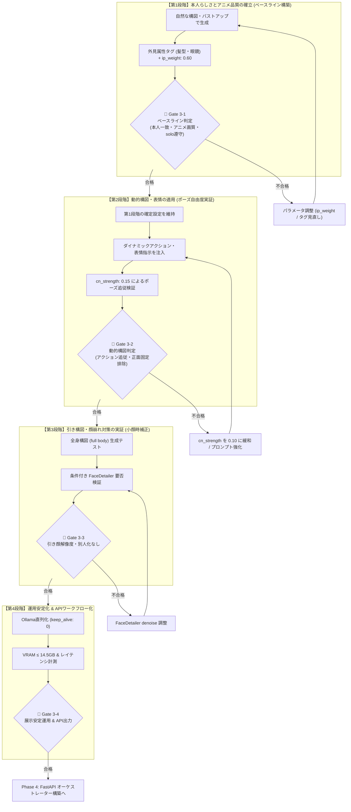

# StoryWeaver Live Phase 3 実装検証計画書
## （Animagine XL v3.1 ＋ InstantID 骨格拘束緩和版・段階的実証仕様）

**文書バージョン**: 3.0.0  
**作成日**: 2026年10月11日  
**基本方針**: **「時間よりも画質・意図した絵の成立を最優先」**  
**対象環境**: ThinkPad X1 Extreme (GPU: RTX 3080 Laptop 16GB / RAM: 32GB / Windows 11)  
**運用制約**: 展示ブース完全ローカル稼働 / ゼロダウンタイム / VRAM 14.5GB 以内 (OOMゼロ)

---

## 1. エグゼクティブサマリー & 方針転換の経緯

### 1.1 前検証（Mage-Flow）の中止理由
Phase 3-1 においてマルチモーダル編集モデル（Mage-Flow-Edit Base）の単体検証を実施した結果、以下の致命的欠陥が確認され、Gate 3-1「不合格（NG）」として正式に検証中止・廃止を決定した。
1. **マルチサブジェクト分裂・コラージュ破綻**:  
   `anime illustration` という指示に対し、モデルの学習データ特性（実写編集中心）から「アニメ集合ポスター」の断片が想起され、`solo` 指示にもかかわらず画面内に 4〜10 人以上の人物と集合絵がパッチワーク状に同時描画された。
2. **チープな平塗り・実写寄りの不気味さ**:  
   Danbooru タグによる洗練されたアニメ表現力を持たず、元写真のリアルな陰影とチープな塗りが混ざり合って品質基準に達しなかった。

### 1.2 採用方針：Animagine XL v3.1 ＋ ApplyInstantIDAdvanced（骨格拘束緩和版）
日本のアニメイラスト画質において実績・完成度ともに最高峰である **`Animagine XL v3.1` (FP8)** を採用し、顔認証エンジン（InsightFace）による高精度な人物同一性を保持する **`InstantID`** と組み合わせる。

特に、過去の InstantID 単体テストで直面した**「ポーズが正面直立に固定される問題」**を根本解決するため、通常ノード（`ApplyInstantID`）ではなく、顔特徴と骨格拘束の重みを完全分離できる **`ApplyInstantIDAdvanced`** を導入する。
* **顔特徴埋め込み (`ip_weight`)**: **`0.60`**（元写真の顔貌・目元・眼鏡を確実にアニメへ反映）
* **骨格拘束強度 (`cn_strength`)**: **`0.15`**（ControlNet の幾何学的拘束を 80% カットし、身体や首の正面固定を完全解除）
* **外見属性の役割分担**: 顔パーツの配置比率は InstantID が担い、髪型・髪色・眼鏡などの装飾属性はプロンプト（Danbooruタグ）で明示的に指定して合体させる。

---

## 2. 検証の基本方針：2段階アプローチによるパラメータ切り分け

パラメータの影響を正確に切り分け、手戻りのない検証を行うため、以下の **2段階アプローチ** を基本方針とする。



---

## 3. モデルファイル群の配置リスト（ユーザーローカル実在確認済み）

ユーザー環境（`C:\pinokio\api\comfy.git\app\models`）において、全モデルおよびカスタムノードの存在を確認済み。追加ダウンロードは不要。

| 種別 | 配置先フォルダ | 実際のファイル名 | ファイルサイズ | 役割 |
| :--- | :--- | :--- | :--- | :--- |
| **Checkpoint** | `models/checkpoints/` | **`animagine-xl-3.1.float8_e4m3fn.safetensors`** | 約 3.47 GB | Animagine XL v3.1 FP8 本体 |
| **InstantID** | `models/instantid/` | **`ip-adapter.bin`** | 約 1.69 GB | InstantID 顔特徴量アダプタ |
| **ControlNet** | `models/controlnet/` | **`diffusion_pytorch_model.safetensors`** | 約 2.50 GB | InstantID 顔骨格 ControlNet |
| **InsightFace** | `models/insightface/models/antelopev2/` | **`antelopev2` 一式（全5ファイル）**<br>`1k3d68.onnx`, `2d106det.onnx`, `genderage.onnx`, `glintr100.onnx`, `scrfd_10g_bnkps.onnx` | 計 約 420 MB | 顔検出・512次元顔特徴量抽出エンジン |
| **YOLO Bbox** | `models/ultralytics/bbox/` | **`face_yolov8m.pt`** | 約 52 MB | 顔検出モデル（Phase 3-3 用） |

---

## 4. ComfyUI ワークフロー構成詳細（全12ノード設計図）

### 4.1 必要なノード一覧表（全 12 ノード）

ComfyUI キャンバスの空白を **ダブルクリック $\rightarrow$ 検索** して配置します。

| # | ノード名（検索キーワード） | 役割 |
| :-: | :--- | :--- |
| **1** | `CheckpointLoaderSimple` (`Checkpoint`) | Animagine XL v3.1 FP8 モデルの読み込み |
| **2** | `InstantIDModelLoader` (`InstantID`) | InstantID モデル (`ip-adapter.bin`) の読み込み |
| **3** | `ControlNetLoader` (`ControlNet`) | InstantID 専用 ControlNet (`diffusion_pytorch_model.safetensors`) の読み込み |
| **4** | `InstantIDFaceAnalysis` (`FaceAnalysis`) | InsightFace (antelopev2) による顔特徴抽出器 (CPU) |
| **5** | `Load Image` (`Load Image`) | 来場者の顔写真（テスト画像）の入力 |
| **6** | `ApplyInstantIDAdvanced` (`Apply InstantID Advanced`) | **【最重要】顔特徴（ip_weight）と骨格拘束（cn_strength）を独立制御** |
| **7** | `CLIPTextEncode` (`CLIP Text`) | Positive プロンプト（アニメ品質タグ＋情景） |
| **8** | `CLIPTextEncode` (`CLIP Text`) | Negative プロンプト（実写排除・品質低下排除） |
| **9** | `EmptyLatentImage` (`Empty Latent`) | 生成解像度 (1024 x 1024) |
| **10** | `KSampler` (`KSampler`) | 30 steps / CFG 6.5 による美麗アニメレンダリング |
| **11** | `VAEDecode` (`VAE Decode`) | 潜在変数からイラスト画像への現像 |
| **12** | `Save Image` (`Save Image`) | 完成した美麗アニメイラストの保存・プレビュー |

---

### 4.2 全体配線図（Mermaid）

```mermaid
graph LR
    subgraph 1. モデル群の読み込み
        CKPT["1. CheckpointLoaderSimple
(animagine-xl-3.1.float8)"]
        I_LOAD["2. InstantIDModelLoader
(ip-adapter.bin)"]
        C_LOAD["3. ControlNetLoader
(diffusion_pytorch_model)"]
        FA["4. InstantIDFaceAnalysis
(provider: CPU)"]
    end

    subgraph 2. 写真入力 & 条件付け
        IMG["5. Load Image
(来場者顔写真)"]
        POS["7. CLIPTextEncode (Pos)
(品質 + 外見属性 + ポーズ)"]
        NEG["8. CLIPTextEncode (Neg)
(品質劣化排除 + 実写排除)"]
        APP["6. ApplyInstantIDAdvanced
ip_weight: 0.60
cn_strength: 0.15"]
        LATENT["9. EmptyLatentImage
(1024 x 1024)"]
    end

    subgraph 3. 高画質生成
        KS["10. KSampler
(Steps: 30 / CFG: 6.5 / euler_ancestral)"]
    end

    subgraph 4. 現像・保存
        DEC["11. VAEDecode"]
        SAVE["12. Save Image"]
    end

    %% InstantID Advanced への入力
    I_LOAD --"INSTANTID"--> APP
    FA --"FACEANALYSIS"--> APP
    C_LOAD --"CONTROL_NET"--> APP
    IMG --"🔵 IMAGE"--> APP
    CKPT --"🟣 MODEL"--> APP
    POS --"🟠 CONDITIONING"--> APP
    NEG --"🟠 CONDITIONING"--> APP

    %% CLIP 接続
    CKPT --"🟡 CLIP"--> POS
    CKPT --"🟡 CLIP"--> NEG

    %% KSampler への接続
    APP --"🟣 MODEL"--> KS
    APP --"🟠 positive"--> KS
    APP --"🟠 negative"--> KS
    LATENT --"🌸 LATENT"--> KS

    %% 現像接続
    KS --"🌸 LATENT"--> DEC
    CKPT --"🔴 VAE"--> DEC
    DEC --"🔵 IMAGE"--> SAVE

    classDef purple fill:#7c3aed,stroke:#a78bfa,color:#fff;
    classDef yellow fill:#d97706,stroke:#fcd34d,color:#fff;
    classDef red fill:#dc2626,stroke:#fca5a5,color:#fff;
    classDef orange fill:#ea580c,stroke:#fdba74,color:#fff;
    classDef pink fill:#db2777,stroke:#f472b6,color:#fff;
    classDef blue fill:#2563eb,stroke:#93c5fd,color:#fff;
```

---

### 4.3 🔌 端子接続の完全一覧表（全 16 本）

右端子をクリック＆ドラッグして、相手の左端子に繋ぎます。

| # | 出発元ノード | 出発端子（右側） | 色 | つなぐ先ノード | 受け取り端子（左側） |
| :-: | :--- | :--- | :-: | :--- | :--- |
| **1** | 1. CheckpointLoaderSimple | `MODEL` | 🟣 紫 | 6. ApplyInstantIDAdvanced | `model` |
| **2** | 1. CheckpointLoaderSimple | `CLIP` | 🟡 黄 | 7. CLIPTextEncode (Pos) | `clip` |
| **3** | 1. CheckpointLoaderSimple | `CLIP` | 🟡 黄 | 8. CLIPTextEncode (Neg) | `clip` |
| **4** | 1. CheckpointLoaderSimple | `VAE` | 🔴 赤 | 11. VAEDecode | `vae` |
| **5** | 2. InstantIDModelLoader | `INSTANTID` | 🟢 緑 | 6. ApplyInstantIDAdvanced | `instantid` |
| **6** | 3. ControlNetLoader | `CONTROL_NET` | 🟣 紫 | 6. ApplyInstantIDAdvanced | `control_net` |
| **7** | 4. InstantIDFaceAnalysis | `FACEANALYSIS` | 🔵 青 | 6. ApplyInstantIDAdvanced | `insightface` |
| **8** | 5. Load Image | `IMAGE` | 🔵 青 | 6. ApplyInstantIDAdvanced | `image` |
| **9** | 7. CLIPTextEncode (Pos) | `CONDITIONING` | 🟠 橙 | 6. ApplyInstantIDAdvanced | `positive` |
| **10** | 8. CLIPTextEncode (Neg) | `CONDITIONING` | 🟠 橙 | 6. ApplyInstantIDAdvanced | `negative` |
| **11** | 6. ApplyInstantIDAdvanced | `MODEL` | 🟣 紫 | 10. KSampler | `model` |
| **12** | 6. ApplyInstantIDAdvanced | `positive` | 🟠 橙 | 10. KSampler | `positive` |
| **13** | 6. ApplyInstantIDAdvanced | `negative` | 🟠 橙 | 10. KSampler | `negative` |
| **14** | 9. EmptyLatentImage | `LATENT` | 🌸 ピンク | 10. KSampler | `latent_image` |
| **15** | 10. KSampler | `LATENT` | 🌸 ピンク | 11. VAEDecode | `samples` |
| **16** | 11. VAEDecode | `IMAGE` | 🔵 青 | 12. Save Image | `images` |

---

### 4.4 各ノードのパラメータ設定値表

| ノード名 | パラメータ | 設定値 | 理由・設定根拠 |
| :--- | :--- | :--- | :--- |
| **1. CheckpointLoaderSimple** | `ckpt_name` | **`animagine-xl-3.1.float8_e4m3fn.safetensors`** | 最高峰アニメ特化 SDXL (FP8) |
| **2. InstantIDModelLoader** | `instantid_file` | **`ip-adapter.bin`** | InstantID 公式アダプタ |
| **3. ControlNetLoader** | `control_net_name` | **`diffusion_pytorch_model.safetensors`** | InstantID 公式 ControlNet |
| **4. InstantIDFaceAnalysis** | `provider` | **`CPU`** | InsightFace を CPU 実行し VRAM 0.4GB 節約 |
| **6. ApplyInstantIDAdvanced** | `ip_weight`<br>`cn_strength`<br>`start_at`<br>`end_at` | **`0.60`**<br>**`0.15`**<br>`0.0`<br>`1.0` | **【核心設定】**<br>顔特徴（`ip_weight`）を `0.60` で転写しつつ、骨格拘束（`cn_strength`）を `0.15` に極小化して正面固定を解除 |
| **9. EmptyLatentImage** | `width`<br>`height` | **`1024`**<br>**`1024`** | SDXL ネイティブ高精細解像度 |
| **10. KSampler** | `steps`<br>`cfg`<br>`sampler_name`<br>`scheduler`<br>`denoise` | **`30`**<br>**`6.5`**<br>**`euler_ancestral`**<br>**`normal`**<br>**`1.0`** | Animagine 公式推奨値。美麗なアニメ塗りと瞳のハイライトを描画 |

---

## 5. 各検証フェーズの手順・プロンプト・Phase Gate・調整方針

### Phase 3-1: 【第1段階：本人らしさとアニメ品質の確立（ベースライン構築）】

- **目的**: 動的なポーズ指定は行わず（バストアップ・正面/自然な構図）、まずは「本人の外見特徴（髪型、眼鏡、顔貌）」の確実な反映と「美麗なアニメ画質」を両立するパラメータ構成を確定させる。
- **検証入力**: 異なる外見特徴を持つ顔写真（例: 短髪男性、黒髪長髪・眼鏡、パーマ髪型）

#### プロンプト設定（第1段階用）
* **Positive (7 番 CLIPTextEncode)**:
  ```text
  masterpiece, best quality, very aesthetic, anime art style, vibrant colors,
  solo, 1boy, short hair, black hair, glasses, confident smile, upper body, looking at viewer,
  fantasy adventurer, magical aura, sharp focus, detailed illustration
  ```
  *(※被写体の性別・外見に合わせて `1boy` $\rightarrow$ `1girl`、`short hair, black hair, glasses` を適宜変更)*
* **Negative (8 番 CLIPTextEncode)**:
  ```text
  lowres, bad anatomy, bad hands, text, error, missing fingers, extra digit,
  fewer digits, cropped, worst quality, low quality, normal quality,
  jpeg artifacts, signature, watermark, username, blurry, artist name,
  realistic, photograph, 3d render, deformed
  ```

#### 🚧 Gate 3-1 判定基準
| # | チェック項目 | 合格基準 | 合否 |
| :-: | :--- | :--- | :---: |
| 1 | **アニメ絵画品質** | 実写の不気味さやチープな平塗りがなく、美麗なアニメイラスト（セル画・瞳のハイライト）であること | ☐ |
| 2 | **人数制御 (solo)** | Mage-Flow で発生した分裂・集合絵がなく、厳密に指定した 1 名のみが描かれていること | ☐ |
| 3 | **本人同一性の反映** | 顔貌（目鼻立ちのバランス）に加え、プロンプトで補強した髪型・眼鏡が写真と一致していること | ☐ |
| 4 | **顔面アーティファクト排除** | 目鼻の崩れ、二重顎、不自然な黒ずみ等がないこと | ☐ |

#### ⚠️ Gate 3-1 未達時のパラメータ調整・代替策
1. **本人らしさが薄い（似ていない）場合**:
   * `ApplyInstantIDAdvanced` の `ip_weight` を `0.60` $\rightarrow$ **`0.70`** に引き上げる。
   * プロンプトの外見タグをより具体化する（例: `round eyeglasses`, `messy hair`, `side-swept bangs`）。
2. **アニメ絵が硬い・実写の質感が混ざる場合**:
   * `ip_weight` を `0.60` $\rightarrow$ **`0.50〜0.55`** にわずかに下げ、Animagine の描画自由度を高める。
   * CFG を `6.5` $\rightarrow$ **`7.0`** に引き上げてアニメプロンプトの強制力を高める。
3. **眼鏡が反映されない場合**:
   * Positive プロンプト内で `(glasses:1.2)` と重み付け強調を行う。

---

### Phase 3-2: 【第2段階：動的構図・表情の適用（ポーズ自由度実証）】

- **目的**: 第1段階で確立した設定（本人らしさと画質）を維持したまま、ダイナミックなアクションポーズ（抜刀、跳躍、振り返り構図）や豊かな表情の指示が写真の顔向きに拘束されず自然に追従するかを実証する。
- **検証条件**: 第1段階で確定した `ip_weight` および外見タグを固定。

#### プロンプト設定（第2段階用：動的アクション & 表情）
* **検証パターン A（ダイナミック抜刀・戦闘アクション）**:
  ```text
  masterpiece, best quality, very aesthetic, anime art style, vibrant colors,
  solo, 1boy, short hair, black hair, glasses,
  dynamic angle, high action pose, swinging glowing katana, battle stance,
  determined expression, shouting, glowing magical particles, dramatic lighting, sharp focus
  ```
* **検証パターン B（振り返り・横顔・エモーショナル構図）**:
  ```text
  masterpiece, best quality, very aesthetic, anime art style, vibrant colors,
  solo, 1boy, short hair, black hair, glasses,
  looking back over shoulder, side profile, turning around,
  gentle smile, wind blowing hair, sunset rim lighting, cinematic composition
  ```

#### 🚧 Gate 3-2 判定基準
| # | チェック項目 | 合格基準 | 合否 |
| :-: | :--- | :--- | :---: |
| 1 | **ポーズ追従性** | 指示された動的アクション（抜刀姿勢、跳躍、身体のひねり、振り返り）が正確に描画されていること | ☐ |
| 2 | **正面拘束の完全排除** | 顔の向き・目線が元写真の正面向きに引っ張られず、身体のアクション方向に自然に追従していること | ☐ |
| 3 | **表情追従性** | 元写真の無表情/静止表情に固定されず、プロンプトで指示した表情（叫び、気迫、微笑み等）になっていること | ☐ |
| 4 | **同一性の継続維持** | ポーズやアングルが変わっても、第1段階で確認された人物特徴（髪型・眼鏡・面影）が維持されていること | ☐ |

#### ⚠️ Gate 3-2 未達時のパラメータ調整・代替策
1. **身体は動くが、顔だけが写真の正面を向いてしまう場合（首のねじれ等）**:
   * `ApplyInstantIDAdvanced` の `cn_strength` を `0.15` $\rightarrow$ **`0.10`** に引き下げる。
   * プロンプト冒頭に `from side, profile shot, looking away from camera` を強調配置する。
2. **ポーズは完璧だが、顔の特徴が抜け落ちてしまう場合**:
   * `cn_strength` は `0.15` を維持したまま、`ip_weight` を `0.65` に微増。
   * `end_at`（適用終了ステップ）を `1.0` $\rightarrow$ **`0.85`** に設定（生成後半のディテール構築時にポーズの自由度を最大化）。

---

### Phase 3-3: 【第3段階：引き構図・顔崩れ対策の実証（FaceDetailer 要否検証）】

- **目的**: 全身構図（`full body`）で人物が遠景に配置された際、顔が潰れるかを確認し、潰れる場合は FaceDetailer で「別人化せずに高精細化できるか」を実証する。
- **検証手順**:
  1. まず **補正なし Direct 生成** を行い、顔領域をクロップ拡大して評価。
  2. 潰れている場合のみ、**条件付き FaceDetailer**（`bbox/face_yolov8m.pt`, `denoise: 0.35`）を適用して比較。

#### 🚧 Gate 3-3 判定基準
| # | チェック項目 | 合格基準 | 合否 |
| :-: | :--- | :--- | :---: |
| 1 | **引きの顔解像度** | 全身構図でも目・瞳・眼鏡・口元が綺麗に描かれていること | ☐ |
| 2 | **別人化の非発生** | 補正後の顔が元写真および Phase 3-1 の面影を保ち、別人化していないこと | ☐ |
| 3 | **首・髪境界の自然さ** | 再描画領域と周囲の境界線に違和感・色浮きがないこと | ☐ |

#### ⚠️ Gate 3-3 未達時のパラメータ調整・代替策
* **別人化する場合**: FaceDetailer の `denoise` を `0.35` $\rightarrow$ **`0.25〜0.30`** に低下。それでも別人化するなら FaceDetailer は不採用とし、全体解像度調整（1024x1024 $\rightarrow$ 1152x1152等）へ切り替え。
* **補正なしで十分に綺麗な場合**: **FaceDetailer は不採用（単一パス）** とし、処理速度とメモリを節約。

---

### Phase 3-4: 【第4段階：運用安定化・APIワークフロー化】

- **目的**: 第1〜3段階で確立されたワークフローに対し、展示運用に耐える安定性（VRAM ≤ 14.5GB、Ollama直列化 `keep_alive: 0`）を確認し、API Format JSON を出力する。

#### 🚧 Gate 3-4 判定基準（最終関門）
| # | チェック項目 | 合格基準 | 確認方法 | 合否 |
| :-: | :--- | :--- | :--- | :--- : |
| 1 | **絵画品質・構図の成立** | Phase 3-1〜3-3 の全要件を満たしていること | レビュー確認 | ☐ |
| 2 | **OOM ゼロ (VRAM ≤ 14.5GB)** | 連続生成中に VRAM 14.5GB を一度も超えないこと | `nvidia-smi` 監視 | ☐ |
| 3 | **メモリ直列化の動作** | Ollama 完了後にモデルが即時アンロードされること | `keep_alive: 0` 確認 | ☐ |
| 4 | **生成レイテンシ記録** | 所要時間を実測・記録し、タイムアウト値を確定 | 実測記録 | ☐ |
| 5 | **API ワークフロー出力** | SceneSpec を動的注入可能な JSON が保存されていること | `storyweaver_anime_api.json` | ☐ |

---

## 6. まとめ：各サブフェーズとマイルストーン

| フェーズ | 主要タスク | 主な評価指標 | 目標到達点 |
| :--- | :--- | :--- | :--- |
| **Phase 3-1** | 【第1段階】基本画質・外見属性・本人一致の確立 | アニメ品質、本人一致、`solo` 遵守 | ベースラインパラメータの確定 (`ip_weight: 0.60`) |
| **Phase 3-2** | 【第2段階】動的構図・表情の追従性実証 | 抜刀/振り返り追従、正面固定解除 | 骨格拘束パラメータの確定 (`cn_strength: 0.15`) |
| **Phase 3-3** | 引き構図・顔解像度検証（FaceDetailer 要否判定） | 全身構図での目鼻立ち、別人化ゼロ | 単一パス or 条件付き FaceDetailer の確定 |
| **Phase 3-4** | 運用安定化・VRAM監視・API JSON出力 | VRAM ≤ 14.5GB、OOMゼロ、直列化 | `storyweaver_anime_api.json` の保存 |
