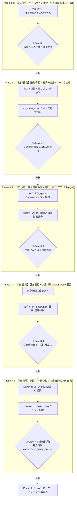

# StoryWeaver Live Phase 3 実装検証計画書
## （Animagine XL v3.1 ＋ InstantID ＋ WD14 Tagger 完全自動化・段階的実証仕様）

**文書バージョン**: 3.1.0  
**作成日**: 2026年10月11日  
**基本方針**: **「時間よりも画質・完全自動化パイプラインの成立を最優先」**  
**対象環境**: ThinkPad X1 Extreme (GPU: RTX 3080 Laptop 16GB / RAM: 32GB / Windows 11)  
**運用制約**: 展示ブース完全ローカル稼働 / ゼロダウンタイム / VRAM 14.5GB 以内 / レイテンシ ≤ 20秒

---

## 1. 改訂の背景・目的と全体スコープ

### 1.1 改訂の目的：手動プロンプトから「完全自動化」への確実な昇格
前版（v3.0.0）では、外見属性（髪型・眼鏡等）を手動プロンプトで記述する構成となっていました。しかし、展示インスタレーションの本来の要件は**「来場者の顔写真（Webカメラ1枚）から完全自動で特徴を抽出し、アニメイラストを生成すること」**です。  
手動プロンプト前提のまま API ワークフロー化（Phase 3-5）に進むと、Phase 4（FastAPI連携）で必ず破綻・手戻りが発生するため、**`WD14 Tagger` およびテキスト結合ノードを組み込んだ自動抽出パイプラインの検証ステップを正式なフェーズとして配置**します。

### 1.2 Phase 3 と Phase 4 の境界（スコープ定義）
* **Phase 3（画像生成コアの完結）**:  
  ComfyUI 単体において、「顔写真（IMAGE）＋ 情景指示テキスト（STRING）」を入力すれば、WD14 Tagger による外見自動抽出、InstantID による顔転生、Animagine XL による高画質描画が**手動介入なしで一気通貫に完結するワークフローを確立**し、最終成果物である **`storyweaver_anime_api.json`** を出力・検証する。
* **Phase 4（オーケストレーター統合）**:  
  FastAPI が SenseVoice (ASR) $\rightarrow$ Ollama (LLM) $\rightarrow$ ComfyUI API（Phase 3 で出力した JSON）を順次呼び出し、システム全体を結合する。

---

## 2. 検証の5段階ロードマップ（手戻り防止フロー）

パラメータの影響を正確に切り分け、手戻りを防ぐため、以下の **5段階アプローチ** で推進します。

---

## 3. モデルおよびノード構成（完全自動化対応）

### 3.1 必要なモデル一覧（ユーザー環境確認済み）
すべて `C:\pinokio\api\comfy.git\app\models` 配下に実在確認済み。

| 種別 | 配置先フォルダ | 選択するファイル名 | 役割 |
| :--- | :--- | :--- | :--- |
| **Checkpoint** | `models/checkpoints/` | **`animagine-xl-3.1.float8_e4m3fn.safetensors`** | 本体モデル（FP8 アニメ画質） |
| **InstantID** | `models/instantid/` | **`ip-adapter.bin`** | InstantID 顔特徴量アダプタ |
| **ControlNet** | `models/controlnet/` | **`diffusion_pytorch_model.safetensors`** | InstantID 専用 ControlNet |
| **InsightFace** | `models/insightface/models/antelopev2/` | **`antelopev2` 一式（全5ファイル）** | 顔認識・パーツ抽出エンジン |
| **YOLO Bbox** | `models/ultralytics/bbox/` | **`face_yolov8m.pt`** | 顔検出モデル（Phase 3-4 用） |
| **LoRA** | `models/loras/` | **`sdxl_lightning_8step_lora.safetensors`** | 高速化用 LoRA（Phase 3-5 用） |

---

### 3.2 必要な全ノード一覧（完全自動化ワークフロー：全14ノード）

| # | ノード名（検索名） | 役割 |
| :-: | :--- | :--- |
| **1** | `CheckpointLoaderSimple` | Animagine XL v3.1 FP8 本体モデルの読み込み |
| **2** | `InstantIDModelLoader` | InstantID モデル (`ip-adapter.bin`) の読み込み |
| **3** | `ControlNetLoader` | 専用 ControlNet (`diffusion_pytorch_model.safetensors`) の読み込み |
| **4** | `InstantIDFaceAnalysis` | InsightFace による顔特徴抽出器 (CPU 実行) |
| **5** | `Load Image` | 来場者の顔写真（Webカメラ入力） |
| **6** | `WD14Tagger\|pysssss` (`WD14 Tagger`) | **【自動化】顔写真から外見属性（髪型・眼鏡等）を自動抽出** |
| **7** | `StringConcatenate` (`Concatenate Text`) | **【自動化】情景プロンプトと WD14 タグをカンマ結合** |
| **8** | `CLIPTextEncode` (Positive) | 情景＋自動外見タグを条件付け（text 端子を入力化） |
| **9** | `CLIPTextEncode` (Negative) | 実写・低品質タグの除外条件付け |
| **10** | `ApplyInstantIDAdvanced` | **顔特徴（`ip_weight`）と骨格拘束（`cn_strength`）の分離制御** |
| **11** | `EmptyLatentImage` | 生成解像度 (1024 x 1024) |
| **12** | `KSampler` | 美麗アニメレンダリング (30 steps, CFG 6.5) |
| **13** | `VAEDecode` | 潜在変数からイラスト画像への現像 |
| **14** | `Save Image` | 完成したイラストの保存・プレビュー |

---

### 3.3 🔌 端子接続の完全一覧表（完全自動化対応：全19本）

※ `CLIPTextEncode` (Positive) は、ノード上で右クリック $\rightarrow$ **「Convert text to input」** を実行して左側に `text` 端子を露出させます。

| # | 出発元ノード | 出発端子（右側） | 色 | つなぐ先ノード | 受け取り端子（左側） |
| :-: | :--- | :--- | :-: | :--- | :--- |
| **1** | 5. Load Image | `IMAGE` | 🔵 青 | 6. WD14 Tagger | `image` |
| **2** | 6. WD14 Tagger | `STRING` | ⚪ 白 | 7. Concatenate Text | `string_b` |
| **3** | 7. Concatenate Text | `STRING` | ⚪ 白 | 8. CLIPTextEncode (Pos) | `text` *(※右クリックで入力化)* |
| **4** | 1. CheckpointLoaderSimple | `CLIP` | 🟡 黄 | 8. CLIPTextEncode (Pos) | `clip` |
| **5** | 1. CheckpointLoaderSimple | `CLIP` | 🟡 黄 | 9. CLIPTextEncode (Neg) | `clip` |
| **6** | 1. CheckpointLoaderSimple | `MODEL` | 🟣 紫 | 10. ApplyInstantIDAdvanced | `model` |
| **7** | 2. InstantIDModelLoader | `INSTANTID` | 🟢 緑 | 10. ApplyInstantIDAdvanced | `instantid` |
| **8** | 3. ControlNetLoader | `CONTROL_NET` | 🟣 紫 | 10. ApplyInstantIDAdvanced | `control_net` |
| **9** | 4. InstantIDFaceAnalysis | `FACEANALYSIS` | 🔵 青 | 10. ApplyInstantIDAdvanced | `insightface` |
| **10** | 5. Load Image | `IMAGE` | 🔵 青 | 10. ApplyInstantIDAdvanced | `image` |
| **11** | 8. CLIPTextEncode (Pos) | `CONDITIONING` | 🟠 橙 | 10. ApplyInstantIDAdvanced | `positive` |
| **12** | 9. CLIPTextEncode (Neg) | `CONDITIONING` | 🟠 橙 | 10. ApplyInstantIDAdvanced | `negative` |
| **13** | 10. ApplyInstantIDAdvanced | `MODEL` | 🟣 紫 | 12. KSampler | `model` |
| **14** | 10. ApplyInstantIDAdvanced | `positive` | 🟠 橙 | 12. KSampler | `positive` |
| **15** | 10. ApplyInstantIDAdvanced | `negative` | 🟠 橙 | 12. KSampler | `negative` |
| **16** | 11. EmptyLatentImage | `LATENT` | 🌸 ピンク | 12. KSampler | `latent_image` |
| **17** | 12. KSampler | `LATENT` | 🌸 ピンク | 13. VAEDecode | `samples` |
| **18** | 1. CheckpointLoaderSimple | `VAE` | 🔴 赤 | 13. VAEDecode | `vae` |
| **19** | 13. VAEDecode | `IMAGE` | 🔵 青 | 14. Save Image | `images` |

---

## 4. 各検証フェーズの手順・判定基準・調整方針

### Phase 3-1: 【第1段階：ベースライン確立（基本画質 & 本人一致）】
* **目的**: 動的ポーズを入れず、手動外見タグ ＋ `ApplyInstantIDAdvanced`（`ip_weight: 0.60`, `cn_strength: 0.15`）により、モデル本来の描画力と顔特徴の反映バランスを確立する。
* **🚧 Gate 3-1 判定基準**:
  * アニメ画質（セル画・瞳のハイライト）が美麗であること。
  * `solo` が遵守され、コラージュや分裂がないこと。
  * 写真の目鼻立ち・髪型・眼鏡が一致していること。
* **⚠️ 調整方針**:
  * 似ていない場合 $\rightarrow$ `ip_weight: 0.70` へ引き上げ。
  * アニメ絵が硬い場合 $\rightarrow$ `ip_weight: 0.50〜0.55` へ微減、CFG 7.0 へ引き上げ。

---

### Phase 3-2: 【第2段階：動的構図・表情の適用（ポーズ自由度実証）】
* **目的**: 第1段階の設定を維持したまま、ダイナミックなアクション（抜刀・振り返り・表情指示）が元写真の正面向きに拘束されず追従するかを実証する。
* **骨格拘束緩和のトレードオフ検証**:
  * `cn_strength` が高すぎる（> 0.25）と正面固定される。
  * `cn_strength` が低すぎる（< 0.08）と顔立ちが崩れ、別人化する。
  * スイートスポット（`0.12〜0.18`、推奨 `0.15`）を確定させる。
* **🚧 Gate 3-2 判定基準**:
  * 抜刀や振り返りポーズに身体と顔が自然に追従していること。
  * 元写真の真顔に固定されず、指示した表情（叫び、微笑み）になっていること。
  * アクション時も第1段階で確認された人物同一性が維持されていること。
* **⚠️ 調整方針**:
  * 首が正面を向く場合 $\rightarrow$ `cn_strength: 0.10` へ引き下げ、`side profile` を強調。
  * 特徴が抜ける場合 $\rightarrow$ `ip_weight: 0.65` へ微増、`end_at: 0.85` 設定。

---

### Phase 3-3: 【第3段階：外見属性の完全自動化実証（WD14 Tagger 統合）】
* **目的**: 手動タグを完全撤廃し、`WD14 Tagger` から抽出されたタグと情景プロンプトを `Concatenate Text` で結合。**写真を入力するだけで、手動介入なしに第1・第2段階と同等の品質・同一性が得られるかを実証する**。
* **ノード設定**:
  * `WD14 Tagger`: `threshold: 0.35`, `character_threshold: 0.85`, `replace_underscore: true`, `trailing_comma: true`
  * `Concatenate Text`:
    * `string_a`: 情景プロンプト（`masterpiece, best quality, anime art style, vibrant colors, solo, 1boy, fantasy warrior, dynamic angle...`）
    * `string_b`: WD14 Tagger の出力 `STRING`（抽出された外見タグ）
    * `delimiter`: `, `
* **🚧 Gate 3-3 判定基準**:
  * 手動タグなしで、写真の髪型・髪色・眼鏡が正しく自動抽出・反映されること。
  * 不要なノイズタグ（服の色や背景タグ）によって構図や画質が崩れないこと。
* **⚠️ 調整方針**:
  * 眼鏡や髪型が抜ける場合 $\rightarrow$ `threshold: 0.25〜0.30` に下げて検出感度を上げる。
  * 余計な背景タグが混ざる場合 $\rightarrow$ `exclude_tags` に除外タグを追加。

---

### Phase 3-4: 【第4段階：引き構図・小顔対策（FaceDetailer 要否検証）】
* **目的**: 全身構図（`full body`）で人物が遠景に配置された際、顔が潰れるかを確認し、`FaceDetailer` による修復の必要性と、処理時間（+2〜3秒）のトレードオフを判定する。
* **🚧 Gate 3-4 判定基準**:
  * 引き構図でも目・瞳・眼鏡が破綻せず綺麗に描かれていること。
  * FaceDetailer を適用した場合に別人化していないこと。
* **⚠️ 調整方針**:
  * **補正なしで十分に綺麗な場合** $\rightarrow$ **FaceDetailer は不採用（単一パス）**。処理時間とメモリを節約。
  * 潰れる場合のみ $\rightarrow$ **条件付き FaceDetailer（`bbox/face_yolov8m.pt`, `denoise: 0.25〜0.30`）** を採用。

---

### Phase 3-5: 【第5段階：高速化・安定化 & 完全自動化 API ワークフロー出力】
* **目的**: 完全自動化されたワークフローに対し、展示運用に耐える安定性、レイテンシ許容基準（≤ 20秒）の達成を確認し、最終成果物 **`storyweaver_anime_api.json`** を出力する。
* **レイテンシ許容基準**:
  * **目標レイテンシ**: 撮影から画像生成完了まで **15秒以内**（許容上限: 20秒以内）。
  * 処理内訳目安:
    - WD14 Tagger: ~0.8秒
    - InsightFace (FaceAnalysis): ~0.5秒
    - KSampler (Base 30 steps: ~14秒 / Lightning 8-step: ~4.5秒 / Lightning 4-step: ~2.5秒)
    - VAEDecode: ~0.6秒
* **🚧 Gate 3-5 判定基準（最終関門）**:
  1. **完全自動化の成立**: 写真と情景プロンプトを流すだけで、手動介入なしに全自動生成されること。
  2. **OOM ゼロ (VRAM ≤ 14.5GB)**: 連続生成中に VRAM 14.5GB を一度も超えないこと。
  3. **レイテンシ基準達成**: 合計生成時間が 20秒以内であること。
  4. **API Format JSON 出力**: `storyweaver_anime_api.json` が正常に出力・保存され、FastAPI からロード可能なこと。

---

## 5. まとめ：各サブフェーズとマイルストーン

| フェーズ | 主要検証内容 | 手動/自動 | 主な判定指標 | 目標到達点 |
| :--- | :--- | :---: | :--- | :--- |
| **Phase 3-1** | 【第1段階】基本画質・本人一致 | 手動タグ | 画質、本人感、`solo` 遵守 | ベースライン確定 (`ip_weight: 0.60`) |
| **Phase 3-2** | 【第2段階】動的アクション・表情 | 手動タグ | 抜刀追従、正面固定解除 | 骨格拘束確定 (`cn_strength: 0.15`) |
| **Phase 3-3** | 【第3段階】外見属性の完全自動化 | **完全自動** | WD14 タグ自動結合、特徴再現 | 手動プロンプトの完全撤廃 |
| **Phase 3-4** | 【第4段階】引き構図・小顔対策 | 完全自動 | 引き顔解像度、別人化なし | FaceDetailer 要否・denoise 確定 |
| **Phase 3-5** | 【第5段階】高速化 & 安定運用化 | 完全自動 | VRAM ≤ 14.5GB、時間 ≤ 20s | **`storyweaver_anime_api.json` の確定** |
