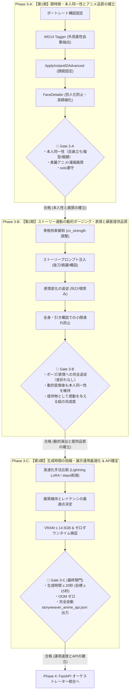

# StoryWeaver Live Phase 3 実装検証計画書
## （本人同一性 ➔ ストーリー動的演出 ➔ 生成時間短縮：3大フェーズ検証仕様）

**文書バージョン**: 4.0.0  
**改訂日**: 2026年10月11日  
**基本思想**: **「顔特徴の再現 ➔ ストーリー連動の動的演出 ➔ 生成速度の最適化」を順次確立し、手戻りゼロで顧客提供価値を最大化する**  
**対象環境**: ThinkPad X1 Extreme (GPU: RTX 3080 Laptop 16GB / RAM: 32GB / Windows 11)  
**運用制約**: 展示ブース完全ローカル稼働 / ゼロダウンタイム / VRAM 14.5GB 以内 / レイテンシ ≤ 20秒

---

## 1. 全体ロードマップと Phase 体系

本計画は、展示インスタレーションとしての顧客体験価値（「あ、自分だ！」「かっこいい！」「早い！」）を段階的かつ確実に達成するため、以下の **3大フェーズ構成** で推進します。



---

## 2. 各フェーズの詳細設計・タスク・判定基準 (Gate)

---

### Phase 3-A: 【第1期】顔特徴・本人同一性とアニメ品質の確立

#### 1. 目的
動的ポーズや全身構図などの不確定要素を完全に排除し、**「元写真の本人らしさ（目元・鼻・口の形状、髪型、眼鏡などの記号）」が確実に残り、かつ美麗なセル画調アニメ・漫画絵として成立するベースライン** を確立する。

#### 2. やること（検証タスク）
1. **構図の固定**:
   * プロンプトをポートレート（上半身・バストアップ、正面〜自然な向き）に固定し、顔の描画解像度を画面全体の50%以上に確保する。
2. **外見属性の自動抽出（WD14 Tagger 連携）**:
   * 写真から「髪型（短髪・黒髪等）」や「眼鏡（glasses）」などの外見属性を漏れなく抽出し、プロンプトへ自動結合する。
3. **InstantID 顔特徴強度の確立**:
   * `ApplyInstantIDAdvanced` の `ip_weight` を最適化し、Animagine XL の強力な美形アニメバイアスに負けずに本人の顔貌を確実に転写する。
4. **FaceDetailer による高精細化と「別人化防止」**:
   * FaceDetailer の `denoise` を「Base の顔立ちを壊さず、瞳のハイライトや眼鏡フレームだけを鮮明にする」安全領域に設定する。

#### 3. ワークフロー推奨構成
* **プロンプト**: `masterpiece, best quality, anime art style, solo, portrait, close-up face, upper body, looking at viewer, detailed facial features, simple background` ＋ WD14 自動タグ
* **ApplyInstantIDAdvanced (Base)**: `ip_weight: 0.70〜0.75`, `cn_strength: 0.25`, `end_at: 1.0`
* **FaceDetailer**: `denoise: 0.25〜0.30`, `bbox_crop_factor: 1.4`, `feather: 10`
* **FaceDetailer 側 InstantID**: `cn_strength: 0.0` (骨格不整合による歪みを排除), `ip_weight: 0.45`

#### 4. 🚧 Gate 3-A 判定基準（合格条件）
| # | チェック項目 | 合格基準 | 確認方法 | 合否 |
| :-: | :--- | :--- | :--- | :---: |
| A-1 | **本人同一性の成立** | 写真を見た人が「本人だ」と即座に認識できる（目元の特徴、髪型、眼鏡が一致） | 写真と比較確認 | ☐ |
| A-2 | **美麗アニメ品質** | 実写の生々しさや崩れがなく、瞳にハイライトが入った美しいセル画アニメ調であること | 目視確認 | ☐ |
| A-3 | **`solo` 遵守** | 人物が1人だけであり、多人数化・コラージュ・分裂が一切発生しないこと | 目視確認 | ☐ |
| A-4 | **別人化の非発生** | FaceDetailer 適用前後で顔立ちが別人に置き換わっていないこと | Preview vs Save 比較 | ☐ |

* **⚠️ 不合格時の対処手順**:
  * 似ていない $\rightarrow$ `ip_weight: 0.75` へ引き上げ、WD14 の `threshold` を `0.30` に下げて眼鏡・髪型タグを補強。
  * アニメ絵が硬い・実写臭い $\rightarrow$ `ip_weight: 0.65` へ微減、CFG を `7.0` に調整。
  * FaceDetailer で別人になる $\rightarrow$ `denoise` を `0.25` 以下へ引き下げ。

---

### Phase 3-B: 【第2期】ストーリー連動の動的ポージング・表情と顧客提供品質

#### 1. 目的
Phase 3-A で確立した「本人同一性」を一切損なうことなく、**ストーリー（戦士、魔法使い、冒険者等）に応じたダイナミックなアクション・ポージング、表情変化（微笑み、叫び、決意）、全身構図への変換** を実現し、展示来場者に提供して感動を与える絵画クオリティを確立する。

#### 2. やること（検証タスク）
1. **骨格拘束緩和によるポーズ自由度の解放**:
   * 元写真の証明写真的な「正面棒立ち骨格」をカットし、ダイナミックなアクションポーズ（抜刀、跳躍、振り返り、見上げ等）に身体と顔が自然に追従するスイートスポットを確定する。
2. **ストーリープロンプトおよび表情の注入**:
   * ストーリー演出タグ（`dynamic pose, full body, fantasy warrior, glowing sword, dynamic angle, shouting/confident smile`）を注入し、シーンに合致した迫力ある構図を生成する。
3. **引き構図・全身構図における顔潰れ対策**:
   * 人物が画面奥に配置された際、遠景の顔が潰れないよう FaceDetailer を連携させ、全身構図でも顔のディテール（目鼻立ち・眼鏡）を鮮明に保つ。
4. **全体調和・顧客提供価値の検証**:
   * 背景、エフェクト（魔法光や風）、衣装と、本人の顔が浮くことなく完全に調和し、持ち帰りたくなる1枚のアートとして成立しているかを評価する。

#### 3. ワークフロー推奨構成
* **ApplyInstantIDAdvanced (Base)**: `ip_weight: 0.65〜0.70`, **`cn_strength: 0.12〜0.18 (推奨 0.15)`**, `end_at: 0.85`
* **プロンプト**: ストーリー情景文 ＋ WD14 外見タグ
* **FaceDetailer**: `wildcard` に顔特化タグ（`detailed beautiful anime eyes, clear pupils`）を注入し、全身タグによる顔内ノイズ混入を防止。

#### 4. 🚧 Gate 3-B 判定基準（合格条件）
| # | チェック項目 | 合格基準 | 確認方法 | 合否 |
| :-: | :--- | :--- | :--- | :---: |
| B-1 | **ポーズ追従性** | 抜刀や跳躍、斜めアングルに身体と頭部が自然に追従し、首折れや正面固定がないこと | 目視確認 | ☐ |
| B-2 | **表情・ストーリー演出** | 指示した表情（叫び、笑顔等）や世界観エフェクトが破綻なく描画されていること | 目視確認 | ☐ |
| B-3 | **動的変換時の本人性維持** | アクションポーズや全身構図になっても、Phase 3-A で確立した本人と同一人物に見えること | 目視確認 | ☐ |
| B-4 | **引き構図の解像感** | 全身（full body）描画時でも、顔・瞳・眼鏡が潰れず綺麗にリファインされていること | 拡大確認 | ☐ |

* **⚠️ 不合格時の対処手順**:
  * 首が正面を向いたままポーズと乖離する $\rightarrow$ `cn_strength: 0.12` へ緩和、`end_at: 0.80` に短縮。
  * 動的ポーズで顔が崩れて別人化する $\rightarrow$ `cn_strength: 0.18` へ微増、`ip_weight: 0.70` へ補強。
  * 顔の中に剣やマントのエフェクトが混ざる $\rightarrow$ FaceDetailer の `positive` または `wildcard` を顔専用プロンプトに完全分離。

---

### Phase 3-C: 【第3期】生成時間の短縮・展示運用最適化 & API確定

#### 1. 目的
Phase 3-A（本人同一性）と Phase 3-B（動的演出・絵画完成度）で確立した品質を**1ミリも妥協することなく、展示ブースで顧客を待たせないレスポンス速度（生成時間短縮）と安定性を実現**し、FastAPI オーケストレーター（Phase 4）に接続可能な完全自動 API ワークフロー（`storyweaver_anime_api.json`）を確定する。

#### 2. やること（検証タスク）
1. **高速化手法の比較実証**:
   * **案 1: Lightning LoRA 8-step / 4-step 導入**（KSampler 8 steps, FaceDetailer 5 steps $\rightarrow$ **合計 約6〜8秒**）。
   * **案 2: 標準 Animagine のサンプリングステップ最適化**（KSampler 20 steps, FaceDetailer 10 steps $\rightarrow$ **合計 約12〜14秒**）。
   * それぞれの生成時間と、Gate 3-A / 3-B で確立した品質・本人同一性とのトレードオフを厳密に比較評価する。
2. **展示運用レイテンシ許容基準の検証**:
   * 撮影から最終画像出力までの合計時間が **20秒以内（目標 15秒以内）** に収まることを実測・記録する。
3. **VRAM 14.5GB 以内 & ゼロダウンタイム検証**:
   * 連続生成（5回以上）を行い、VRAM リークや OOM（Out of Memory）、温度上昇によるスロットリングがないことを確認する。
4. **完全自動化 API ワークフローの出力と検証**:
   * 「写真（IMAGE）＋ ストーリープロンプト（STRING）」を外部から注入するだけで全自動稼働する `storyweaver_anime_api.json` を出力・テスト実行する。

#### 3. 🚧 Gate 3-C 判定基準（最終関門）
| # | チェック項目 | 合格基準 | 確認方法 | 合否 |
| :-: | :--- | :--- | :--- | :---: |
| C-1 | **生成レイテンシ** | 1回のイラスト生成が **20秒以内**（目標 15秒以内）で完了すること | 処理時間実測 | ☐ |
| C-2 | **品質・本人性の非劣化** | 高速化後も Gate 3-A（本人同一性）および Gate 3-B（動的演出）の基準を満たしていること | A/B 比較評価 | ☐ |
| C-3 | **OOM ゼロ (VRAM ≤ 14.5GB)** | 連続生成中に VRAM 14.5GB を一度も超えず、クラッシュしないこと | `nvidia-smi` 監視 | ☐ |
| C-4 | **完全自動 API JSON 確立** | `storyweaver_anime_api.json` が正常に出力され、手動介入なしで再現実行できること | API 実行検証 | ☐ |

* **⚠️ 不合格時の対処手順**:
  * Lightning LoRA で顔の陰影が崩れる $\rightarrow$ LoRA strength を `0.8` に下げるか、案2（標準モデル 20 steps、約13秒）を採用。
  * VRAM が 14.5GB を超える $\rightarrow$ FaceDetailer の `guide_size` を 768 から 512 に調整、または tiled_decode 有効化。

---

## 3. フェーズ間の連携と全体マイルストーン

```
【Phase 3-A】本人同一性・アニメ画質の確立 (ポートレート)
     │
     ▼ 🚧 Gate 3-A 合格 (似ている！美麗！)
【Phase 3-B】動的ポージング・表情と顧客提供品質 (ストーリー連動)
     │
     ▼ 🚧 Gate 3-B 合格 (かっこいい！ポーズ追従！提供価値成立！)
【Phase 3-C】生成時間短縮・展示運用最適化 & API確定 (高速化)
     │
     ▼ 🚧 Gate 3-C 合格 (早い！安定！API JSON確定！)
【Phase 4】FastAPI オーケストレーター統合 (ASR ➔ LLM ➔ ComfyUI)
```

---

## 4. 今回の検証方針の決定

以上の体系に基づき、**まずはすべての土台となる「Phase 3-A（顔特徴・本人同一性とアニメ品質の確立）」に全リソースを集中** します。
ポーズ指定や高速化 LoRA を一旦切り離し、Phase 3-A の Gate 合格を目指して検証を進めます。
